GPT analysis 2
================
Birol Cabukusta
2026-08-07

Yes. I would make this a **different analysis from the previous one**.
The central quantities become:

- `SampleMolPct`: each lipid species as % of all measured lipid
  molecules in that sample.
- `ClassMolPct`: each lipid class as % of all measured lipid molecules
  in that sample.
- `WithinClassPct`: each lipid species as % of its own lipid class.

The third quantity is the key one for compensation. If total PC stays
similar but PC shifts from 34:1/36:1 toward 36:4/38:4, that is a strong
**within-class remodelling phenotype** even though total PC barely
changes.

Below is an R Markdown-ready workflow.

------------------------------------------------------------------------

# 1. Setup

``` r
# ============================================================
# LTP KO LIBRARY
# COMPOSITIONAL LIPID + SATURATION REMODELLING ANALYSIS
# ============================================================

library(tidyverse)
```

    ## Warning: package 'ggplot2' was built under R version 4.4.3

    ## Warning: package 'readr' was built under R version 4.4.3

    ## Warning: package 'purrr' was built under R version 4.4.1

    ## Warning: package 'lubridate' was built under R version 4.4.1

    ## ── Attaching core tidyverse packages ──────────────────────── tidyverse 2.0.0 ──
    ## ✔ dplyr     1.1.4     ✔ readr     2.2.0
    ## ✔ forcats   1.0.0     ✔ stringr   1.5.1
    ## ✔ ggplot2   4.0.2     ✔ tibble    3.2.1
    ## ✔ lubridate 1.9.4     ✔ tidyr     1.3.1
    ## ✔ purrr     1.0.4     
    ## ── Conflicts ────────────────────────────────────────── tidyverse_conflicts() ──
    ## ✖ dplyr::filter() masks stats::filter()
    ## ✖ dplyr::lag()    masks stats::lag()
    ## ℹ Use the conflicted package (<http://conflicted.r-lib.org/>) to force all conflicts to become errors

``` r
library(ggrepel)
library(ggthemes)

knitr::opts_chunk$set(echo = F,warning = FALSE,
  message = FALSE,fig.width = 10,fig.height = 7
)

theme_set(
  theme_base(base_size = 10) +
    theme(
      panel.grid.minor = element_blank(),
      strip.background = element_rect(fill = "grey95")
    )
)

options(dplyr.summarise.inform = FALSE)


# ------------------------------------------------------------
# SETTINGS
# ------------------------------------------------------------

# Change this to the name(s) of your control samples.
#
# IMPORTANT:
# Controls are NOT used for normalization.
# They are only used later as a biological reference
# when asking whether a KO composition differs from normal.

CONTROL_GENES <- paste0("NonTarget_", 1:6)   # <-- EDIT


# For detecting compensation:
#
# "controls"       = compare the within-sample-normalized
#                    composition to controls
#
# "library_median" = compare each LTP to the median
#                    composition of the complete screen

REFERENCE_MODE <- "controls"


# Manual exclusions.
#
# Run the QC section first.
# Then add problematic samples/genes here and rerun.

EXCLUDE_GENES <- c(
  # "GENE1",
  # "GENE2"
)

EXCLUDE_SAMPLE_KEYS <- c(
  # "GENE1__Sample1__Extraction1__Roster1"
)


# Number of biological replicates we ideally want
MIN_REPLICATES <- 2

# Replicate correlation below this is worth inspecting.
MIN_REPLICATE_CORRELATION <- 0.70


# Compensation thresholds.
# A class is considered "stable" when its abundance differs
# by less than:
# max(1 percentage point, 20% of its reference abundance)

CLASS_STABILITY_MIN_PP <- 1
CLASS_STABILITY_RELATIVE <- 0.20


# At least this much of the within-class saturation
# distribution must be rearranged.

MIN_REDISTRIBUTION_PERCENT <- 10

# Replicate saturation profiles should point in approximately
# the same direction.

MIN_PROFILE_AGREEMENT <- 0.50


# Heatmap sizes
TOP_N_SPECIES <- 50
```

------------------------------------------------------------------------

# 2. Prepare the raw data

Check the samples:

    ## # A tibble: 248 × 5
    ##     Gene        SampleID Extraction Roster SampleKey              
    ##     <chr>       <chr>    <chr>       <dbl> <chr>                  
    ##   1 ACOT11      C25      C              25 ACOT11__C25__C__25     
    ##   2 ACOT11      H25      H              25 ACOT11__H25__H__25     
    ##   3 ACOT12      C26      C              26 ACOT12__C26__C__26     
    ##   4 ACOT12      H26      H              26 ACOT12__H26__H__26     
    ##   5 ARHGAP1     E63      E              63 ARHGAP1__E63__E__63    
    ##   6 ARHGAP1     H63      H              63 ARHGAP1__H63__H__63    
    ##   7 ARHGAP8     E62      E              62 ARHGAP8__E62__E__62    
    ##   8 ARHGAP8     H62      H              62 ARHGAP8__H62__H__62    
    ##   9 ARHGAP8     J62      J              62 ARHGAP8__J62__J__62    
    ##  10 ARHGAP8     K62      K              62 ARHGAP8__K62__K__62    
    ##  11 ATCAY       E69      E              69 ATCAY__E69__E__69      
    ##  12 ATCAY       H69      H              69 ATCAY__H69__H__69      
    ##  13 BNIP2       C64      C              64 BNIP2__C64__C__64      
    ##  14 BNIP2       H64      H              64 BNIP2__H64__H__64      
    ##  15 BNIPL       E66      E              66 BNIPL__E66__E__66      
    ##  16 BNIPL       H66      H              66 BNIPL__H66__H__66      
    ##  17 C2CD2       C82      C              82 C2CD2__C82__C__82      
    ##  18 C2CD2       H82      H              82 C2CD2__H82__H__82      
    ##  19 C2CD2L      C81      C              81 C2CD2L__C81__C__81     
    ##  20 C2CD2L      H81      H              81 C2CD2L__H81__H__81     
    ##  21 CLVS1       C59      C              59 CLVS1__C59__C__59      
    ##  22 CLVS1       H59      H              59 CLVS1__H59__H__59      
    ##  23 CLVS2       C58      C              58 CLVS2__C58__C__58      
    ##  24 CLVS2       H58      H              58 CLVS2__H58__H__58      
    ##  25 COL4A3BP    B90      B              90 COL4A3BP__B90__B__90   
    ##  26 COL4A3BP    C90      C              90 COL4A3BP__C90__C__90   
    ##  27 COL4A3BP    H90      H              90 COL4A3BP__H90__H__90   
    ##  28 COL4A3BP    K90      K              90 COL4A3BP__K90__K__90   
    ##  29 CPTP        C44      C              44 CPTP__C44__C__44       
    ##  30 CPTP        H44      H              44 CPTP__H44__H__44       
    ##  31 DLC1        B23      B              23 DLC1__B23__B__23       
    ##  32 DLC1        H23      H              23 DLC1__H23__H__23       
    ##  33 ESYT1       C79      C              79 ESYT1__C79__C__79      
    ##  34 ESYT1       H79      H              79 ESYT1__H79__H__79      
    ##  35 ESYT2       E77      E              77 ESYT2__E77__E__77      
    ##  36 ESYT2       H77      H              77 ESYT2__H77__H__77      
    ##  37 ESYT3       C78      C              78 ESYT3__C78__C__78      
    ##  38 ESYT3       H78      H              78 ESYT3__H78__H__78      
    ##  39 GDAP2       B67      B              67 GDAP2__B67__B__67      
    ##  40 GDAP2       C67      C              67 GDAP2__C67__C__67      
    ##  41 GDAP2       H67      H              67 GDAP2__H67__H__67      
    ##  42 GLTP        C46      C              46 GLTP__C46__C__46       
    ##  43 GLTP        H46      H              46 GLTP__H46__H__46       
    ##  44 GLTP        K46      K              46 GLTP__K46__K__46       
    ##  45 GLTPD2      B45      B              45 GLTPD2__B45__B__45     
    ##  46 GLTPD2      C45      C              45 GLTPD2__C45__C__45     
    ##  47 GLTPD2      H45      H              45 GLTPD2__H45__H__45     
    ##  48 GLTPD2      J45      J              45 GLTPD2__J45__J__45     
    ##  49 GM2A        C32      C              32 GM2A__C32__C__32       
    ##  50 GM2A        H32      H              32 GM2A__H32__H__32       
    ##  51 GRAMD1A     C83      C              83 GRAMD1A__C83__C__83    
    ##  52 GRAMD1A     H83      H              83 GRAMD1A__H83__H__83    
    ##  53 GRAMD1B     C84      C              84 GRAMD1B__C84__C__84    
    ##  54 GRAMD1B     H84      H              84 GRAMD1B__H84__H__84    
    ##  55 GRAMD1C     E85      E              85 GRAMD1C__E85__E__85    
    ##  56 GRAMD1C     F85      F              85 GRAMD1C__F85__F__85    
    ##  57 GRAMD1C     H85      H              85 GRAMD1C__H85__H__85    
    ##  58 GRAMD1C     J85      J              85 GRAMD1C__J85__J__85    
    ##  59 HSD17B4     C41      C              41 HSD17B4__C41__C__41    
    ##  60 HSD17B4     H41      H              41 HSD17B4__H41__H__41    
    ##  61 HSDL2       C43      C              43 HSDL2__C43__C__43      
    ##  62 HSDL2       H43      H              43 HSDL2__H43__H__43      
    ##  63 KALRN       E75      E              75 KALRN__E75__E__75      
    ##  64 KALRN       H75      H              75 KALRN__H75__H__75      
    ##  65 KIAA1755    E74      E              74 KIAA1755__E74__E__74   
    ##  66 KIAA1755    H74      H              74 KIAA1755__H74__H__74   
    ##  67 LY86        C30      C              30 LY86__C30__C__30       
    ##  68 LY86        H30      H              30 LY86__H30__H__30       
    ##  69 LY96        C31      C              31 LY96__C31__C__31       
    ##  70 LY96        H31      H              31 LY96__H31__H__31       
    ##  71 MCF2        C55      C              55 MCF2__C55__C__55       
    ##  72 MCF2        H55      H              55 MCF2__H55__H__55       
    ##  73 MCF2L       C54      C              54 MCF2L__C54__C__54      
    ##  74 MCF2L       H54      H              54 MCF2L__H54__H__54      
    ##  75 MCF2L2      C73      C              73 MCF2L2__C73__C__73     
    ##  76 MCF2L2      H73      H              73 MCF2L2__H73__H__73     
    ##  77 MOSPD2      C72      C              72 MOSPD2__C72__C__72     
    ##  78 MOSPD2      H72      H              72 MOSPD2__H72__H__72     
    ##  79 MOSPD2      J72      J              72 MOSPD2__J72__J__72     
    ##  80 MOSPD2      K72      K              72 MOSPD2__K72__K__72     
    ##  81 NF1         C61      C              61 NF1__C61__C__61        
    ##  82 NF1         H61      H              61 NF1__H61__H__61        
    ##  83 NPC1        C27      C              27 NPC1__C27__C__27       
    ##  84 NPC1        H27      H              27 NPC1__H27__H__27       
    ##  85 NPC1        J27      J              27 NPC1__J27__J__27       
    ##  86 NPC1        K27      K              27 NPC1__K27__K__27       
    ##  87 NPC1L1      C28      C              28 NPC1L1__C28__C__28     
    ##  88 NPC1L1      H28      H              28 NPC1L1__H28__H__28     
    ##  89 NPC2        C29      C              29 NPC2__C29__C__29       
    ##  90 NPC2        H29      H              29 NPC2__H29__H__29       
    ##  91 NPC2        K29      K              29 NPC2__K29__K__29       
    ##  92 NonTarget_1 E91      E              91 NonTarget_1__E91__E__91
    ##  93 NonTarget_1 H91      H              91 NonTarget_1__H91__H__91
    ##  94 NonTarget_1 K91      K              91 NonTarget_1__K91__K__91
    ##  95 NonTarget_2 B92      B              92 NonTarget_2__B92__B__92
    ##  96 NonTarget_2 C92      C              92 NonTarget_2__C92__C__92
    ##  97 NonTarget_2 E92      E              92 NonTarget_2__E92__E__92
    ##  98 NonTarget_2 H92      H              92 NonTarget_2__H92__H__92
    ##  99 NonTarget_2 J92      J              92 NonTarget_2__J92__J__92
    ## 100 NonTarget_2 K92      K              92 NonTarget_2__K92__K__92
    ## 101 NonTarget_3 C93      C              93 NonTarget_3__C93__C__93
    ## 102 NonTarget_3 E93      E              93 NonTarget_3__E93__E__93
    ## 103 NonTarget_3 H93      H              93 NonTarget_3__H93__H__93
    ## 104 NonTarget_3 J93      J              93 NonTarget_3__J93__J__93
    ## 105 NonTarget_3 K93      K              93 NonTarget_3__K93__K__93
    ## 106 NonTarget_4 B94      B              94 NonTarget_4__B94__B__94
    ## 107 NonTarget_4 C94      C              94 NonTarget_4__C94__C__94
    ## 108 NonTarget_4 E94      E              94 NonTarget_4__E94__E__94
    ## 109 NonTarget_4 H94      H              94 NonTarget_4__H94__H__94
    ## 110 NonTarget_4 K94      K              94 NonTarget_4__K94__K__94
    ## 111 NonTarget_5 B95      B              95 NonTarget_5__B95__B__95
    ## 112 NonTarget_5 C95      C              95 NonTarget_5__C95__C__95
    ## 113 NonTarget_5 E95      E              95 NonTarget_5__E95__E__95
    ## 114 NonTarget_5 H95      H              95 NonTarget_5__H95__H__95
    ## 115 NonTarget_5 J95      J              95 NonTarget_5__J95__J__95
    ## 116 NonTarget_5 K95      K              95 NonTarget_5__K95__K__95
    ## 117 NonTarget_6 B96      B              96 NonTarget_6__B96__B__96
    ## 118 NonTarget_6 E96      E              96 NonTarget_6__E96__E__96
    ## 119 NonTarget_6 H96      H              96 NonTarget_6__H96__H__96
    ## 120 NonTarget_6 J96      J              96 NonTarget_6__J96__J__96
    ## 121 NonTarget_6 K96      K              96 NonTarget_6__K96__K__96
    ## 122 OSBP        E01      E               1 OSBP__E01__E__1        
    ## 123 OSBP        H01      H               1 OSBP__H01__H__1        
    ## 124 OSBP2       C05      C               5 OSBP2__C05__C__5       
    ## 125 OSBP2       H05      H               5 OSBP2__H05__H__5       
    ## 126 OSBPL10     C11      C              11 OSBPL10__C11__C__11    
    ## 127 OSBPL10     H11      H              11 OSBPL10__H11__H__11    
    ## 128 OSBPL11     E12      E              12 OSBPL11__E12__E__12    
    ## 129 OSBPL11     H12      H              12 OSBPL11__H12__H__12    
    ## 130 OSBPL11     J12      J              12 OSBPL11__J12__J__12    
    ## 131 OSBPL1A     C02      C               2 OSBPL1A__C02__C__2     
    ## 132 OSBPL1A     H02      H               2 OSBPL1A__H02__H__2     
    ## 133 OSBPL2      C03      C               3 OSBPL2__C03__C__3      
    ## 134 OSBPL2      H03      H               3 OSBPL2__H03__H__3      
    ## 135 OSBPL3      C04      C               4 OSBPL3__C04__C__4      
    ## 136 OSBPL3      H04      H               4 OSBPL3__H04__H__4      
    ## 137 OSBPL5      C06      C               6 OSBPL5__C06__C__6      
    ## 138 OSBPL5      H06      H               6 OSBPL5__H06__H__6      
    ## 139 OSBPL6      C07      C               7 OSBPL6__C07__C__7      
    ## 140 OSBPL6      H07      H               7 OSBPL6__H07__H__7      
    ## 141 OSBPL7      C08      C               8 OSBPL7__C08__C__8      
    ## 142 OSBPL7      H08      H               8 OSBPL7__H08__H__8      
    ## 143 OSBPL8      B09      B               9 OSBPL8__B09__B__9      
    ## 144 OSBPL8      C09      C               9 OSBPL8__C09__C__9      
    ## 145 OSBPL8      H09      H               9 OSBPL8__H09__H__9      
    ## 146 OSBPL9      B10      B              10 OSBPL9__B10__B__10     
    ## 147 OSBPL9      C10      C              10 OSBPL9__C10__C__10     
    ## 148 OSBPL9      H10      H              10 OSBPL9__H10__H__10     
    ## 149 OSBPL9      K10      K              10 OSBPL9__K10__K__10     
    ## 150 PCTP        E14      E              14 PCTP__E14__E__14       
    ## 151 PCTP        H14      H              14 PCTP__H14__H__14       
    ## 152 PDZD8       C76      C              76 PDZD8__C76__C__76      
    ## 153 PDZD8       H76      H              76 PDZD8__H76__H__76      
    ## 154 PITPNA      C37      C              37 PITPNA__C37__C__37     
    ## 155 PITPNA      J37      J              37 PITPNA__J37__J__37     
    ## 156 PITPNA      K37      K              37 PITPNA__K37__K__37     
    ## 157 PITPNB      C36      C              36 PITPNB__C36__C__36     
    ## 158 PITPNB      H36      H              36 PITPNB__H36__H__36     
    ## 159 PITPNB      J36      J              36 PITPNB__J36__J__36     
    ## 160 PITPNB      K36      K              36 PITPNB__K36__K__36     
    ## 161 PITPNC1     B35      B              35 PITPNC1__B35__B__35    
    ## 162 PITPNC1     C35      C              35 PITPNC1__C35__C__35    
    ## 163 PITPNC1     H35      H              35 PITPNC1__H35__H__35    
    ## 164 PITPNM1     C33      C              33 PITPNM1__C33__C__33    
    ## 165 PITPNM1     H33      H              33 PITPNM1__H33__H__33    
    ## 166 PITPNM2     C34      C              34 PITPNM2__C34__C__34    
    ## 167 PITPNM2     H34      H              34 PITPNM2__H34__H__34    
    ## 168 PITPNM3     C38      C              38 PITPNM3__C38__C__38    
    ## 169 PITPNM3     H38      H              38 PITPNM3__H38__H__38    
    ## 170 PLEKHA8     C47      C              47 PLEKHA8__C47__C__47    
    ## 171 PLEKHA8     H47      H              47 PLEKHA8__H47__H__47    
    ## 172 PRUNE2      C65      C              65 PRUNE2__C65__C__65     
    ## 173 PRUNE2      H65      H              65 PRUNE2__H65__H__65     
    ## 174 PTPN9       C71      C              71 PTPN9__C71__C__71      
    ## 175 PTPN9       H71      H              71 PTPN9__H71__H__71      
    ## 176 PTPN9       J71      J              71 PTPN9__J71__J__71      
    ## 177 PTPN9       K71      K              71 PTPN9__K71__K__71      
    ## 178 RLBP1       C56      C              56 RLBP1__C56__C__56      
    ## 179 RLBP1       H56      H              56 RLBP1__H56__H__56      
    ## 180 SCP2        C39      C              39 SCP2__C39__C__39       
    ## 181 SCP2        J39      J              39 SCP2__J39__J__39       
    ## 182 SCP2        K39      K              39 SCP2__K39__K__39       
    ## 183 SCP2D1      C40      C              40 SCP2D1__C40__C__40     
    ## 184 SCP2D1      H40      H              40 SCP2D1__H40__H__40     
    ## 185 SEC14L1     B48      B              48 SEC14L1__B48__B__48    
    ## 186 SEC14L1     C48      C              48 SEC14L1__C48__C__48    
    ## 187 SEC14L1     H48      H              48 SEC14L1__H48__H__48    
    ## 188 SEC14L1     K48      K              48 SEC14L1__K48__K__48    
    ## 189 SEC14L2     C49      C              49 SEC14L2__C49__C__49    
    ## 190 SEC14L2     H49      H              49 SEC14L2__H49__H__49    
    ## 191 SEC14L2     J49      J              49 SEC14L2__J49__J__49    
    ## 192 SEC14L3     C50      C              50 SEC14L3__C50__C__50    
    ## 193 SEC14L3     H50      H              50 SEC14L3__H50__H__50    
    ## 194 SEC14L3     J50      J              50 SEC14L3__J50__J__50    
    ## 195 SEC14L4     C51      C              51 SEC14L4__C51__C__51    
    ## 196 SEC14L4     H51      H              51 SEC14L4__H51__H__51    
    ## 197 SEC14L5     C52      C              52 SEC14L5__C52__C__52    
    ## 198 SEC14L5     H52      H              52 SEC14L5__H52__H__52    
    ## 199 SEC14L6     C53      C              53 SEC14L6__C53__C__53    
    ## 200 SEC14L6     H53      H              53 SEC14L6__H53__H__53    
    ## 201 SESTD1      B68      B              68 SESTD1__B68__B__68     
    ## 202 SESTD1      C68      C              68 SESTD1__C68__C__68     
    ## 203 SESTD1      H68      H              68 SESTD1__H68__H__68     
    ## 204 STAR        E13      E              13 STAR__E13__E__13       
    ## 205 STAR        H13      H              13 STAR__H13__H__13       
    ## 206 STARD10     B22      B              22 STARD10__B22__B__22    
    ## 207 STARD10     H22      H              22 STARD10__H22__H__22    
    ## 208 STARD13     C24      C              24 STARD13__C24__C__24    
    ## 209 STARD13     H24      H              24 STARD13__H24__H__24    
    ## 210 STARD3      C15      C              15 STARD3__C15__C__15     
    ## 211 STARD3      H15      H              15 STARD3__H15__H__15     
    ## 212 STARD4      C16      C              16 STARD4__C16__C__16     
    ## 213 STARD4      H16      H              16 STARD4__H16__H__16     
    ## 214 STARD4      K16      K              16 STARD4__K16__K__16     
    ## 215 STARD5      C17      C              17 STARD5__C17__C__17     
    ## 216 STARD5      H17      H              17 STARD5__H17__H__17     
    ## 217 STARD6      C18      C              18 STARD6__C18__C__18     
    ## 218 STARD6      H18      H              18 STARD6__H18__H__18     
    ## 219 STARD6      K18      K              18 STARD6__K18__K__18     
    ## 220 STARD7      B19      B              19 STARD7__B19__B__19     
    ## 221 STARD7      H19      H              19 STARD7__H19__H__19     
    ## 222 STARD8      B20      B              20 STARD8__B20__B__20     
    ## 223 STARD8      H20      H              20 STARD8__H20__H__20     
    ## 224 STARD9      B21      B              21 STARD9__B21__B__21     
    ## 225 STARD9      C21      C              21 STARD9__C21__C__21     
    ## 226 STARD9      H21      H              21 STARD9__H21__H__21     
    ## 227 STOML1      C42      C              42 STOML1__C42__C__42     
    ## 228 STOML1      H42      H              42 STOML1__H42__H__42     
    ## 229 TEX2        B80      B              80 TEX2__B80__B__80       
    ## 230 TEX2        C80      C              80 TEX2__C80__C__80       
    ## 231 TEX2        H80      H              80 TEX2__H80__H__80       
    ## 232 TRIO        E70      E              70 TRIO__E70__E__70       
    ## 233 TRIO        H70      H              70 TRIO__H70__H__70       
    ## 234 TTPA        B57      B              57 TTPA__B57__B__57       
    ## 235 TTPA        C57      C              57 TTPA__C57__C__57       
    ## 236 TTPA        H57      H              57 TTPA__H57__H__57       
    ## 237 TTPAL       C60      C              60 TTPAL__C60__C__60      
    ## 238 TTPAL       H60      H              60 TTPAL__H60__H__60      
    ## 239 VPS13A      E86      E              86 VPS13A__E86__E__86     
    ## 240 VPS13A      H86      H              86 VPS13A__H86__H__86     
    ## 241 VPS13B      E87      E              87 VPS13B__E87__E__87     
    ## 242 VPS13B      H87      H              87 VPS13B__H87__H__87     
    ## 243 VPS13B      J87      J              87 VPS13B__J87__J__87     
    ## 244 VPS13C      C88      C              88 VPS13C__C88__C__88     
    ## 245 VPS13C      H88      H              88 VPS13C__H88__H__88     
    ## 246 VPS13D      B89      B              89 VPS13D__B89__B__89     
    ## 247 VPS13D      E89      E              89 VPS13D__E89__E__89     
    ## 248 VPS13D      H89      H              89 VPS13D__H89__H__89

------------------------------------------------------------------------

# 3. Function for within-sample normalization

This is now the core of the analysis.

Initial normalization, before exclusions:

Check that each sample sums to 100%:

    ##   SampleKey            TotalPct  
    ##  Length:248         Min.   :100  
    ##  Class :character   1st Qu.:100  
    ##  Mode  :character   Median :100  
    ##                     Mean   :100  
    ##                     3rd Qu.:100  
    ##                     Max.   :100

These should all be approximately `100`.

------------------------------------------------------------------------

# 4. QC before excluding anything

Because the analysis is compositional, I would assess replicate
similarity using a **CLR-like transformation of the within-sample
proportions**, rather than raw nmol.

Create sample × species matrix:

Sample metadata:

------------------------------------------------------------------------

# 5. Replicate-to-consensus correlation

For every replicate, compare its lipidome with the median of the other
replicates for that same LTP.

Sample totals:

Plot:

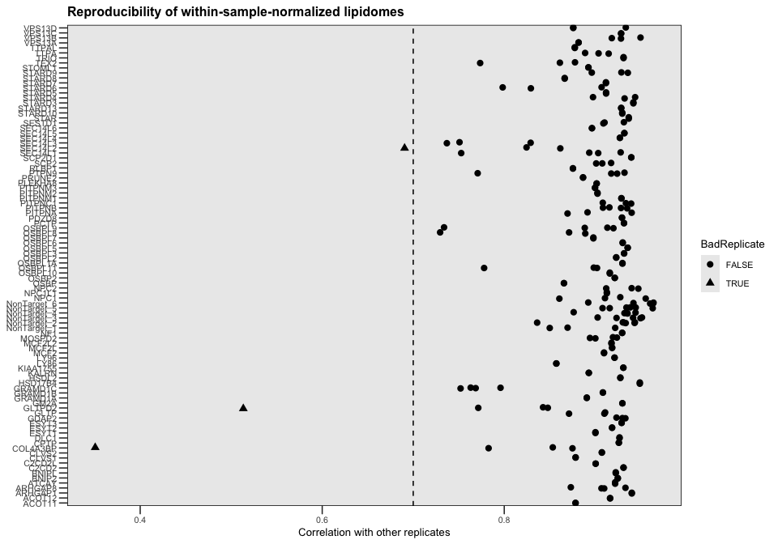<!-- -->

This is where I would identify the obviously non-reproducible samples.

Print their exact keys:

    ## # A tibble: 3 × 4
    ##   Gene     SampleID SampleKey            ReplicateConsensusR
    ##   <chr>    <chr>    <chr>                              <dbl>
    ## 1 COL4A3BP K90      COL4A3BP__K90__K__90               0.351
    ## 2 GLTPD2   H45      GLTPD2__H45__H__45                 0.513
    ## 3 SEC14L2  J49      SEC14L2__J49__J__49                0.690

Then put the problematic ones into `EXCLUDE_SAMPLE_KEYS` at the top.

------------------------------------------------------------------------

# 6. Apply exclusions and renormalize

This renormalization step is important: if a complete sample is removed,
no issue. The percentages of the remaining samples are calculated
independently anyway.

------------------------------------------------------------------------

# Part A — Overview of lipid classes

# 7. Class composition for each sample

Thus:

\[ ==================

100 {} \]

No control normalization is involved.

------------------------------------------------------------------------

# 8. Median class composition per LTP

    ## # A tibble: 1 × 1
    ##   `sum(n)`
    ##      <int>
    ## 1      276

------------------------------------------------------------------------

# 9. Absolute class-composition heatmap

I would show the actual percentages first.

<!-- -->

------------------------------------------------------------------------

# 10. Relative class abnormalities across the library

The absolute plot is dominated by naturally abundant classes such as PC.

For detecting unusual LTP phenotypes, make another heatmap that scales
**each class across the library**.

This is visualization only. It is not control normalization.

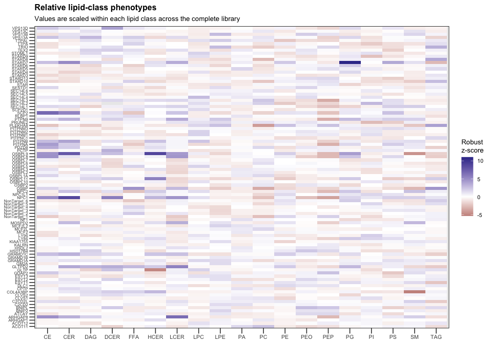<!-- -->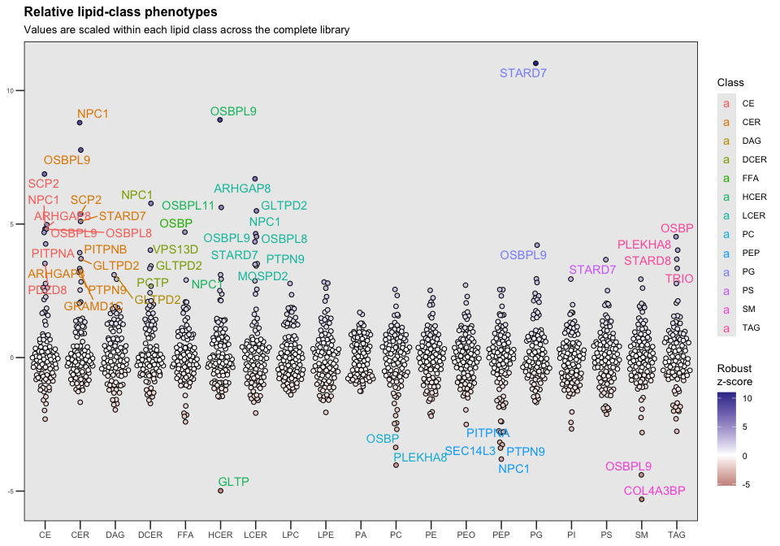<!-- -->

This should make things such as the ORP9/ORP11 SM phenotype much easier
to see than the absolute mol-% plot.

------------------------------------------------------------------------

# 11. Stacked class-composition plot for selected LTPs

For follow-up figures:

For example:

<!-- --><!-- --><!-- -->

------------------------------------------------------------------------

# Part B — Species-level composition

# 12. Median abundance of individual species

Find the most variable lipid species:

Scale each species across LTPs for visualization:

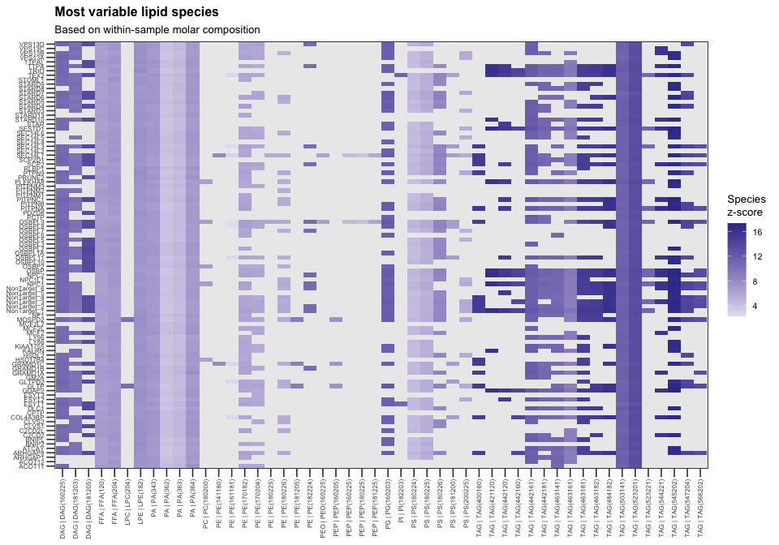<!-- -->

------------------------------------------------------------------------

# Part C — Saturation rearrangement

There are two useful ways of doing this.

### Analysis 1: whole lipid species

Use:

``` text
Total_tail_bend
```

For example:

- PC(16:0/18:0) → DB0
- PC(16:0/18:1) → DB1
- PC(18:1/18:1) → DB2
- PC(16:0/20:4) → DB4

This works even when individual acyl chains cannot be fully resolved.

### Analysis 2: individual resolved chains

Use:

``` text
Tail_1_bend
Tail_2_bend
```

This distinguishes genuinely polyunsaturated chains from two MUFA
chains.

I would perform both.

------------------------------------------------------------------------

# 13. Molecular saturation category

------------------------------------------------------------------------

# 14. Saturation distribution within each lipid class

This uses `WithinClassPct`.

Therefore PC always sums to 100%, PE always sums to 100%, etc.

Create all missing DB categories explicitly as zero:

------------------------------------------------------------------------

# 15. Median saturation distribution per LTP

------------------------------------------------------------------------

# 16. Plot saturation profile for one lipid class

This is one of the plots I would inspect heavily.

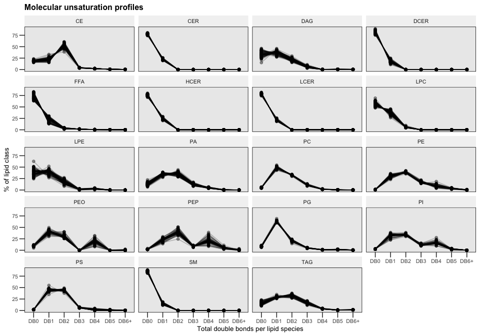<!-- -->

Example:

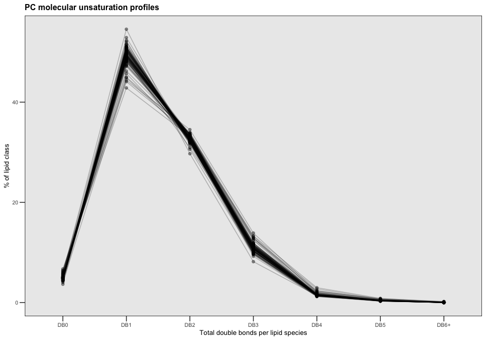<!-- -->

And:

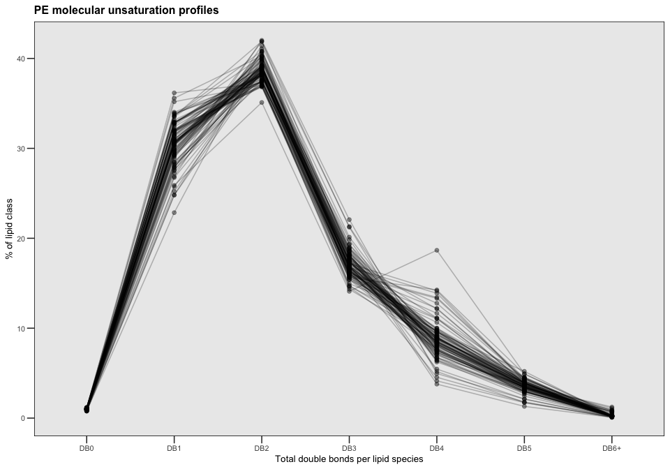<!-- -->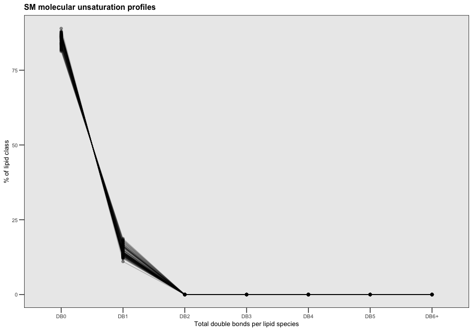<!-- -->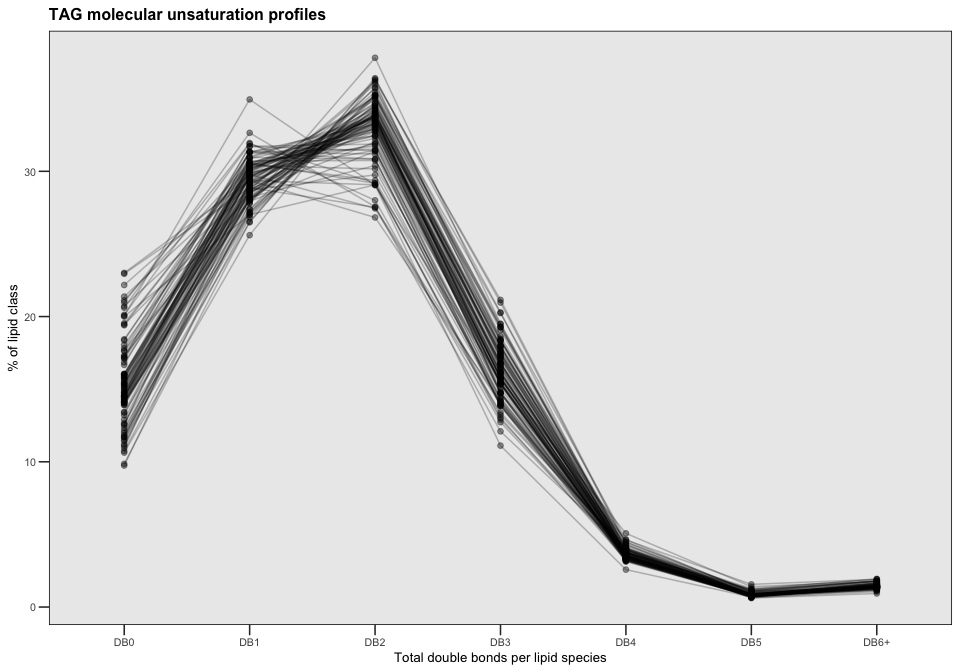<!-- -->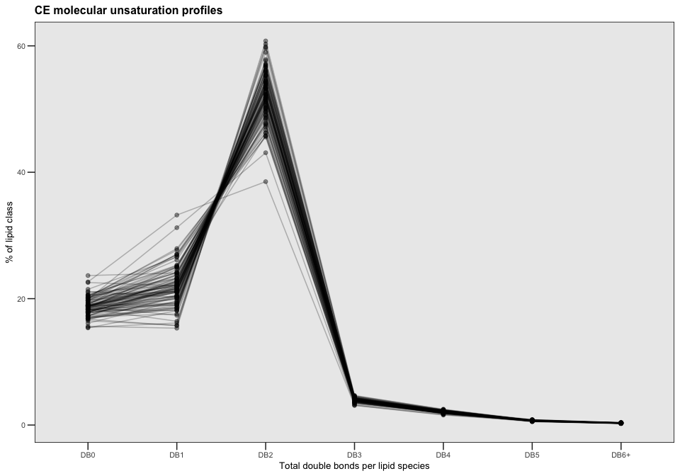<!-- -->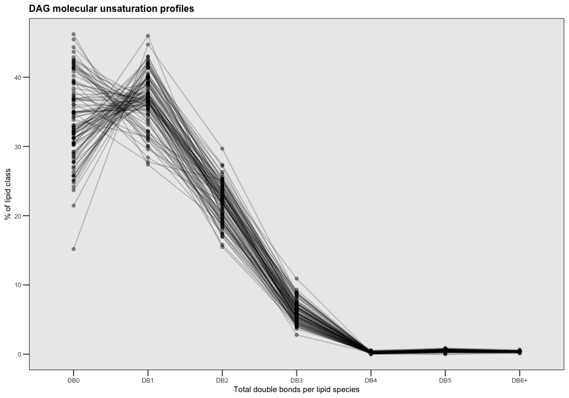<!-- -->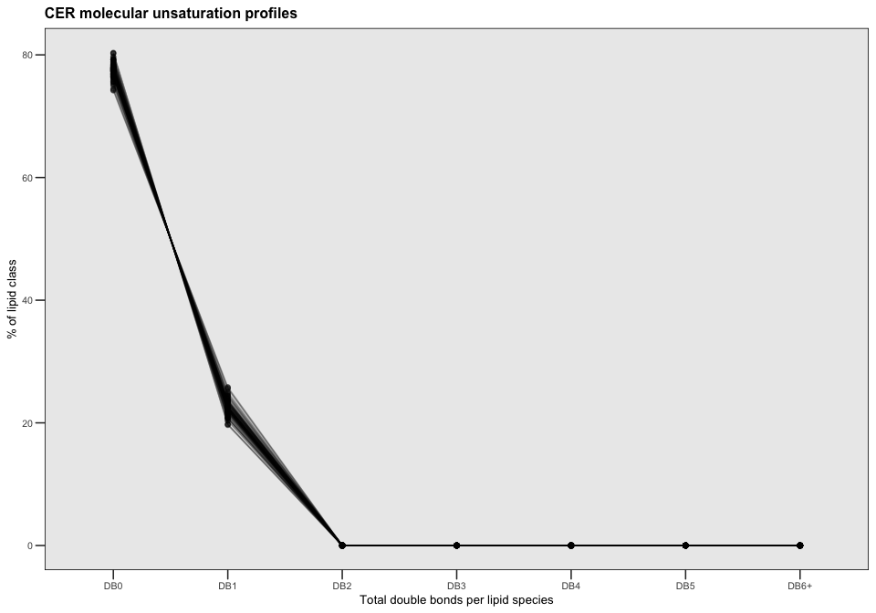<!-- -->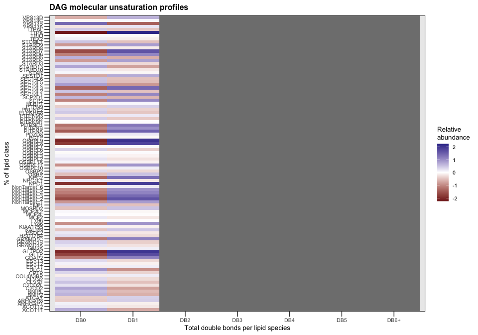<!-- -->

------------------------------------------------------------------------

# 17. A more useful heatmap

For a large LTP library, I would make:

``` text
PC_DB0
PC_DB1
PC_DB2
PC_DB3
PC_DB4
...
PE_DB0
PE_DB1
...
```

Scale each saturation feature across LTPs:

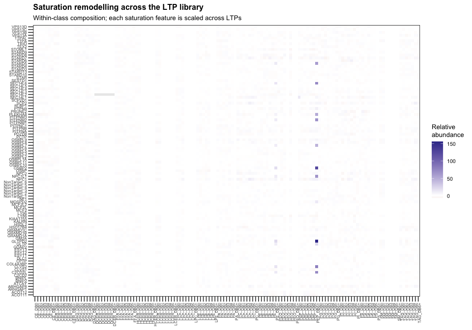<!-- -->

This is probably one of the most useful overview plots for the entire
library.

------------------------------------------------------------------------

# 18. Continuous saturation metrics

Rather than only bins, calculate average unsaturation.

Median by LTP:

Heatmap:

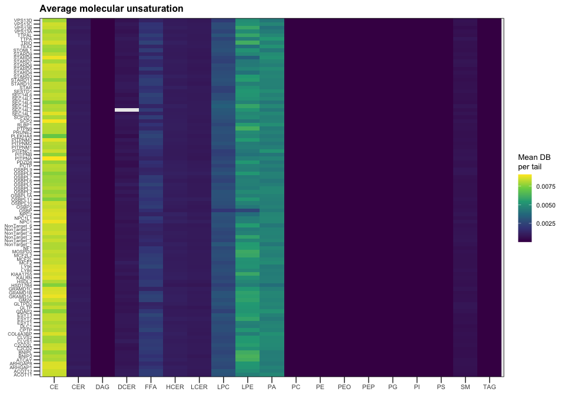<!-- -->

------------------------------------------------------------------------

# Part D — Explicitly detect saturation compensation

This is the part I think is scientifically most interesting.

The logic is:

> **Class abundance stable + internal saturation profile substantially
> rearranged + replicates agree = candidate compensatory remodelling.**

No lipid value is normalized against the control. The control is simply
the reference composition.

------------------------------------------------------------------------

# 19. Define the reference composition

Class abundance reference:

Saturation reference:

Normalize the reference saturation profiles to 100%.

------------------------------------------------------------------------

# 20. Class-abundance change

Again, this is a **difference after sample normalization**, not a
normalization to controls.

------------------------------------------------------------------------

# 21. Saturation-profile change

------------------------------------------------------------------------

# 22. Quantify redistribution

A very useful metric here is the **total variation distance**:

\[ R = *i \|p*{KO,i} - p\_{reference,i}\|\]

Because the profiles sum to 100%, this has an intuitive interpretation.

If:

``` text
RedistributionPct = 20
```

approximately 20% of that lipid class would have to be redistributed
among saturation bins to convert the reference profile into the KO
profile.

Join class abundance:

------------------------------------------------------------------------

# 23. Replicate agreement in the *direction* of saturation remodelling

Two samples can both have a high redistribution score while moving in
completely opposite directions.

Therefore, I would explicitly compare their vectors:

``` text
DB0 change
DB1 change
DB2 change
DB3 change
...
```

using cosine similarity.

Calculate it:

Interpretation:

- near `+1`: replicates undergo the same rearrangement
- around `0`: unrelated rearrangements
- negative: replicates move in opposing directions

This is useful for identifying the non-reproducible analyses you
mentioned.

------------------------------------------------------------------------

# 24. Gene-level compensation table

------------------------------------------------------------------------

# 25. Define whether the class itself is stable

------------------------------------------------------------------------

# 26. Rank compensation candidates

I would not treat this score as statistics; it is simply a useful
ranking function.

Print candidates:

    ## # A tibble: 66 × 10
    ##    Gene     LBP_Family Class     n MedianClassPct RefClassPct MedianClassDeltaPP
    ##    <chr>    <chr>      <chr> <int>          <dbl>       <dbl>              <dbl>
    ##  1 OSBP     OSBP       LPE       2         0.0907       0.138           -0.0470 
    ##  2 TRIO     CRALTRIO   LPE       2         0.267        0.138            0.129  
    ##  3 ATCAY    CRALTRIO   LPE       2         0.201        0.138            0.0638 
    ##  4 VPS13B   VPS13      LPE       3         0.265        0.138            0.128  
    ##  5 KIAA1755 CRALTRIO   LPE       2         0.214        0.138            0.0758 
    ##  6 BNIPL    CRALTRIO   LPE       2         0.192        0.138            0.0542 
    ##  7 BNIP2    CRALTRIO   LPE       2         0.226        0.138            0.0884 
    ##  8 ESYT2    SMP        LPE       2         0.210        0.138            0.0722 
    ##  9 PLEKHA8  GLTP       LPE       2         0.258        0.138            0.121  
    ## 10 STARD7   START      PEO       2         0.866        0.850            0.0159 
    ## 11 TRIO     CRALTRIO   FFA       2         6.34         6.88            -0.543  
    ## 12 STARD7   START      LPE       2         0.133        0.138           -0.00509
    ## 13 ESYT3    SMP        FFA       2         7.17         6.88             0.288  
    ## 14 TTPA     CRALTRIO   PA        3         0.616        0.490            0.126  
    ## 15 LY86     ML         PEO       2         0.775        0.850           -0.0749 
    ## 16 CPTP     GLTP       FFA       2         6.92         6.88             0.0409 
    ## 17 PLEKHA8  GLTP       CE        2         1.68         2.38            -0.704  
    ## 18 STARD5   START      DAG       2         2.22         2.46            -0.240  
    ## 19 STARD7   START      PEP       2         9.55        10.6             -1.02   
    ## 20 GM2A     ML         LPE       2         0.218        0.138            0.0807 
    ## 21 LY96     ML         FFA       2         6.25         6.88            -0.636  
    ## 22 ATCAY    CRALTRIO   FFA       2         6.91         6.88             0.0314 
    ## 23 OSBP     OSBP       LPC       2         0.148        0.186           -0.0380 
    ## 24 ACOT11   START      FFA       2         6.27         6.88            -0.616  
    ## 25 STOML1   SCP2       PEP       2        10.3         10.6             -0.224  
    ## 26 GM2A     ML         FFA       2         5.62         6.88            -1.27   
    ## 27 SEC14L6  CRALTRIO   FFA       2         5.68         6.88            -1.20   
    ## 28 SEC14L4  CRALTRIO   FFA       2         6.26         6.88            -0.625  
    ## 29 SCP2     SCP2       PA        3         0.508        0.490            0.0176 
    ## 30 MCF2L    CRALTRIO   FFA       2         6.22         6.88            -0.659  
    ## 31 HSD17B4  SCP2       PA        2         0.705        0.490            0.215  
    ## 32 ESYT2    SMP        FFA       2         6.56         6.88            -0.328  
    ## 33 STARD13  START      FFA       2         5.88         6.88            -0.999  
    ## 34 STOML1   SCP2       PEO       2         0.920        0.850            0.0693 
    ## 35 HSD17B4  SCP2       FFA       2         6.37         6.88            -0.512  
    ## 36 ESYT3    SMP        LPE       2         0.211        0.138            0.0736 
    ## 37 OSBP     OSBP       PA        2         0.465        0.490           -0.0245 
    ## 38 SEC14L5  CRALTRIO   FFA       2         5.97         6.88            -0.914  
    ## 39 ACOT12   START      FFA       2         6.67         6.88            -0.212  
    ## 40 VPS13D   VPS13      PA        3         0.575        0.490            0.0852 
    ## 41 OSBP2    OSBP       FFA       2         6.42         6.88            -0.466  
    ## 42 DLC1     START      FFA       2         6.45         6.88            -0.429  
    ## 43 MCF2L2   CRALTRIO   LPE       2         0.229        0.138            0.0914 
    ## 44 LY86     ML         PEP       2         8.76        10.6             -1.81   
    ## 45 MOSPD2   CRALTRIO   LPE       4         0.206        0.138            0.0685 
    ## 46 GRAMD1B  ASTER/VAST FFA       2         6.17         6.88            -0.717  
    ## 47 PITPNM2  PITP       FFA       2         6.56         6.88            -0.322  
    ## 48 STARD13  START      LPE       2         0.189        0.138            0.0510 
    ## 49 OSBPL2   OSBP       FFA       2         6.50         6.88            -0.386  
    ## 50 SEC14L2  CRALTRIO   PEP       2         8.87        10.6             -1.69   
    ## 51 PITPNB   PITP       PA        4         0.545        0.490            0.0551 
    ## 52 GDAP2    CRALTRIO   FFA       3         5.91         6.88            -0.970  
    ## 53 NPC1     NPC1 NTD   PI        4         9.93         9.47             0.462  
    ## 54 HSDL2    SCP2       FFA       2         6.60         6.88            -0.282  
    ## 55 STARD7   START      PE        2        10.4          9.50             0.903  
    ## 56 STARD8   START      DAG       2         2.47         2.46             0.0148 
    ## 57 C2CD2    SMP        FFA       2         7.24         6.88             0.358  
    ## 58 HSD17B4  SCP2       TAG       2         9.41        11.3             -1.88   
    ## 59 ACOT12   START      PEP       2        11.2         10.6              0.593  
    ## 60 PRUNE2   CRALTRIO   PS        2         3.57         4.27            -0.700  
    ## 61 STARD7   START      DAG       2         2.93         2.46             0.469  
    ## 62 COL4A3BP START      DAG       3         2.86         2.46             0.402  
    ## 63 GLTP     GLTP       TAG       3        12.2         11.3              0.908  
    ## 64 OSBPL1A  OSBP       FFA       2         6.42         6.88            -0.459  
    ## 65 OSBPL9   OSBP       PA        4         0.676        0.490            0.186  
    ## 66 OSBPL6   OSBP       FFA       2         6.86         6.88            -0.0271 
    ## # ℹ 3 more variables: MedianRedistributionPct <dbl>, ProfileAgreement <dbl>,
    ## #   CompensationScore <dbl>

------------------------------------------------------------------------

# 27. Main compensation plot

This may be the single most useful plot in the new analysis.

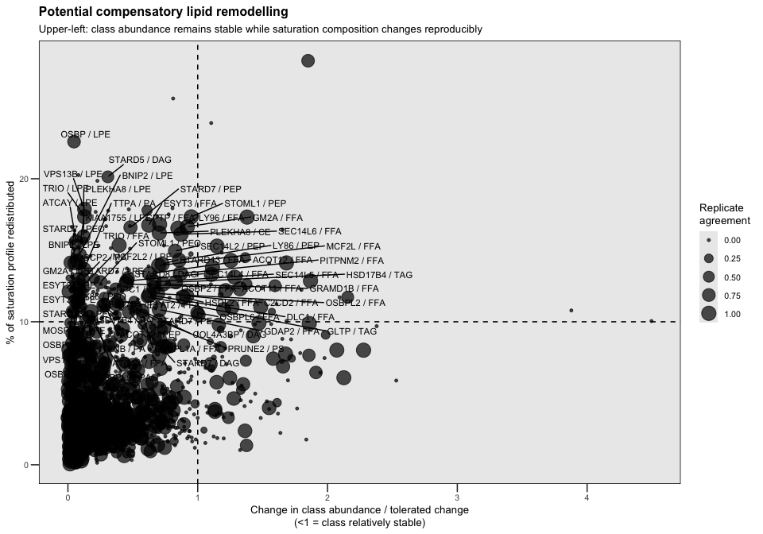<!-- -->

The quadrant you care most about is:

**upper left**.

That means:

> total abundance of the class barely changed, but its molecular
> composition changed substantially.

That is exactly the phenotype I would call a candidate **compensatory
remodelling mechanism**.

------------------------------------------------------------------------

# 28. Inspect biological replicates of the strongest candidates

This is important before believing the score.

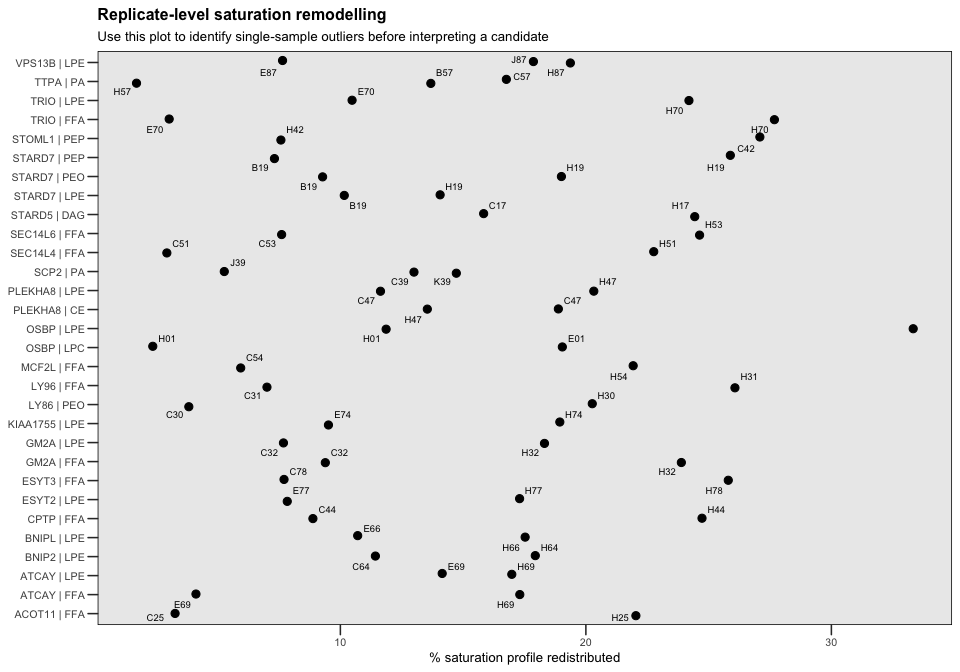<!-- -->

If one LTP looks interesting solely because one replicate is enormous,
add that sample to:

    ## [1] "COL4A3BP__K90__K__90" "GLTPD2__H45__H__45"   "SEC14L2__J49__J__49"

and rerun.

------------------------------------------------------------------------

# Part E — Which saturation bins drive the compensation?

# 29. Plot the actual DB rearrangement

For the top compensation candidates:

Median changes:

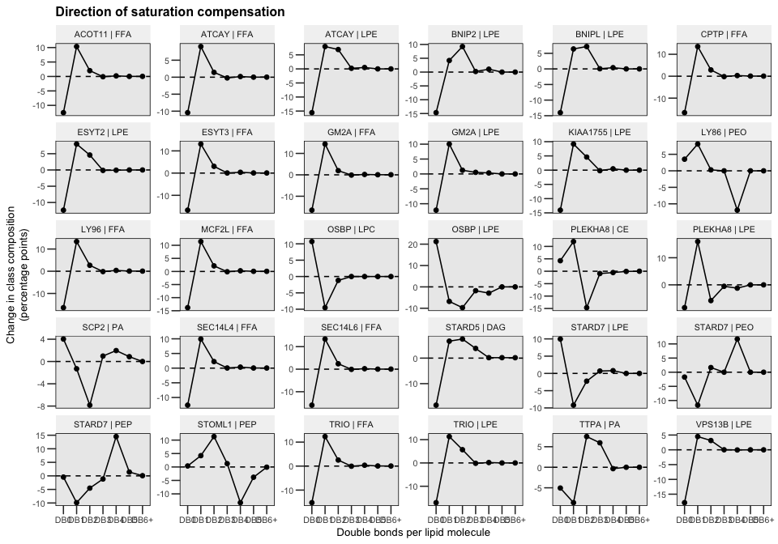<!-- -->

Now you can distinguish patterns such as:

``` text
DB0 ↓
DB1 ↓
DB4 ↑
DB6+ ↑
```

from:

``` text
DB0 ↑
DB1 ↑
DB4 ↓
```

These are mechanistically very different compensatory responses.

------------------------------------------------------------------------

# Part F — Resolved individual-chain saturation

This is complementary to `Total_tail_bend`.

For example:

``` text
PC(18:1/18:1)
```

has `Total_tail_bend = 2`, but contains **two monounsaturated chains**,
not one PUFA.

So I would also analyse each resolved chain.

------------------------------------------------------------------------

# 30. Convert tails to long format

I use `"2+ DB"` rather than `"PUFA"` here because some chains may be
sphingoid bases or ether-linked chains rather than conventional fatty
acids.

------------------------------------------------------------------------

# 31. Chain-equivalent amounts

One nmol:

``` text
PC(16:0/20:4)
```

contributes:

``` text
1 nmol saturated chain
1 nmol 4-DB chain
```

Therefore:

------------------------------------------------------------------------

# 32. Median chain-saturation composition

Heatmap:

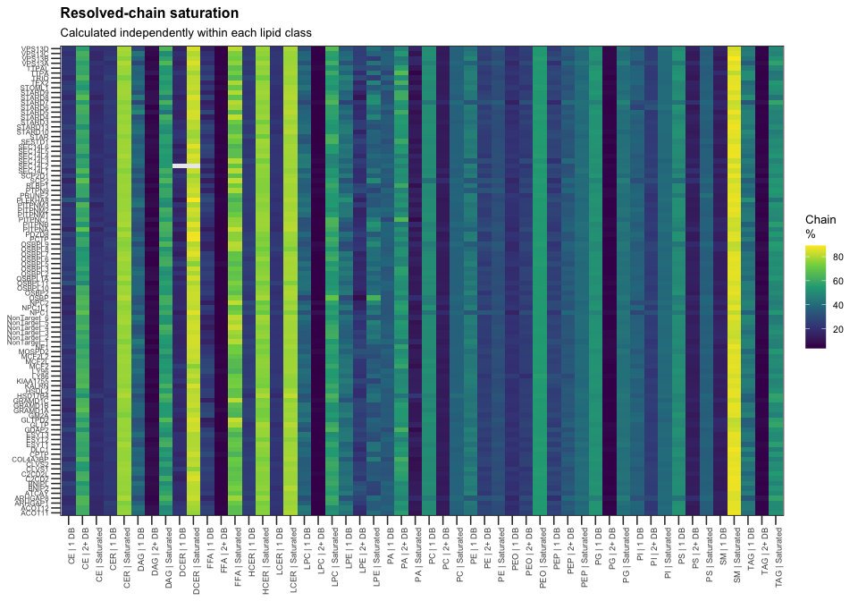<!-- -->

------------------------------------------------------------------------

# 33. Resolved-chain unsaturation index

This is the metric I would use if you specifically want to say:

> this LTP knockout shifts PC toward polyunsaturated acyl chains.

The `TotalDB` analysis alone cannot make that distinction reliably.

------------------------------------------------------------------------

# Part G — Look explicitly for SFA ↔ MUFA ↔ PUFA compensation

This is another useful way to phrase the biology.

Suppose:

``` text
total PE abundance = unchanged

SFA PE ↓
MUFA PE ↓
PUFA PE ↑
```

That is a very clean remodelling phenotype.

Median chain profile:

Plot one class:

Example:

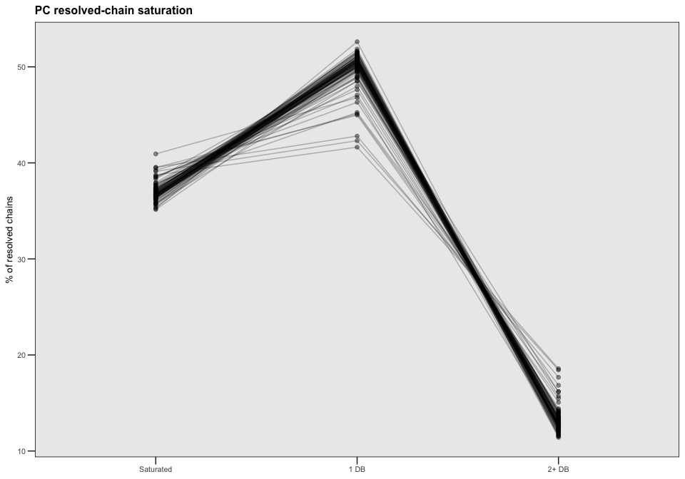<!-- -->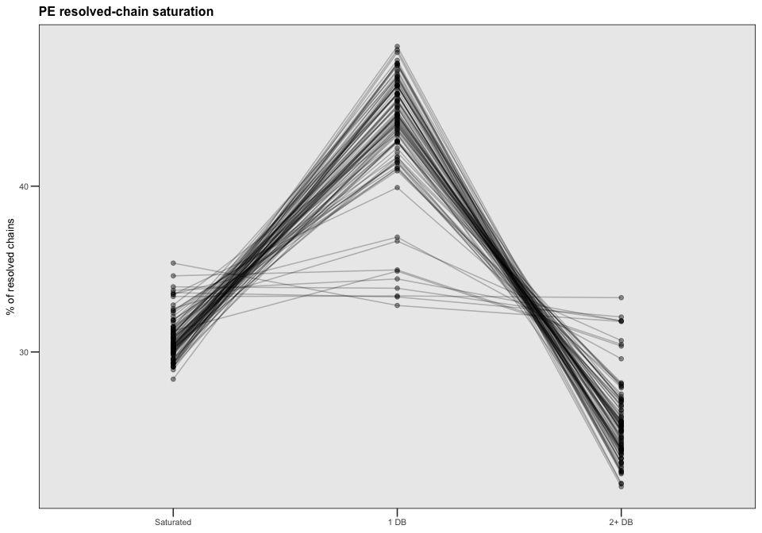<!-- -->

------------------------------------------------------------------------

# 34. Export the main results

And:

    ## R version 4.4.0 (2024-04-24)
    ## Platform: aarch64-apple-darwin20
    ## Running under: macOS Sonoma 14.8.3
    ## 
    ## Matrix products: default
    ## BLAS:   /Library/Frameworks/R.framework/Versions/4.4-arm64/Resources/lib/libRblas.0.dylib 
    ## LAPACK: /Library/Frameworks/R.framework/Versions/4.4-arm64/Resources/lib/libRlapack.dylib;  LAPACK version 3.12.0
    ## 
    ## locale:
    ## [1] en_US.UTF-8/en_US.UTF-8/en_US.UTF-8/C/en_US.UTF-8/en_US.UTF-8
    ## 
    ## time zone: Europe/Amsterdam
    ## tzcode source: internal
    ## 
    ## attached base packages:
    ## [1] stats     graphics  grDevices utils     datasets  methods   base     
    ## 
    ## other attached packages:
    ##  [1] ggsignif_0.6.4   ggbeeswarm_0.7.2 ggthemes_5.1.0   ggrepel_0.9.5   
    ##  [5] lubridate_1.9.4  forcats_1.0.0    stringr_1.5.1    dplyr_1.1.4     
    ##  [9] purrr_1.0.4      readr_2.2.0      tidyr_1.3.1      tibble_3.2.1    
    ## [13] ggplot2_4.0.2    tidyverse_2.0.0 
    ## 
    ## loaded via a namespace (and not attached):
    ##  [1] utf8_1.2.4         generics_0.1.3     stringi_1.8.4      hms_1.1.3         
    ##  [5] digest_0.6.35      magrittr_2.0.3     evaluate_0.24.0    grid_4.4.0        
    ##  [9] timechange_0.3.0   RColorBrewer_1.1-3 fastmap_1.2.0      fansi_1.0.6       
    ## [13] viridisLite_0.4.2  scales_1.4.0       cli_3.6.2          rlang_1.1.4       
    ## [17] crayon_1.5.2       bit64_4.0.5        withr_3.0.0        yaml_2.3.8        
    ## [21] tools_4.4.0        parallel_4.4.0     tzdb_0.4.0         vctrs_0.6.5       
    ## [25] R6_2.5.1           lifecycle_1.0.4    bit_4.0.5          vipor_0.4.7       
    ## [29] vroom_1.7.0        beeswarm_0.4.0     pkgconfig_2.0.3    pillar_1.9.0      
    ## [33] gtable_0.3.6       glue_1.7.0         Rcpp_1.0.12        xfun_0.51         
    ## [37] tidyselect_1.2.1   rstudioapi_0.18.0  knitr_1.49         farver_2.1.2      
    ## [41] htmltools_0.5.8.1  rmarkdown_2.27     labeling_0.4.3     compiler_4.4.0    
    ## [45] S7_0.2.1

## How I would interpret this analysis

The most important distinction is between **abundance** and
**remodelling**.

Imagine these two phenotypes:

| KO    |   PC total | Saturation redistribution |
|-------|-----------:|--------------------------:|
| LTP-A |       −40% |                        5% |
| LTP-B | ~unchanged |                       28% |

`LTP-A` mainly affects **how much PC exists**.

`LTP-B` is potentially much more interesting from a compensation
perspective: the cell maintains PC abundance, but substantially changes
**what kind of PC it makes**.

I would therefore prioritize the output from `compensation_gene`,
especially LTP–class combinations with:

- `ClassStabilityRatio < 1`
- high `MedianRedistributionPct`
- `ProfileAgreement` approaching 1
- the same phenotype visible in all biological replicates
- support from the resolved-chain analysis.

The resolved-chain analysis also lets you distinguish a very important
case:

**PC(18:1/18:1) → PC(16:0/20:2)**

Both molecules contain two total double bonds, so a simple
`Total_tail_bend` analysis sees essentially no difference. But the chain
analysis detects the change from **two MUFA chains to one saturated +
one PUFA chain**. That kind of hidden rearrangement may be particularly
relevant for LTP knockouts because it could preserve average membrane
unsaturation while profoundly changing lipid packing, oxidation
sensitivity, and downstream metabolism.

For your library, I would probably use the **class-composition heatmap +
saturation-feature heatmap + compensation plot** as the three main
screen-level figures, then drill into individual PC/PE/SM/TAG profiles
for the strongest hits.
