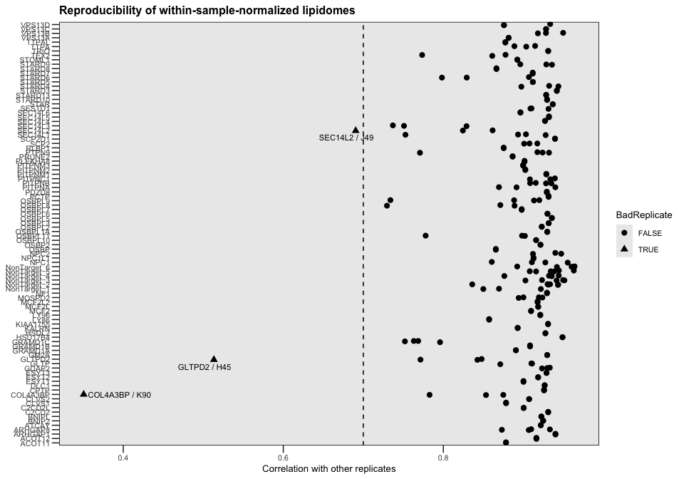
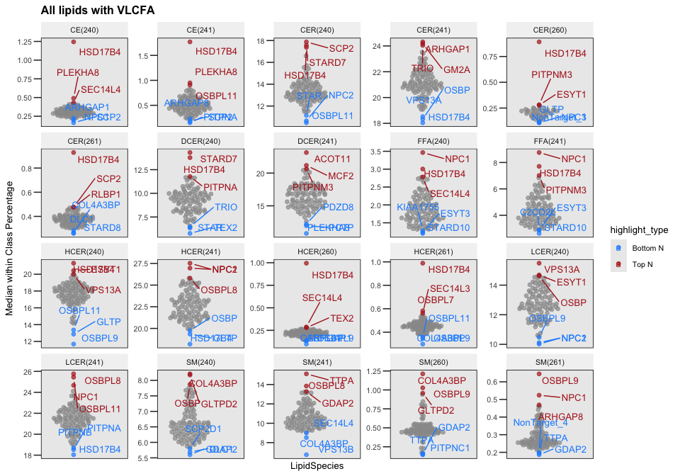
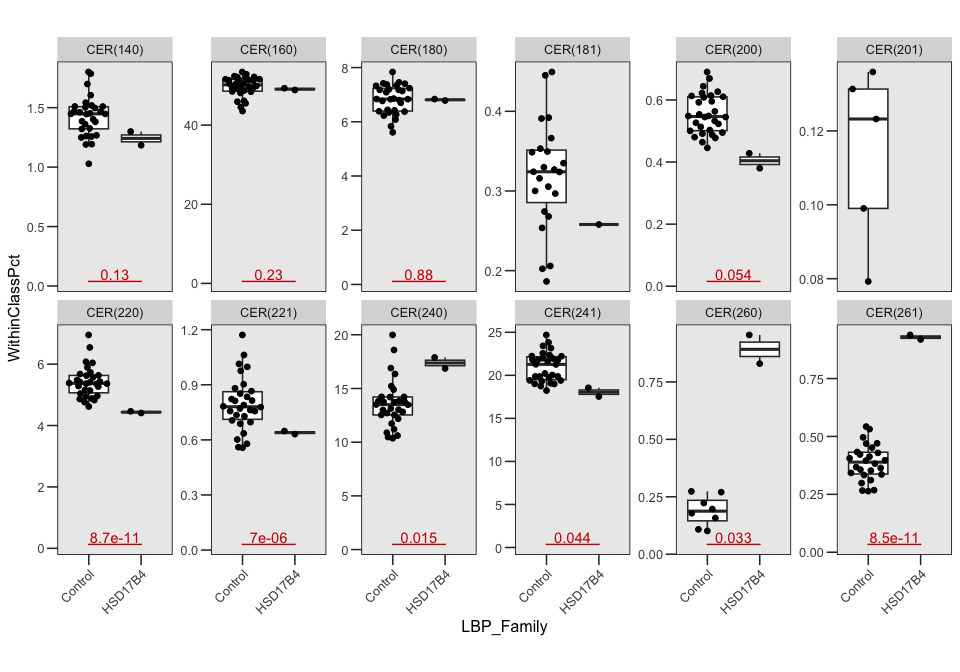
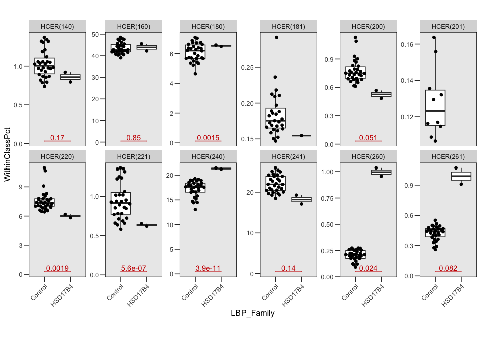
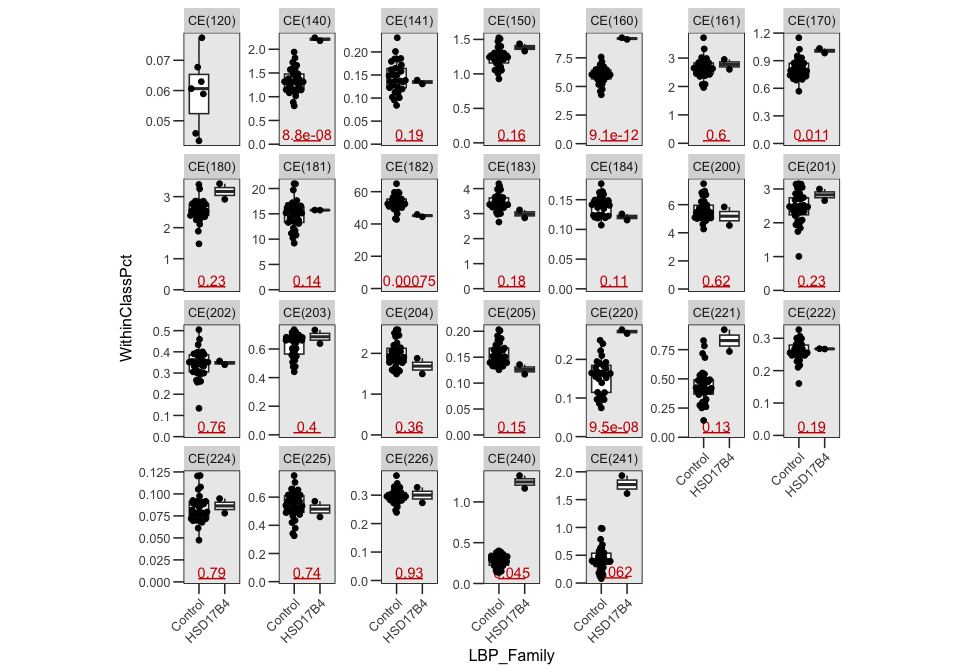
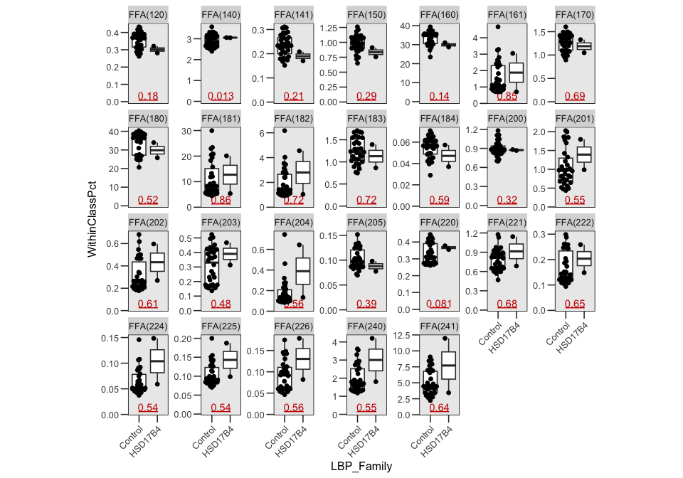
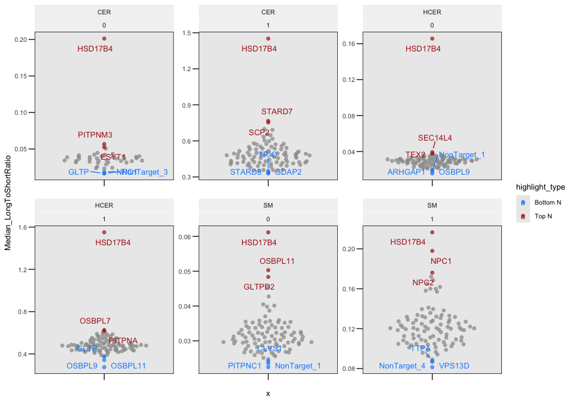
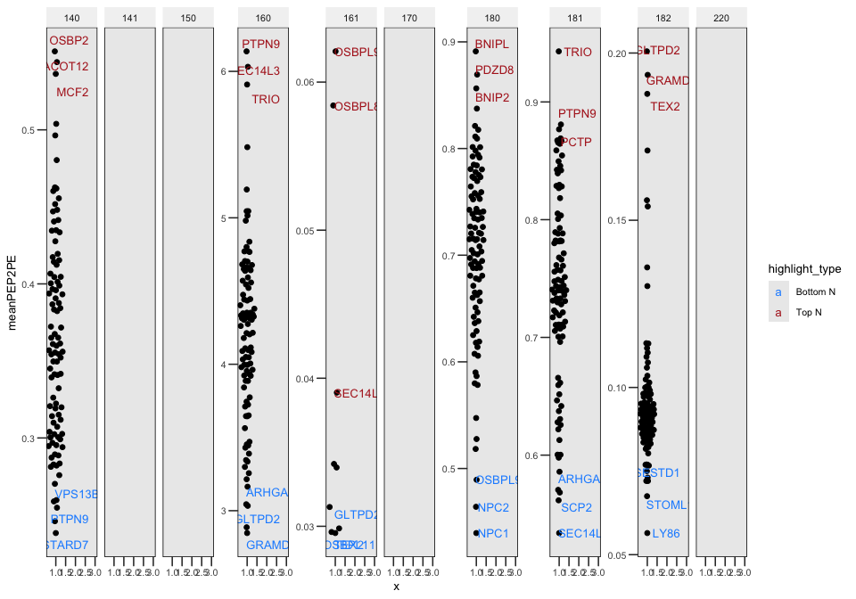
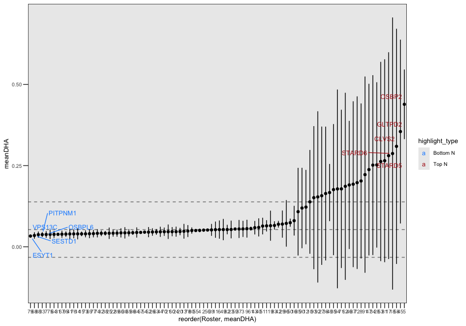

Analysis for peroxisome imbalance
================
Birol Cabukusta
2026-10-08

Adapted from Analysis 2. Doing this analysis for **Joe Costello
(Exeter)** to see how the peroxisomal biology is effected in LTP
knockouts. I will anaylze the dataset for the following metrics
(suggested by ChatGPT) to evaluate peroxisomal biology:

1.  LPC 26:0

- Abundance; optionally LPC 26:0/LPC 22:0
- A particularly useful starting marker for VLCFA accumulation

2.  VLCFA-containing lipids

- Species containing 24:0, 26:0, or 26:1, analyzed separately within
  each lipid class
- Look for a coordinated shift toward longer chains

3.  Chain-length ratios

- C26:0-containing/C22:0-containing species within the same class

4.  Ether PC and PE

- Ether species relative to corresponding diacyl species; plasmalogens
  separately if resolved

5.  DHA-containing lipids:

- Species with a confirmed 22:6 chain

------------------------------------------------------------------------

# 1. Setup

    ## ── Attaching core tidyverse packages ──────────────────────── tidyverse 2.0.0 ──
    ## ✔ dplyr     1.1.4     ✔ readr     2.2.0
    ## ✔ forcats   1.0.1     ✔ stringr   1.6.0
    ## ✔ ggplot2   4.0.2     ✔ tibble    3.3.1
    ## ✔ lubridate 1.9.5     ✔ tidyr     1.3.2
    ## ✔ purrr     1.0.4     
    ## ── Conflicts ────────────────────────────────────────── tidyverse_conflicts() ──
    ## ✖ dplyr::filter() masks stats::filter()
    ## ✖ dplyr::lag()    masks stats::lag()
    ## ℹ Use the conflicted package (<http://conflicted.r-lib.org/>) to force all conflicts to become errors
    ## 
    ## Attaching package: 'reshape2'
    ## 
    ## 
    ## The following object is masked from 'package:tidyr':
    ## 
    ##     smiths

------------------------------------------------------------------------

# 2. Prepare the raw data

Check the samples: Run this to list all ~250 measurements

------------------------------------------------------------------------

# 3. Function for within-sample normalization

This is now the core of the analysis.

Initial normalization, before exclusions:

Check that each sample sums to 100%:

    ##   SampleKey            TotalPct  
    ##  Length:248         Min.   :100  
    ##  Class :character   1st Qu.:100  
    ##  Mode  :character   Median :100  
    ##                     Mean   :100  
    ##                     3rd Qu.:100  
    ##                     Max.   :100

These should all be approximately `100`.

------------------------------------------------------------------------

# 4. QC before excluding anything

Because the analysis is compositional, I would assess replicate
similarity using a **CLR-like transformation of the within-sample
proportions**, rather than raw nmol.

Create sample × species matrix:

Sample metadata:

------------------------------------------------------------------------

# 5. Replicate-to-consensus correlation

For every replicate, compare its lipidome with the median of the other
replicates for that same LTP.

Sample totals:

Plot:

<!-- -->

This is where I would identify the obviously non-reproducible samples.

Print their exact keys:

    ## # A tibble: 3 × 4
    ##   Gene     SampleID SampleKey            ReplicateConsensusR
    ##   <chr>    <chr>    <chr>                              <dbl>
    ## 1 COL4A3BP K90      COL4A3BP__K90__K__90               0.351
    ## 2 GLTPD2   H45      GLTPD2__H45__H__45                 0.513
    ## 3 SEC14L2  J49      SEC14L2__J49__J__49                0.690

Then put the problematic ones into `EXCLUDE_SAMPLE_KEYS` at the top.

------------------------------------------------------------------------

# 6. Apply exclusions and renormalize

This renormalization step is important: if a complete sample is removed,
no issue. The percentages of the remaining samples are calculated
independently anyway.

------------------------------------------------------------------------

Scale each species across LTPs for visualization:

------------------------------------------------------------------------

# 7. Start peroxiome analysis

## Analysis 1: LPC 26:0

No LPC 26:0

    ## # A tibble: 0 × 10
    ## # ℹ 10 variables: Gene <chr>, LBP_Family <chr>, Class <chr>,
    ## #   LipidSpecies <chr>, Feature <chr>, Tail_1 <dbl>, Tail_2 <dbl>, n <int>,
    ## #   MedianSampleMolPct <dbl>, MedianWithinClassPct <dbl>

## Analysis 2: VLCFA-containing lipids

- Species containing 24:0, 26:0, or 26:1, analyzed separately within
  each lipid class
- Look for a coordinated shift toward longer chains

<!-- -->

*Print the results:*

    ## # A tibble: 120 × 13
    ## # Groups:   Class [7]
    ##    Gene     LBP_Family Class LipidSpecies Feature          Tail_1 Tail_2     n
    ##    <chr>    <chr>      <chr> <chr>        <chr>             <dbl>  <dbl> <int>
    ##  1 ACOT11   START      DCER  DCER(241)    DCER | DCER(241)    241     NA     2
    ##  2 ARHGAP1  CRALTRIO   CE    CE(240)      CE | CE(240)        240     NA     2
    ##  3 ARHGAP1  CRALTRIO   CER   CER(241)     CER | CER(241)      241     NA     2
    ##  4 ARHGAP1  CRALTRIO   HCER  HCER(260)    HCER | HCER(260)    260     NA     2
    ##  5 ARHGAP8  CRALTRIO   CE    CE(241)      CE | CE(241)        241     NA     4
    ##  6 ARHGAP8  CRALTRIO   SM    SM(261)      SM | SM(261)        261     NA     4
    ##  7 C2CD2L   SMP        FFA   FFA(241)     FFA | FFA(241)      241     NA     2
    ##  8 COL4A3BP START      CER   CER(261)     CER | CER(261)      261     NA     2
    ##  9 COL4A3BP START      HCER  HCER(261)    HCER | HCER(261)    261     NA     3
    ## 10 COL4A3BP START      SM    SM(240)      SM | SM(240)        240     NA     3
    ## # ℹ 110 more rows
    ## # ℹ 5 more variables: MedianSampleMolPct <dbl>, MedianWithinClassPct <dbl>,
    ## #   rank_desc <int>, rank_asc <int>, highlight_type <chr>

HSD17B4 appears as an interesting candidate. Let’s investigate little
further.

<!-- --><!-- --><!-- --><!-- -->

## Analysis 3: Chain-length ratios

C26:0-containing/C22:0-containing species within the same class

<!-- -->

## Analysis 4: Ether PC and PE

- Ether species relative to corresponding diacyl species; plasmalogens
  separately if resolved

<!-- -->

## Analysis 5: DHA-containing lipids

<!-- -->

Original commit `git commit -m "initial commit"` `git push origin main`

`git config http.postBuffer 524288000` `git pull & git push`
`git commit -m “Update files”` `git pull & git push`
