LTP KO library analysis 2
================
Birol Cabukusta
2026-08-07

Yes. Given the structure of `acyls1`, I would build the R Markdown
around **four layers**: whole-sample QC, lipid/class phenotypes,
resolved fatty-acyl composition, and reproducibility-aware
prioritisation. Importantly, the code below **flags** suspicious
samples/results but does not automatically remove them. You then
populate the manual exclusion vectors after inspecting the plots.

One assumption: I treat `X` as the lipid-species identifier and `nmolg`
as the abundance. If `nmolg` is actually nmol/g rather than nmol, all
fatty-acyl amounts retain that same denominator.

### 1. Setup and configuration

``` r
# ============================================================
# LTP KO LIBRARY — LIPID / FATTY-ACYL ANALYSIS
# ============================================================

library(tidyverse)
library(ggrepel)

theme_set(
  theme_bw(base_size = 11) +
    theme(
      panel.grid.minor = element_blank(),
      strip.background = element_rect(fill = "grey95")
    )
)

options(dplyr.summarise.inform = FALSE)

OUTDIR <- "results_acyls1"
dir.create(OUTDIR, showWarnings = FALSE)
acyls1 = read_csv("~/Desktop/GitProjects/ltp_library_analysis/data/LTP_acyl_concentrations_raw1.csv")


# ------------------------------------------------------------
# USER SETTINGS
# ------------------------------------------------------------
CONTROL_GENES <- paste0("NonTarget_", 1:6)

# Variables that represent experimental batch.
# The code will preferentially compare each KO with controls
# from the same Extraction / Roster.
BATCH_VARS <- c("Extraction", "Roster")
BATCH_VARS <- intersect(BATCH_VARS, names(acyls1))

# QC thresholds
MIN_REPLICATES <- 2

# Correlation of one replicate with the median of the other
# replicates from the same KO.
MIN_REPLICATE_CORRELATION <- 0.70

# Standard robust outlier threshold
ROBUST_Z_THRESHOLD <- 3.5

# With n = 3, 2/3 means at least two replicates agree
# on the direction of the effect.
MIN_SIGN_CONSISTENCY <- 2 / 3

# Number of features shown in large heatmaps
TOP_N_LIPIDS <- 50
TOP_N_FATTY_ACYLS <- 50
```

### 2. First inspect genes and controls

``` r
gene_names <- acyls1 %>%
   distinct(Target.Gene.Symbol) %>%
   arrange(Target.Gene.Symbol)

print(gene_names)
```

    ## # A tibble: 96 × 1
    ##    Target.Gene.Symbol
    ##    <chr>             
    ##  1 ACOT11            
    ##  2 ACOT12            
    ##  3 ARHGAP1           
    ##  4 ARHGAP8           
    ##  5 ATCAY             
    ##  6 BNIP2             
    ##  7 BNIPL             
    ##  8 C2CD2             
    ##  9 C2CD2L            
    ## 10 CLVS1             
    ## # ℹ 86 more rows

``` r
if (!any(acyls1$Target.Gene.Symbol %in% CONTROL_GENES)) {
  stop(
    paste0(
      "None of CONTROL_GENES were found in Target.Gene.Symbol.\n",
      "Edit CONTROL_GENES at the top of the script."
    )
  )
}
```

### 3. Prepare the dataset

``` r
# Expected number of lipid chains.
# Tails is used preferentially if it already contains this information.
# This lookup is only a fallback.

EXPECTED_TAILS <- c(
  "CE"   = 1,
  "FFA"  = 1,

  "LPC"  = 1,
  "LPE"  = 1,

  "PC"   = 2,
  "PE"   = 2,
  "PS"   = 2,
  "PI"   = 2,
  "PG"   = 2,
  "PA"   = 2,

  "DAG"  = 2,
  "TAG"  = 1,

  # Sphingolipids:
  # one N-linked fatty acid + sphingoid base
  "CER"  = 1,
  "DCER" = 1,
  "SM"   = 1,
  "HCER" = 1,
  "LCER" = 1
)

#BC add
acyls1 <- acyls1 %>% 
   mutate(X = paste0(Class, "(",Tails,")")) 

acyls_raw <- acyls1 %>%
  mutate(
    RowID = row_number(),
    Gene = as.character(Target.Gene.Symbol),
    Lipid = as.character(X),
    Class = as.character(Class),
    amount = as.numeric(nmolg),
    Group = if_else(
      Gene %in% CONTROL_GENES,
      "CTRL",
      Gene
    ),

    LipidKey = paste(Class, Lipid, sep = " | "),
    # Number of chains if Tails contains something such as 2 or "2 tails"
    ExpectedTailCount_from_Tails =
      readr::parse_number(as.character(Tails)),

    ExpectedTailCount_from_Class =
      as.numeric(EXPECTED_TAILS[Class]),

    ExpectedTailCount =
      coalesce(
        ExpectedTailCount_from_Tails,
        ExpectedTailCount_from_Class
      ),

    # Make a unique biological/sample identifier.
    SampleKey = paste(
      Gene,
      SampleID,
      Extraction,
      Roster,
      sep = "__"
    )
  ) %>%

  filter(
    !is.na(Gene),
    !is.na(Lipid),
    !is.na(Class),
    is.finite(amount),
    amount >= 0
  )


cat("Rows:", nrow(acyls_raw), "\n")
```

    ## Rows: 195770

``` r
cat("Samples:", n_distinct(acyls_raw$SampleKey), "\n")
```

    ## Samples: 248

``` r
cat("Genes:", n_distinct(acyls_raw$Gene), "\n")
```

    ## Genes: 96

``` r
cat("Lipid species:", n_distinct(acyls_raw$LipidKey), "\n")
```

    ## Lipid species: 1113

``` r
cat("Classes:", n_distinct(acyls_raw$Class), "\n")
```

    ## Classes: 19

### 4. Some helper functions

These make the later analysis much cleaner.

``` r
# ============================================================
# HELPER FUNCTIONS
# ============================================================
half_min_positive <- function(x) {
  x <- x[is.finite(x) & x > 0]
  if (length(x) == 0)
    return(1e-12)
  min(x) / 2
}


robust_z <- function(x) {
  med <- median(x, na.rm = TRUE)
  s <- mad(x, na.rm = TRUE)
  if (!is.finite(s) || s == 0) {
    return(rep(0, length(x)))
  }
  (x - med) / s
}


safe_cor <- function(x, y,method = "spearman") {
  ok <- is.finite(x) & is.finite(y)
  if (sum(ok) < 5)
    return(NA_real_)
  if (sd(x[ok]) == 0 ||
      sd(y[ok]) == 0)
    return(NA_real_)
  cor( x[ok], y[ok], method = method)
}


sign_consistency <- function(x) {
  x <- x[is.finite(x)]
  if (length(x) < 2)
    return(NA_real_)
  med <- median(x)
  if (med == 0)
    return(NA_real_)
  mean(sign(x) == sign(med))
}
```

This function calculates a control-normalised effect while
preferentially using controls from the same `Extraction`/`Roster`.

``` r
add_control_effect <- function(tbl,
                               feature_cols,
                               value_col = "value",
                               effect_type = c(
                                 "log2fc",
                                 "difference"
                               ),
                               batch_vars = BATCH_VARS) {

  effect_type <- match.arg(effect_type)
  feature_cols <- unique(feature_cols)
  batch_vars <- unique(batch_vars)
  dat <- tbl
  
  # ----------------------------------
  # Transformation
  # ----------------------------------
  
  if (effect_type == "log2fc") {
    pseudocounts <- dat %>%
      group_by(
        across(
          all_of(feature_cols)
        )
      ) %>%
      summarise(
        .pseudo =
          half_min_positive(
            .data[[value_col]]
          ),
        .groups = "drop"
      )

    dat <- dat %>%
      left_join(
        pseudocounts,
        by = feature_cols
      ) %>%
      mutate(
        .analysis_value =
          log2(
            .data[[value_col]] +
            .pseudo
          )
      )

  } else {

    dat <- dat %>%
      mutate(
        .analysis_value =
          .data[[value_col]]
      )
  }


  # ----------------------------------
  # Matched controls
  # ----------------------------------

  matched_keys <- unique(
    c(
      batch_vars,
      feature_cols
    )
  )


  ctrl_matched <- dat %>%
    filter(Group == "CTRL") %>%
    group_by(
      across(
        all_of(matched_keys)
      )
    ) %>%

    summarise(
      .ctrl_matched =
        median(
          .analysis_value,
          na.rm = TRUE
        ),
      .groups = "drop"
    )


  # ----------------------------------
  # Global controls
  # Used if no matched control exists
  # ----------------------------------

  ctrl_global <- dat %>%
    filter(Group == "CTRL") %>%
    group_by(
      across(
        all_of(feature_cols)
      )
    ) %>%
    summarise(
      .ctrl_global =
        median(
          .analysis_value,
          na.rm = TRUE
        ),
      .groups = "drop"
    )

    dat %>%
    left_join(
      ctrl_matched,
      by = matched_keys
    ) %>%
    left_join(
      ctrl_global,
      by = feature_cols
    ) %>%

    mutate(
      ControlReference =
        coalesce(
          .ctrl_matched,
          .ctrl_global
        ),
      effect =
        .analysis_value -
        ControlReference,
      ControlSource = case_when(
        !is.na(.ctrl_matched) ~
          "matched batch",
        !is.na(.ctrl_global) ~
          "global fallback",
        TRUE ~
          "no control"
      )
    )
}
```

And one generic reproducibility summariser:

``` r
summarise_gene_effect <- function(tbl,
                                  feature_cols) {
  tbl %>%
    filter(
      Group != "CTRL",
      is.finite(effect)
    ) %>%
    group_by(
      Gene,
      across(
        all_of(feature_cols)
      )
    ) %>%
    summarise(
      n_rep =
        n_distinct(SampleKey),
      effect_median =
        median(
          effect,
          na.rm = TRUE
        ),
      effect_mean =
        mean(
          effect,
          na.rm = TRUE
        ),
      effect_sd =
        sd(
          effect,
          na.rm = TRUE
        ),
      effect_mad =
        mad(
          effect,
          na.rm = TRUE
        ),
      effect_iqr =
        IQR(
          effect,
          na.rm = TRUE
        ),
      sign_consistency =
        sign_consistency(effect),
      .groups = "drop"
    ) %>%
    mutate(
      reproducible =
        n_rep >= MIN_REPLICATES &
        sign_consistency >=
        MIN_SIGN_CONSISTENCY
    )
}
```

------------------------------------------------------------------------

# Part I — Sample-level QC

### 5. Build sample × lipid matrix

``` r
species_raw <- acyls_raw %>%
  group_by(
    SampleKey,
    Gene,
    Group,
    SampleID,
    across(
      all_of(BATCH_VARS)
    ),
    Class,
    Lipid,
    LipidKey
  ) %>%
  summarise(
    amount =
      sum(
        amount,
        na.rm = TRUE
      ),
    .groups = "drop"
  )


lipid_pseudocounts <- species_raw %>%
  group_by(LipidKey) %>%
  summarise(
    pseudo =
      half_min_positive(amount),
    .groups = "drop"
  )

species_raw <- species_raw %>%
  left_join(
    lipid_pseudocounts,
    by = "LipidKey"
  ) %>%
  mutate(
    log2_amount =
      log2(
        amount +
        pseudo
      )
  )
```

### 6. Sample totals

``` r
sample_qc <- species_raw %>%
  group_by(
    SampleKey,
    Gene,
    Group,
    SampleID,
    across(
      all_of(BATCH_VARS)
    )
  ) %>%
  summarise(
    TotalAmount =
      sum(
        amount,
        na.rm = TRUE
      ),
    DetectedLipids =
      sum(
        amount > 0,
        na.rm = TRUE
      ),
    MedianLipidAmount =
      median(
        amount,
        na.rm = TRUE
      ),
    .groups = "drop"
  )

sample_qc <- sample_qc %>%
  mutate(
    log2Total =
      log2(
        TotalAmount +
        half_min_positive(
          TotalAmount
        )
      ),

    TotalAmount_Z =
      robust_z(log2Total),
    DetectedLipids_Z =
      robust_z(DetectedLipids)
  )
```

### 7. Replicate-to-consensus correlations

For each biological replicate, this compares its complete lipidomic
profile with the median profile of the **other replicates of the same
gene**.

This is particularly useful for your library.

``` r
lipid_wide <- species_raw %>%
  select(
    SampleKey,
    LipidKey,
    log2_amount
  ) %>%

  pivot_wider(
    names_from = LipidKey,
    values_from = log2_amount,
    values_fill = NA_real_
  )

sample_ids <-
  lipid_wide$SampleKey

lipid_matrix <-
  lipid_wide %>%
  select(-SampleKey) %>%
  as.matrix()

rownames(lipid_matrix) <-
  sample_ids

sample_metadata <- species_raw %>%
  distinct(
    SampleKey,
    Gene,
    Group,
    SampleID,
    across(
      all_of(BATCH_VARS)
    )
  )

consensus_correlations <-
  map_dfr(
    unique(sample_metadata$Gene),

    function(gene_i) {
      ids <-
        sample_metadata %>%
        filter(Gene == gene_i) %>%
        pull(SampleKey)

      if (length(ids) < 2) {
        return(
          tibble(
            SampleKey = ids,
            ReplicateConsensusR =
              NA_real_
          )
        )
      }

      map_dfr(
        ids,
        function(id_i) {
          other_ids <-
            setdiff(
              ids,
              id_i
            )
          consensus <-
            apply(lipid_matrix[other_ids,,drop = FALSE],2,median,na.rm = TRUE)
          r <-
            safe_cor(lipid_matrix[id_i,],consensus,method = "spearman")

          tibble(
            SampleKey = id_i,
            ReplicateConsensusR = r
          )
        }
      )
    }
  )
```

### 8. PCA

PCA is only being used for QC/visualisation. Missing measurements are
median-imputed **only for the PCA**.

``` r
pca_matrix <-lipid_matrix
for (j in seq_len(ncol(pca_matrix))) {
  replacement <-
    median(
      pca_matrix[, j],
      na.rm = TRUE
    )
  if (!is.finite(replacement))
    replacement <- 0

  pca_matrix[
    is.na(pca_matrix[, j]),
    j
  ] <- replacement
}

# Remove zero-variance features
keep <-
  apply(pca_matrix,2,sd) > 0

pca_matrix <-
  pca_matrix[, keep, drop = FALSE]

pca_fit <-
  prcomp(
    pca_matrix,
    center = TRUE,
    scale. = TRUE
  )

pca_scores <-
  as_tibble(pca_fit$x,rownames = "SampleKey") %>%
  left_join(sample_metadata,by = "SampleKey")


variance_explained <-
  100 *pca_fit$sdev^2 /sum(pca_fit$sdev^2)
```

### 9. Combine QC metrics and flag suspicious samples

``` r
qc_table <- sample_qc %>%
  left_join(
    consensus_correlations,
    by = "SampleKey"
  ) %>%

  mutate(
    FlagTotalAmount =
      abs(TotalAmount_Z) >
      ROBUST_Z_THRESHOLD,

    FlagDetectedLipids =
      abs(DetectedLipids_Z) >
      ROBUST_Z_THRESHOLD,

    FlagReplicateCorrelation =
      !is.na(ReplicateConsensusR) &
      ReplicateConsensusR <
      MIN_REPLICATE_CORRELATION,

    QC_Flag =
      FlagTotalAmount |
      FlagDetectedLipids |
      FlagReplicateCorrelation
  )


qc_candidates <- qc_table %>%
  filter(QC_Flag) %>%
  arrange(
    ReplicateConsensusR
  )


print(
  qc_candidates,
  n = Inf
)
```

    ## # A tibble: 3 × 17
    ##   SampleKey    Gene  Group SampleID Extraction Roster TotalAmount DetectedLipids
    ##   <chr>        <chr> <chr> <chr>    <chr>       <dbl>       <dbl>          <int>
    ## 1 NonTarget_1… NonT… CTRL  K91      K              91       9343.            905
    ## 2 COL4A3BP__K… COL4… COL4… K90      K              90       2499.            587
    ## 3 GLTPD2__H45… GLTP… GLTP… H45      H              45      12659.            549
    ## # ℹ 9 more variables: MedianLipidAmount <dbl>, log2Total <dbl>,
    ## #   TotalAmount_Z <dbl>, DetectedLipids_Z <dbl>, ReplicateConsensusR <dbl>,
    ## #   FlagTotalAmount <lgl>, FlagDetectedLipids <lgl>,
    ## #   FlagReplicateCorrelation <lgl>, QC_Flag <lgl>

``` r
write_csv(
  qc_candidates,
  file.path(
    OUTDIR,
    "QC_candidate_outliers.csv"
  )
)
```

### 10. QC plots

``` r
ggplot(qc_table,
  aes(x = DetectedLipids,y = TotalAmount)) +
  geom_point(
    aes(shape = QC_Flag),size = 2.5) +
  geom_text_repel(
    data =qc_table %>% filter(QC_Flag),

    aes(label =paste(Gene,SampleID,sep = " / ")),

    size = 3,max.overlaps = Inf) +
   scale_y_log10() +
   labs(
    title =
      "Lipidomics sample QC",
    x =
      "Number of detected lipid species",
    y =
      "Total measured lipid abundance",
    shape =
      "QC flag"
  )
```

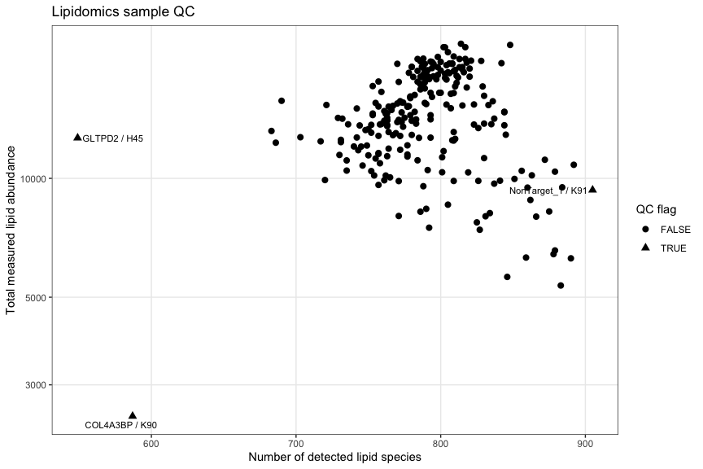<!-- -->

Replicate reproducibility:

``` r
gene_repro_order <- qc_table %>%
  group_by(Gene) %>%
  summarise(
    median_r =
      median(
        ReplicateConsensusR,
        na.rm = TRUE
      ),
    .groups = "drop"
  ) %>%

  arrange(median_r) %>%

  pull(Gene)


qc_table <- qc_table %>%
  mutate(
    Gene_QC =
      factor(
        Gene,
        levels =
          gene_repro_order
      )
  )


ggplot(
  qc_table,
  aes(
    x = Gene_QC,
    y = ReplicateConsensusR
  )
) +

  geom_hline(
    yintercept =
      MIN_REPLICATE_CORRELATION,
    linetype = 2
  ) +

  geom_point(
    position =
      position_jitter(
        width = 0.15
      ),
    size = 2
  ) +

  geom_text_repel(
    data =
      qc_table %>%
      filter(
        FlagReplicateCorrelation
      ),

    aes(
      label =
        paste(
          Gene,
          SampleID,
          sep = " / "
        )
    ),

    size = 2.5,
    max.overlaps = Inf
  ) +

  coord_flip() +

  labs(
    title =
      "Reproducibility of biological replicates",
    subtitle =
      "Each sample is correlated with the median lipidome of the other replicates of the same KO",
    x = NULL,
    y =
      "Spearman correlation with replicate consensus"
  )
```

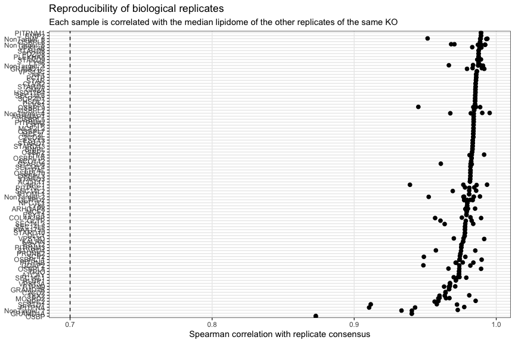<!-- -->

PCA:

``` r
pca_plot_data <- pca_scores %>%

  left_join(
    qc_table %>%
      select(
        SampleKey,
        QC_Flag
      ),
    by = "SampleKey"
  )


ggplot(
  pca_plot_data,
  aes(
    x = PC1,
    y = PC2
  )
) +

  geom_point(
    aes(
      shape = QC_Flag
    ),
    size = 2.5
  ) +

  geom_text_repel(
    data =
      pca_plot_data %>%
      filter(QC_Flag),

    aes(
      label =
        paste(
          Gene,
          SampleID,
          sep = " / "
        )
    ),

    size = 3,
    max.overlaps = Inf
  ) +

  labs(
    title =
      "PCA of the LTP KO lipidomics library",
    x =
      paste0(
        "PC1 (",
        round(
          variance_explained[1],
          1
        ),
        "%)"
      ),
    y =
      paste0(
        "PC2 (",
        round(
          variance_explained[2],
          1
        ),
        "%)"
      )
  )
```

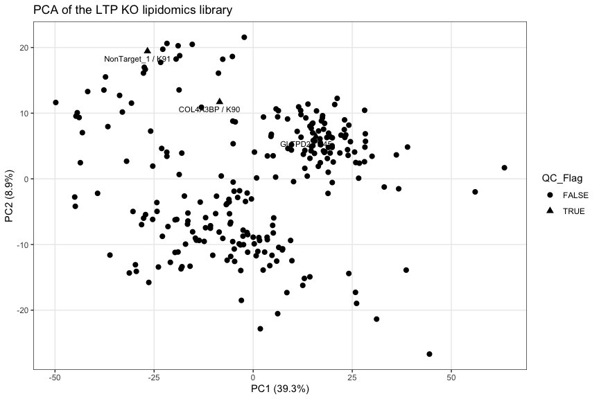<!-- -->

------------------------------------------------------------------------

# Part II — Manual exclusions

This is the part I would edit **after looking at the QC plots**.

I strongly recommend excluding an individual sample rather than the
whole gene whenever possible.

``` r
# ============================================================
# MANUAL EXCLUSIONS
# ============================================================
# 
# # Remove a complete KO only if there is a clear technical reason.
# EXCLUDE_GENES <- c(
#   # "GENE1",
#   # "GENE2"
# )
# 
# 
# # Best option:
# # copy SampleKey directly from qc_candidates.
# EXCLUDE_SAMPLES <- c(
#   # "GENE1__A1__Extraction1__Roster1"
# )
# 
# 
# # Alternatively identify individual samples by Gene + SampleID.
# EXCLUDE_GENE_SAMPLE <- tibble(
#   Gene = character(),
#   SampleID = c("H45",'K90')
# 
#   # Example:
#   # Gene = c("OSBPL9"),
#   # SampleID = c("A3")
# )
# 
# 
# # Sometimes only ONE lipid class is technically bad in one sample.
# # This lets you remove e.g. TAG from a sample without throwing away
# # the PC/PE/SM measurements from that sample.
# 
# EXCLUDE_CLASS_SAMPLE <- tibble(
#   Gene = character(),
#   SampleID = character(),
#   Class = character()
# 
#   # Example:
#   # Gene = c("OSBPL9"),
#   # SampleID = c("A3"),
#   # Class = c("TAG")
# )
```

Apply:

``` r
# acyls_clean <- acyls_raw %>%
#   filter(!Gene %in% EXCLUDE_GENES, !SampleKey %in% c('H45','K90')) %>%
#   anti_join(EXCLUDE_GENE_SAMPLE,by = c("Gene", "SampleID")) %>%
#   anti_join(EXCLUDE_CLASS_SAMPLE, by = c("Gene", "SampleID", "Class"))

acyls_clean <- acyls_raw %>% 
  filter(!SampleID %in% c('H45','K90')) 


cat("Rows before QC exclusion:",nrow(acyls_raw),"\n")
```

    ## Rows before QC exclusion: 195770

``` r
cat("Rows after QC exclusion:",nrow(acyls_clean),"\n")
```

    ## Rows after QC exclusion: 194634

------------------------------------------------------------------------

# Part III — Lipid-class abundance

### 11. Total amount per lipid class

``` r
class_sample <- acyls_clean %>%

  group_by(
    SampleKey,
    Gene,
    Group,
    SampleID,
    across(
      all_of(BATCH_VARS)
    ),
    Class
  ) %>%

  summarise(
    value =
      sum(
        amount,
        na.rm = TRUE
      ),
    .groups = "drop"
  )
```

Calculate log2 fold change against matched controls:

``` r
class_effect <- add_control_effect(
  class_sample,
  feature_cols =
    "Class",
  value_col =
    "value",
  effect_type =
    "log2fc"
)


class_gene <- summarise_gene_effect(
  class_effect,
  feature_cols =
    "Class"
)
```

Inspect:

``` r
class_gene %>%
  arrange(
    desc(
      abs(
        effect_median
      )
    )
  ) %>%
  print(n = 50)
```

    ## # A tibble: 1,710 × 10
    ##    Gene    Class n_rep effect_median effect_mean effect_sd effect_mad effect_iqr
    ##    <chr>   <chr> <int>         <dbl>       <dbl>     <dbl>      <dbl>      <dbl>
    ##  1 TRIO    LPE       2         1.18        1.18     0.858      0.900      0.607 
    ##  2 PLEKHA8 LPE       2         1.18        1.18     0.692      0.726      0.490 
    ##  3 VPS13B  LPE       3         1.13        0.857    0.649      0.300      0.605 
    ##  4 SESTD1  LPE       3         1.12        0.841    0.588      0.184      0.537 
    ##  5 NPC1    PEP       4        -1.01       -0.933    0.676      0.499      0.433 
    ##  6 SEC14L4 LPC       2         1.01        1.01     0.864      0.906      0.611 
    ##  7 GLTP    HCER      3        -0.967      -1.02     0.263      0.256      0.259 
    ##  8 OSBPL9  PEP       4        -0.966      -0.718    0.723      0.367      0.698 
    ##  9 SEC14L3 PEO       3        -0.956      -0.844    0.632      0.678      0.625 
    ## 10 ARHGAP8 PEP       4        -0.950      -0.888    0.737      0.837      1.15  
    ## 11 OSBPL9  TAG       4        -0.934      -0.508    1.05       0.215      0.579 
    ## 12 STARD7  TAG       2        -0.932      -0.932    0.0679     0.0712     0.0480
    ## 13 MCF2L2  LPE       2         0.918       0.918    1.19       1.25       0.840 
    ## 14 PTPN9   PEP       4        -0.904      -0.763    1.03       0.724      0.647 
    ## 15 BNIP2   LPE       2         0.899       0.899    0.475      0.498      0.336 
    ## 16 SEC14L3 PEP       3        -0.898      -0.803    0.508      0.532      0.501 
    ## 17 SEC14L3 PE        3        -0.881      -0.888    0.604      0.881      0.604 
    ## 18 PLEKHA8 LPC       2         0.851       0.851    0.0706     0.0740     0.0499
    ## 19 KIAA17… LPE       2         0.839       0.839    0.549      0.575      0.388 
    ## 20 GDAP2   LPE       3         0.808       0.667    0.435      0.307      0.418 
    ## 21 SCP2    PEP       3        -0.807      -0.641    0.525      0.378      0.505 
    ## 22 OSBPL8  TAG       3        -0.806      -0.545    0.805      0.564      0.772 
    ## 23 GRAMD1A LPE       2         0.801       0.801    0.903      0.946      0.638 
    ## 24 STARD5  PA        2         0.800       0.800    0.707      0.741      0.500 
    ## 25 OSBPL9  LPE       4        -0.790      -0.478    0.927      0.533      1.03  
    ## 26 BNIPL   LPE       2         0.765       0.765    0.328      0.344      0.232 
    ## 27 STOML1  LPC       2         0.764       0.764    0.539      0.565      0.381 
    ## 28 PRUNE2  LPE       2         0.755       0.755    0.839      0.880      0.593 
    ## 29 GM2A    LPE       2         0.754       0.754    0.659      0.690      0.466 
    ## 30 PLEKHA8 TAG       2         0.754       0.754    0.427      0.447      0.302 
    ## 31 OSBP    LPE       2        -0.752      -0.752    0.397      0.417      0.281 
    ## 32 OSBPL9  PEO       4        -0.749      -0.478    0.659      0.164      0.436 
    ## 33 ACOT11  PA        2         0.748       0.748    0.953      0.999      0.674 
    ## 34 OSBPL9  SM        4        -0.747      -0.633    0.480      0.325      0.446 
    ## 35 STARD13 LPE       2         0.745       0.745    0.412      0.432      0.291 
    ## 36 GLTPD2  TAG       3        -0.733      -0.866    0.352      0.198      0.332 
    ## 37 GRAMD1B LPE       2         0.733       0.733    0.825      0.865      0.583 
    ## 38 ARHGAP1 LPE       2         0.732       0.732    0.346      0.363      0.245 
    ## 39 NPC1    PEO       4        -0.722      -0.644    0.674      0.586      0.616 
    ## 40 PITPNB  PEP       4        -0.716      -0.490    0.752      0.474      0.817 
    ## 41 ESYT3   LPE       2         0.714       0.714    0.385      0.403      0.272 
    ## 42 NF1     PA        2         0.709       0.709    0.481      0.505      0.340 
    ## 43 C2CD2   LPE       2         0.706       0.706    1.11       1.16       0.782 
    ## 44 OSBPL8  PEP       3        -0.706      -0.647    0.835      1.10       0.833 
    ## 45 GRAMD1A LPC       2         0.705       0.705    0.999      1.05       0.707 
    ## 46 ESYT2   LPE       2         0.700       0.700    0.516      0.541      0.365 
    ## 47 TTPAL   LPE       2         0.693       0.693    1.15       1.21       0.813 
    ## 48 MCF2L2  PA        2         0.692       0.692    0.329      0.345      0.233 
    ## 49 SEC14L6 LPE       2         0.687       0.687    0.799      0.837      0.565 
    ## 50 ARHGAP8 TAG       4        -0.687      -0.680    0.551      0.571      0.511 
    ## # ℹ 1,660 more rows
    ## # ℹ 2 more variables: sign_consistency <dbl>, reproducible <lgl>

### 12. Class-level heatmap

Low-reproducibility effects are faded rather than deleted.

``` r
gene_order <- class_gene %>%
  group_by(Gene) %>%
  summarise(phenotype =sqrt(mean(effect_median^2,na.rm = TRUE)),
    .groups = "drop") %>%
  arrange(phenotype) %>%
  pull(Gene)


class_gene_plot <- class_gene %>%
   mutate(Gene =factor(Gene,levels =gene_order),
          plot_alpha = if_else(reproducible,1,0))


ggplot(
  class_gene_plot,
  aes(
    x = Class,
    y = Gene,
    fill = effect_median,
    alpha = plot_alpha
  )
) +

  geom_tile() +

  scale_fill_gradient2(
    midpoint = 0,
    name =
      "Median\nlog2 FC"
  ) +

  scale_alpha_identity() +

  labs(
    title =
      "Lipid-class phenotypes across the LTP KO library",
    subtitle =
      "Green cells indicate poor replicate consistency",
   x = NULL,
    y = NULL) +
   theme_classic()+
  theme(axis.text.y = element_text(size = 6),
        panel.background = element_rect(fill = 'green')) 
```

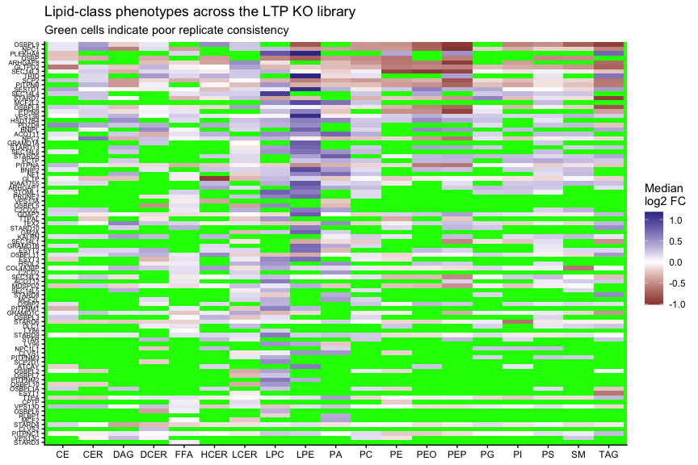<!-- -->

------------------------------------------------------------------------

# Part IV — Individual lipid-species phenotypes

### 13. Lipid-species log2FC

``` r
species_clean <- acyls_clean %>%
  group_by(
    SampleKey, Gene, Group, SampleID,
    across(all_of(BATCH_VARS)),
    Class,Lipid,LipidKey) %>%
  summarise(value =sum(amount,na.rm = TRUE),.groups = "drop")


species_effect <- add_control_effect(species_clean,
  feature_cols = c(
      "Class","Lipid","LipidKey"
    ),
  value_col ="value",
  effect_type ="log2fc"
)


species_gene <- summarise_gene_effect(
  species_effect,
  feature_cols =
    c(
      "Class",
      "Lipid",
      "LipidKey"
    )
)
```

Select the most informative lipid species:

``` r
top_lipids <- species_gene %>% 
  group_by(LipidKey) %>%
  summarise(
    phenotype_score =
      median(
        abs(
          effect_median
        ),
        na.rm = TRUE
      ),
    .groups = "drop"
  ) %>%

  slice_max(phenotype_score, n = TOP_N_LIPIDS) %>%
  pull(LipidKey)
```

``` r
ggplot(
   species_gene %>% filter(LipidKey %in% top_lipids),
   aes(x = LipidKey,y = Gene,fill = effect_median,#color = effect_median,
       alpha =if_else(reproducible,1,0.2))) +
   geom_point(shape = 21) +
   scale_fill_gradient2(midpoint = 0, name ="log2 FC") +
   #scale_color_gradient2(midpoint = 0, name ="log2 FC") +
   scale_alpha_identity() +
   labs(title ="Strongest lipid-species phenotypes",
        x = NULL,y = NULL) +
   theme(axis.text.x =element_text(angle = 90,hjust = 1,vjust = 0.5,size = 6),
         axis.text.y =element_text(size = 6))
```

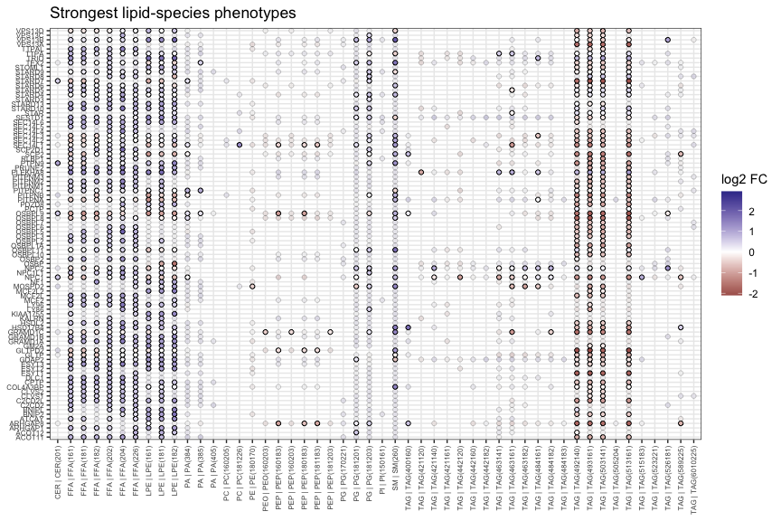<!-- -->

------------------------------------------------------------------------

# Part V — Convert lipids into resolved fatty-acyl molecules

This is the important part for saturation/PUFA analysis.

For example:

``` text
10 units PC(14:0/20:2)
```

becomes:

``` text
10 units 14:0
10 units 20:2
```

while:

``` text
10 units PC(16:0/16:0)
```

becomes:

``` text
20 units 16:0
```

### 14. Convert Tail_1 and Tail_2 to long format

``` r
common_cols <- unique(
  c(
    "RowID",
    "SampleKey",
    "Gene",
    "Group",
    "SampleID",
    BATCH_VARS,
    "Class",
    "Lipid",
    "amount",
    "ExpectedTailCount"
  )
)


tail1 <- acyls_clean %>% 
  transmute(
     across(
      all_of(common_cols)
    ),
    TailPosition = 1L,
    FattyAcyl =
      as.character(
        Tail_1
      ),

    FA_length =
      as.numeric(
        Tail_1_length
      ),

    FA_bend =
      as.numeric(
        Tail_1_bend
      )
  )


tail2 <- acyls_clean %>% 
  transmute(
    across(
      all_of(common_cols)
    ),
    TailPosition = 2L,
    FattyAcyl =
      as.character(
        Tail_2
      ),
    FA_length =
      as.numeric(
        Tail_2_length
      ),
    FA_bend =
      as.numeric(
        Tail_2_bend
      )
  )


acyl_long_all <- bind_rows(
  tail1,
  tail2
)
```

### 15. Recognise fatty acids, ether chains and sphingoid bases

This prevents `d18:1` in SM/Cer from being counted as an 18:1 fatty
acid.

``` r
nrow(acyl_long_all)
```

    ## [1] 389268

``` r
acyl_long_all = acyl_long_all %>%  
   filter(!is.na(FattyAcyl))
nrow(acyl_long_all)
```

    ## [1] 266396

``` r
acyl_long_all <- acyl_long_all %>%
   mutate( 
      # FattyAcyl = na_if(FattyAcyl,""),
      ChainType = case_when(
         str_detect(Class,regex("^PEO",ignore_case = TRUE)) ~"Ether-linked chain",      
         str_detect(Class,regex("^PEP",ignore_case = TRUE)) ~"Ether-linked chain",
         str_detect(Class,regex("^SM",ignore_case = TRUE)) ~"Sphingoid-linked",
         str_detect(Class,regex("CER",ignore_case = TRUE)) ~"Sphingoid-linked",
         
         #str_detect(FattyAcyl,"^(FA)?[0-9]+:[0-9]+") ~"Fatty acyl",
         #is.na(FattyAcyl) ~ "Fatty acyl",
         TRUE ~ "Fatty acyl"
      )
      
      # Parse length from annotation if missing
      #FA_length = coalesce(FA_length, readr::parse_number(FattyAcyl)),
      
      # Parse number of double bonds if missing
      #FA_bend = coalesce(FA_bend,as.numeric(str_match(FattyAcyl,":(\\d+)")[, 2] )),
      #FA =FattyAcyl %>%str_remove("^FA")
   )
```

Check how the annotations were classified:

``` r
acyl_long_all %>% 
   count(ChainType) %>%
   arrange(desc(n))
```

    ## # A tibble: 3 × 2
    ##   ChainType               n
    ##   <chr>               <int>
    ## 1 Fatty acyl         229752
    ## 2 Ether-linked chain  25896
    ## 3 Sphingoid-linked    10748

------------------------------------------------------------------------

# Part VI — Annotation coverage

This is particularly relevant for species such as: `TAG48:0-FA18:0`
where only one of three chains may be identified. \### 16. Calculate
resolved-chain coverage

``` r
annotation_coverage <- acyl_long_all %>%
  group_by(RowID) %>%
  summarise(
    ResolvedChains =
      sum(
        ChainType !=
          "Unresolved" &
        !is.na(FattyAcyl)
      ),

    ResolvedFattyAcyls =
      sum(
        ChainType ==
          "Fatty acyl"
      ),

    .groups = "drop"
  )


coverage_table <- acyls_clean %>%

  select(
    RowID,
    SampleKey,
    Gene,
    SampleID,
    Class,
    Lipid,
    amount,
    ExpectedTailCount
  ) %>%

  left_join(
    annotation_coverage,
    by = "RowID"
  ) %>%

  mutate(

    AnnotationCoverage =
      if_else(
        !is.na(
          ExpectedTailCount
        ) &
        ExpectedTailCount > 0,

        pmin(
          ResolvedChains /
            ExpectedTailCount,
          1
        ),

        NA_real_
      )
  )
```

Abundance-weighted annotation coverage:

``` r
coverage_sample <- coverage_table %>%

  group_by(
    SampleKey,
    Gene,
    SampleID,
    Class
  ) %>%

  summarise(

    AnnotationCoverage =
      weighted.mean(
        AnnotationCoverage,
        w = amount,
        na.rm = TRUE
      ),

    .groups = "drop"
  )
```

``` r
ggplot(
  coverage_sample,
  aes(
    x = Class,
    y =
      100 *
      AnnotationCoverage
  )
) +

  geom_boxplot(
    outlier.shape = NA
  ) +

  geom_jitter(
    width = 0.15,
    alpha = 0.4,
    size = 1
  ) +

  labs(
    title =
      "Fatty-chain annotation coverage",
    y =
      "% of expected chains resolved",
    x = NULL
  )
```

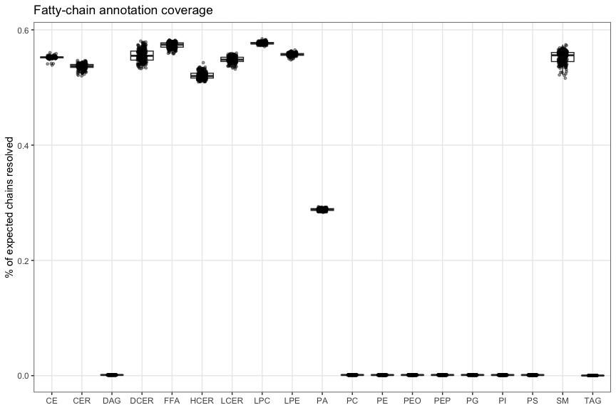<!-- -->

This is an important figure because it tells you which classes are
actually suitable for individual fatty-acyl analysis.

------------------------------------------------------------------------

# Part VII — Fatty-acyl amounts

### 17. Keep true ester-linked fatty acids

``` r
fa_long <- acyl_long_all %>%
  filter(
    ChainType ==
      "Fatty acyl",
    !is.na(FA_length),
    !is.na(FA_bend)
  ) %>%
  mutate(
    # Standard biochemical definition:
    # PUFA = two or more double bonds
    Saturation = case_when(

      FA_bend == 0 ~
        "SFA",

      FA_bend == 1 ~
        "MUFA",

      FA_bend >= 2 ~
        "PUFA",

      TRUE ~
        NA_character_
    ),

    Saturation =
      factor(
        Saturation,
        levels =
          c(
            "SFA",
            "MUFA",
            "PUFA"
          )
      ),

    DB_group = case_when(
      FA_bend == 0 ~ "0",
      FA_bend == 1 ~ "1",
      FA_bend == 2 ~ "2",
      FA_bend == 3 ~ "3",
      FA_bend == 4 ~ "4",
      FA_bend == 5 ~ "5",
      FA_bend >= 6 ~ "6+"
    ),

    ChainLengthGroup = case_when(
      FA_length < 16 ~ "<16",
      FA_length == 16 ~ "16",
      FA_length == 18 ~ "18",
      FA_length == 20 ~ "20",
      FA_length == 22 ~ "22",
      FA_length >= 24 ~ "24+",
      TRUE ~ "other"
    )
  )
```

### 18. Calculate amount of each fatty acid

Because each tail carries the amount of the parent lipid, duplicate
chains are automatically counted correctly.

``` r
fa_amount_class <- fa_long %>%
  group_by(
    SampleKey,
    Gene,
    Group,
    SampleID,
    across(
      all_of(BATCH_VARS)
    ),
    Class,
    FattyAcyl,
    FA_length,
    FA_bend,
    Saturation
  ) %>%
  summarise(
    FA_amount =
      sum(
        amount,
        na.rm = TRUE
      ),
    .groups = "drop"
  )
```

### 19. Fatty-acyl percentages within each class

``` r
fa_amount_class <- fa_amount_class %>%
  group_by(
    SampleKey,
    Class
  ) %>%
  mutate(
    TotalResolvedFA =
      sum(
        FA_amount,
        na.rm = TRUE
      ),
    FA_percent =
      100 *
      FA_amount /
      TotalResolvedFA
  ) %>%
  ungroup()
```

You now have, for every sample:

``` text
PC / 16:0 / amount
PC / 16:0 / %
PC / 18:1 / amount
PC / 18:1 / %
PC / 20:4 / amount
...
```

------------------------------------------------------------------------

# Part VIII — Overall fatty-acyl composition

``` r
fa_amount_total <- fa_long %>%
  group_by(
    SampleKey,
    Gene,
    Group,
    SampleID,
    across(
      all_of(BATCH_VARS)
    ),
    FattyAcyl,
    FA_length,
    FA_bend,
    Saturation
  ) %>%

  summarise(

    FA_amount =
      sum(
        amount,
        na.rm = TRUE
      ),

    .groups = "drop"
  ) %>%

  group_by(
    SampleKey
  ) %>%

  mutate(

    FA_percent =
      100 *
      FA_amount /
      sum(
        FA_amount,
        na.rm = TRUE
      )
  ) %>%

  ungroup()
```

------------------------------------------------------------------------

# Part IX — SFA, MUFA and PUFA

### 20. Class-specific saturation profile

``` r
saturation_class <- fa_amount_class %>%
  group_by(
    SampleKey,
    Gene,
    Group,
    SampleID,
    across(
      all_of(BATCH_VARS)
    ),
    Class,
    Saturation
  ) %>%

  summarise(

    FA_amount =
      sum(
        FA_amount,
        na.rm = TRUE
      ),

    .groups = "drop"
  ) %>%

  group_by(
    SampleKey,
    Class
  ) %>%

  mutate(

    Percent =
      100 *
      FA_amount /
      sum(
        FA_amount,
        na.rm = TRUE
      )
  ) %>%
  ungroup()
```

### 21. Control-normalised SFA/MUFA/PUFA amounts

``` r
saturation_amount_effect <- saturation_class %>%
  rename(
    value =
      FA_amount
  ) %>%

  add_control_effect(
    feature_cols =
      c(
        "Class",
        "Saturation"
      ),
    value_col =
      "value",
    effect_type =
      "log2fc"
  )


saturation_amount_gene <-
  summarise_gene_effect(
    saturation_amount_effect,
    feature_cols =
      c(
        "Class",
        "Saturation"
      )
  )
```

### 22. Control-normalised saturation percentages

Percentages should be analysed as **percentage-point differences**, not
fold changes.

``` r
saturation_percent_effect <-
  saturation_class %>%
  rename(
    value =
      Percent
  ) %>%

  add_control_effect(
    feature_cols =
      c(
        "Class",
        "Saturation"
      ),
    value_col =
      "value",
    effect_type =
      "difference"
  )


saturation_percent_gene <-
  summarise_gene_effect(
    saturation_percent_effect,
    feature_cols =
      c(
        "Class",
        "Saturation"
      )
  )
```

### 23. PUFA heatmap

``` r
ggplot(
  saturation_percent_gene %>%
    filter(
      Saturation ==
        "PUFA"
    ),
  aes(
    x = Class,
    y = Gene,
    fill =
      effect_median,
    alpha =
      if_else(
        reproducible,
        1,
        0.2
      )
  )
) +

  geom_tile() +

  scale_fill_gradient2(
    midpoint = 0,
    name =
      "Δ PUFA\npercentage points"
  ) +

  scale_alpha_identity() +

  labs(
    title =
      "Change in PUFA composition",
    subtitle =
      "Based only on resolved individual fatty-acyl chains",
    x = NULL,
    y = NULL
  ) +

  theme(
    axis.text.y =
      element_text(
        size = 6
      )
  )
```

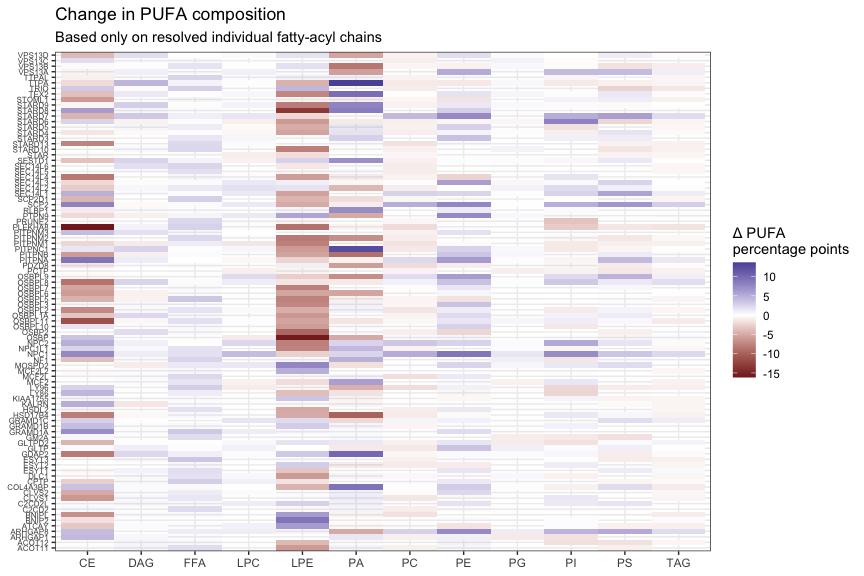<!-- -->

You can replace `"PUFA"` with `"SFA"` or `"MUFA"`.

------------------------------------------------------------------------

# Part X — Unsaturation index and chain length

This is probably one of the most useful analyses for the library.

### 24. Calculate class-specific structural metrics

``` r
fa_metrics <- fa_amount_class %>%

  group_by(
    SampleKey,
    Gene,
    Group,
    SampleID,
    across(
      all_of(BATCH_VARS)
    ),
    Class
  ) %>%

  summarise(

    TotalResolvedFA =
      sum(
        FA_amount,
        na.rm = TRUE
      ),

    # Mean number of double bonds
    # per resolved fatty-acyl chain
    UnsaturationIndex =
      weighted.mean(
        FA_bend,
        w =
          FA_amount,
        na.rm = TRUE
      ),

    MeanChainLength =
      weighted.mean(
        FA_length,
        w =
          FA_amount,
        na.rm = TRUE
      ),

    SFA_percent =
      100 *
      sum(
        FA_amount[
          FA_bend == 0
        ],
        na.rm = TRUE
      ) /
      sum(
        FA_amount,
        na.rm = TRUE
      ),

    MUFA_percent =
      100 *
      sum(
        FA_amount[
          FA_bend == 1
        ],
        na.rm = TRUE
      ) /
      sum(
        FA_amount,
        na.rm = TRUE
      ),

    PUFA_percent =
      100 *
      sum(
        FA_amount[
          FA_bend >= 2
        ],
        na.rm = TRUE
      ) /
      sum(
        FA_amount,
        na.rm = TRUE
      ),

    # Highly unsaturated fatty acids
    HUFA_percent =
      100 *
      sum(
        FA_amount[
          FA_bend >= 4
        ],
        na.rm = TRUE
      ) /
      sum(
        FA_amount,
        na.rm = TRUE
      ),

    # Very-long-chain fatty acids
    VLCFA_percent =
      100 *
      sum(
        FA_amount[
          FA_length >= 22
        ],
        na.rm = TRUE
      ) /
      sum(
        FA_amount,
        na.rm = TRUE
      ),

    C24plus_percent =
      100 *
      sum(
        FA_amount[
          FA_length >= 24
        ],
        na.rm = TRUE
      ) /
      sum(
        FA_amount,
        na.rm = TRUE
      ),

    .groups = "drop"
  )
```

Convert to long format:

``` r
fa_metrics_long <- fa_metrics %>%

  pivot_longer(

    cols =
      c(
        UnsaturationIndex,
        MeanChainLength,
        SFA_percent,
        MUFA_percent,
        PUFA_percent,
        HUFA_percent,
        VLCFA_percent,
        C24plus_percent
      ),

    names_to =
      "Metric",

    values_to =
      "value"
  )
```

### 25. Calculate differences from controls

``` r
fa_metric_effect <- add_control_effect(
  fa_metrics_long,
  feature_cols =
    c(
      "Class",
      "Metric"
    ),
  value_col =
    "value",
  effect_type =
    "difference"
)


fa_metric_gene <- summarise_gene_effect(
  fa_metric_effect,
  feature_cols =
    c(
      "Class",
      "Metric"
    )
)
```

------------------------------------------------------------------------

# Part XI — Unsaturation-index heatmap

``` r
ggplot(
  fa_metric_gene %>%
    filter(
      Metric ==
        "UnsaturationIndex"
    ),
  aes(
    x = Class,
    y = Gene,
    fill =
      effect_median,
    alpha =
      if_else(
        reproducible,
        1,
        0.2
      )
  )
) +

  geom_tile() +

  scale_fill_gradient2(
    midpoint = 0,
    name =
      "Δ unsaturation\nindex"
  ) +

  scale_alpha_identity() +

  labs(
    title =
      "Fatty-acyl unsaturation phenotype",
    subtitle =
      "Positive = shift towards more double bonds per fatty-acyl chain",
    x = NULL,
    y = NULL
  ) +

  theme(
    axis.text.y =
      element_text(
        size = 6
      )
  )
```

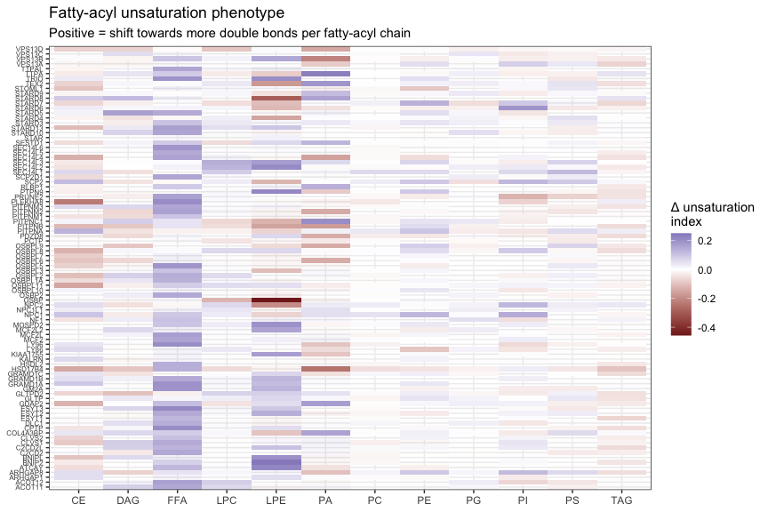<!-- -->

------------------------------------------------------------------------

# Part XII — PUFA percentage heatmap

``` r
ggplot(
  fa_metric_gene %>%
    filter(
      Metric ==
        "PUFA_percent"
    ),
  aes(
    x = Class,
    y = Gene,
    fill =
      effect_median,
    alpha =
      if_else(
        reproducible,
        1,
        0.2
      )
  )
) +

  geom_tile() +

  scale_fill_gradient2(
    midpoint = 0,
    name =
      "Δ PUFA\n%"
  ) +

  scale_alpha_identity() +

  labs(
    title =
      "PUFA phenotype across LTP knockouts",
    x = NULL,
    y = NULL
  ) +

  theme(
    axis.text.y =
      element_text(
        size = 6
      )
  )
```

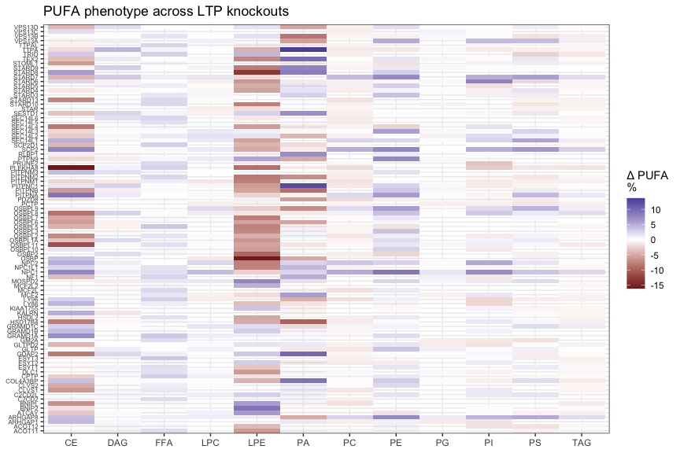<!-- -->

------------------------------------------------------------------------

# Part XIII — Chain-length phenotypes

``` r
ggplot(
  fa_metric_gene %>%
    filter(
      Metric ==
        "MeanChainLength"
    ),
  aes(
    x = Class,
    y = Gene,
    fill =
      effect_median,
    alpha =
      if_else(
        reproducible,
        1,
        0.2
      )
  )
) +

  geom_tile() +

  scale_fill_gradient2(
    midpoint = 0,
    name =
      "Δ mean\ncarbons"
  ) +

  scale_alpha_identity() +

  labs(
    title =
      "Fatty-acyl chain-length phenotype",
    x = NULL,
    y = NULL
  ) +

  theme(
    axis.text.y =
      element_text(
        size = 6
      )
  )
```

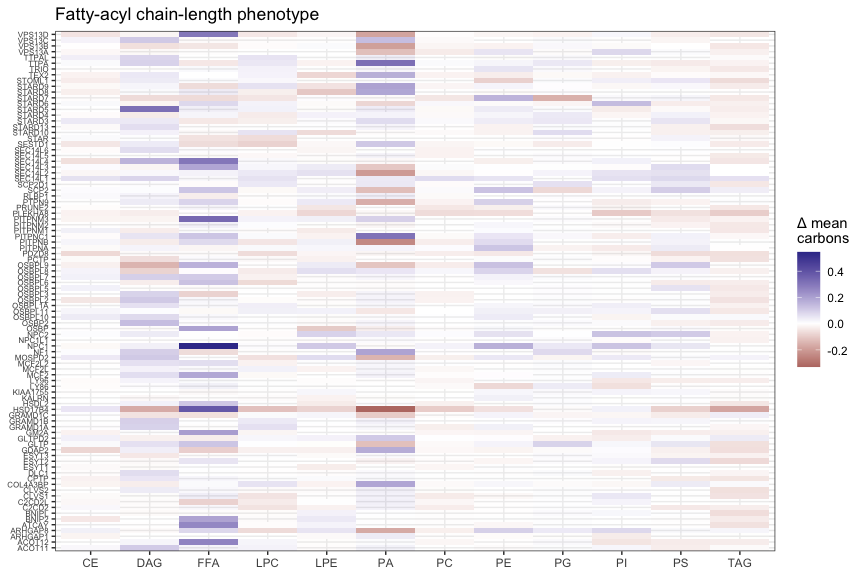<!-- -->

VLCFA:

``` r
ggplot(
  fa_metric_gene %>%
    filter(
      Metric ==
        "VLCFA_percent"
    ),
  aes(
    x = Class,
    y = Gene,
    fill =
      effect_median
  )
) +

  geom_tile() +

  scale_fill_gradient2(
    midpoint = 0,
    name =
      "Δ ≥C22\n%"
  ) +

  labs(
    title =
      "Very-long-chain fatty-acyl phenotype",
    x = NULL,
    y = NULL
  )
```

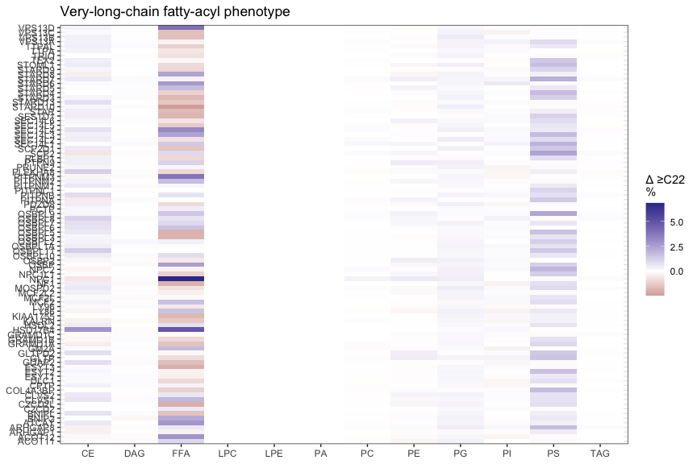<!-- -->

------------------------------------------------------------------------

# Part XIV — Exact double-bond distributions

This lets you distinguish changes in 0, 1, 2, 3, 4, 5 or 6+ double-bond
fatty acids.

``` r
db_distribution <- fa_amount_class %>%

  mutate(

    DB_group = case_when(
      FA_bend == 0 ~ "0",
      FA_bend == 1 ~ "1",
      FA_bend == 2 ~ "2",
      FA_bend == 3 ~ "3",
      FA_bend == 4 ~ "4",
      FA_bend == 5 ~ "5",
      FA_bend >= 6 ~ "6+"
    ),

    DB_group =
      factor(
        DB_group,
        levels =
          c(
            "0",
            "1",
            "2",
            "3",
            "4",
            "5",
            "6+"
          )
      )
  ) %>%

  group_by(
    SampleKey,
    Gene,
    Group,
    SampleID,
    across(
      all_of(BATCH_VARS)
    ),
    Class,
    DB_group
  ) %>%

  summarise(

    amount =
      sum(
        FA_amount,
        na.rm = TRUE
      ),

    .groups = "drop"
  ) %>%

  group_by(
    SampleKey,
    Class
  ) %>%

  mutate(

    Percent =
      100 *
      amount /
      sum(
        amount,
        na.rm = TRUE
      )
  ) %>%

  ungroup()
```

Control-normalise:

``` r
db_effect <- db_distribution %>%

  rename(
    value =
      Percent
  ) %>%

  add_control_effect(
    feature_cols =
      c(
        "Class",
        "DB_group"
      ),
    effect_type =
      "difference"
  )


db_gene <- summarise_gene_effect(
  db_effect,
  feature_cols =
    c(
      "Class",
      "DB_group"
    )
)
```

------------------------------------------------------------------------

# Part XV — Individual fatty-acid phenotypes

This can reveal things such as specific changes in:

- 16:0
- 18:0
- 18:1
- 18:2
- 20:4
- 20:5
- 22:4
- 22:6
- 24:0
- 24:1

### 26. Absolute fatty-acyl amounts

``` r
fa_specific_effect <- fa_amount_class %>%
  rename(
    value =
      FA_amount
  ) %>%

  add_control_effect(
    feature_cols =
      c(
        "Class",
        "FattyAcyl"
      ),
    value_col =
      "value",
    effect_type =
      "log2fc"
  )


fa_specific_gene <-
  summarise_gene_effect(
    fa_specific_effect,
    feature_cols =
      c(
        "Class",
        "FattyAcyl"
      )
  )
```

### 27. Fatty-acyl percentages

``` r
fa_percentage_effect <- fa_amount_class %>%

  rename(
    value =
      FA_percent
  ) %>%

  add_control_effect(
    feature_cols =
      c(
        "Class",
        "FattyAcyl"
      ),
    value_col =
      "value",
    effect_type =
      "difference"
  )


fa_percentage_gene <-
  summarise_gene_effect(
    fa_percentage_effect,
    feature_cols =
      c(
        "Class",
        "FattyAcyl"
      )
  )
```

------------------------------------------------------------------------

# Part XVI — Find the strongest fatty-acyl phenotypes

``` r
top_fa_features <-
  fa_specific_gene %>%

  mutate(
    Feature =
      paste(
        Class,
        FattyAcyl,
        sep = " | "
      )
  ) %>%

  group_by(Feature) %>%

  summarise(

    score =
      median(
        abs(
          effect_median
        ),
        na.rm = TRUE
      ),

    .groups = "drop"
  ) %>%

  slice_max(
    score,
    n =
      TOP_N_FATTY_ACYLS
  ) %>%

  pull(Feature)
```

``` r
fa_heatmap <- fa_specific_gene %>%

  mutate(
    Feature =
      paste(
        Class,
        FattyAcyl,
        sep = " | "
      )
  ) %>%

  filter(
    Feature %in%
      top_fa_features
  )


ggplot(
  fa_heatmap,
  aes(
    x = Feature,
    y = Gene,
    fill =
      effect_median,
    alpha =
      if_else(
        reproducible,
        1,
        0.2
      )
  )
) +

  geom_tile() +

  scale_fill_gradient2(
    midpoint = 0,
    name =
      "FattyAcyl log2 FC"
  ) +

  scale_alpha_identity() +

  labs(
    title =
      "Strongest fatty-acyl phenotypes",
    x = NULL,
    y = NULL
  ) +

  theme(
    axis.text.x =
      element_text(
        angle = 90,
        hjust = 1,
        vjust = 0.5,
        size = 6
      ),

    axis.text.y =
      element_text(
        size = 6
      )
  )
```

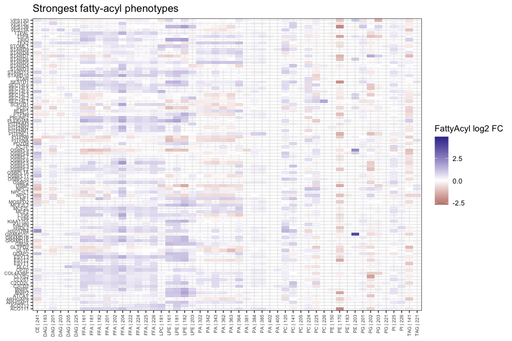<!-- -->

------------------------------------------------------------------------

# Part XVII — Specifically inspect biologically interesting FAs

``` r
FA_OF_INTEREST <- c(
  "160",
  "161",
  "180",
  "181",
  "182",
  "204",
  "205",
  "224",
  "225",
  "226",
  "240",
  "241"
)


ggplot(
  fa_percentage_gene %>%
    filter(FattyAcyl %in%FA_OF_INTEREST
    ),
  aes(
    y = Class,
    x = Gene,
    fill = effect_median, alpha = if_else(reproducible,1,0.2))) +
  geom_tile() +
  facet_grid(FattyAcyl~.) +
  scale_fill_gradient2(midpoint = 0,name ="Δ FA %") +
  scale_alpha_identity() +
  labs(title =
      "Changes in selected fatty acids", x = NULL,y = NULL)
```

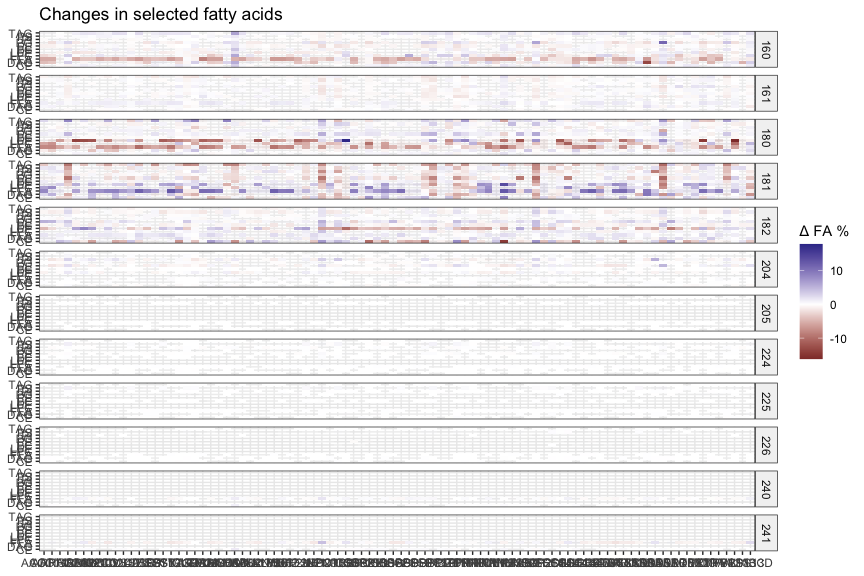<!-- -->

------------------------------------------------------------------------

# Part XVIII — Inspect replicate behaviour of top hits

This is where I would explicitly look for cases where one replicate is
producing an apparently interesting result.

For example, PUFA:

``` r
top_pufa_hits <- fa_metric_gene %>%
  filter(
    Metric ==
      "PUFA_percent"
  ) %>%

  arrange(
    desc(
      abs(
        effect_median
      )
    )
  ) %>%

  slice_head(
    n = 25
  ) %>%

  transmute(
    Gene,
    Class,
    Hit =
      paste(
        Gene,
        Class,
        sep = " | "
      )
  )


pufa_samples <- fa_metric_effect %>%

  filter(
    Metric ==
      "PUFA_percent",
    Group != "CTRL"
  ) %>%

  inner_join(
    top_pufa_hits,
    by =
      c(
        "Gene",
        "Class"
      )
  )
```

``` r
ggplot(
  pufa_samples,
  aes(
    x = Hit,
    y = effect
  )
) +

  geom_hline(
    yintercept = 0,
    linetype = 2
  ) +

  geom_point(
    position =
      position_jitter(
        width = 0.12
      ),
    size = 2
  ) +

  geom_text_repel(
    aes(
      label =
        SampleID
    ),
    size = 2.5,
    max.overlaps = Inf
  ) +

  coord_flip() +

  labs(
    title =
      "Replicate-level behaviour of strongest PUFA phenotypes",
    subtitle =
      "Sample labels make single-replicate outliers easy to identify",
    x = NULL,
    y =
      "Δ PUFA percentage points vs control"
  )
```

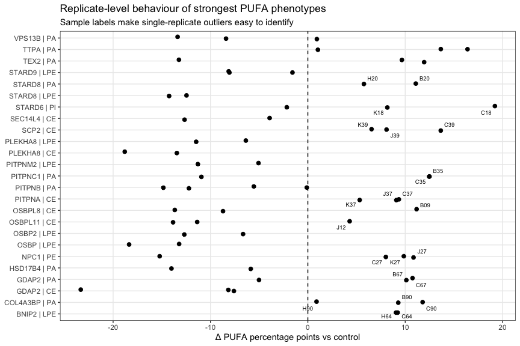<!-- -->

You can use the same approach for unsaturation:

``` r
top_unsaturation_hits <- fa_metric_gene %>%
  filter(
    Metric ==
      "UnsaturationIndex"
  ) %>%

  arrange(
    desc(
      abs(
        effect_median
      )
    )
  ) %>%

  slice_head(
    n = 25
  ) %>%

  transmute(
    Gene,
    Class,
    Hit =
      paste(
        Gene,
        Class,
        sep = " | "
      )
  )


unsaturation_samples <- fa_metric_effect %>%

  filter(
    Metric ==
      "UnsaturationIndex",
    Group != "CTRL"
  ) %>%

  inner_join(
    top_unsaturation_hits,
    by =
      c(
        "Gene",
        "Class"
      )
  )


ggplot(
  unsaturation_samples,
  aes(
    x = Hit,
    y = effect
  )
) +

  geom_hline(
    yintercept = 0,
    linetype = 2
  ) +

  geom_point(
    position =
      position_jitter(
        width = 0.12
      ),
    size = 2
  ) +

  geom_text_repel(
    aes(
      label =
        SampleID
    ),
    size = 2.5,
    max.overlaps = Inf
  ) +

  coord_flip() +

  labs(
    title =
      "Replicate-level behaviour of strongest unsaturation phenotypes",
    x = NULL,
    y =
      "Δ unsaturation index"
  )
```

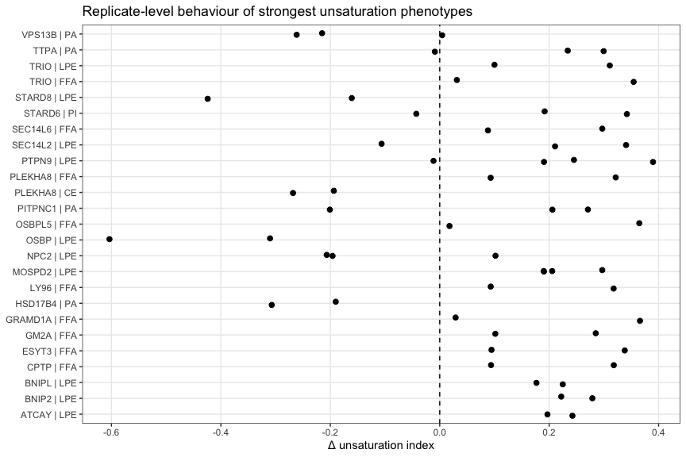<!-- -->

------------------------------------------------------------------------

# Part XIX — Find explicitly non-reproducible results

This produces the table I would inspect before claiming a phenotype.

``` r
poorly_reproduced_metrics <- fa_metric_gene %>%
  filter(
    n_rep >=
      MIN_REPLICATES,
    !reproducible
  ) %>%
  arrange(
    desc(
      abs(
        effect_median
      )
    )
  )


print(
  poorly_reproduced_metrics,
  n = 100
)
```

    ## # A tibble: 2,993 × 11
    ##     Gene     Class Metric   n_rep effect_median effect_mean effect_sd effect_mad
    ##     <chr>    <chr> <chr>    <int>         <dbl>       <dbl>     <dbl>      <dbl>
    ##   1 TTPAL    LPE   SFA_per…     2        -13.1       -13.1      20.3       21.3 
    ##   2 SCP2D1   FFA   SFA_per…     2        -11.4       -11.4      16.2       17.0 
    ##   3 STARD8   FFA   SFA_per…     2        -11.0       -11.0      17.1       18.0 
    ##   4 MCF2L2   FFA   SFA_per…     2        -10.9       -10.9      17.1       17.9 
    ##   5 SEC14L4  LPC   SFA_per…     2        -10.3       -10.3      20.7       21.7 
    ##   6 NPC1L1   FFA   SFA_per…     2        -10.3       -10.3      17.0       17.8 
    ##   7 STARD8   FFA   MUFA_pe…     2          9.76        9.76     15.5       16.2 
    ##   8 SEC14L4  LPC   MUFA_pe…     2          9.59        9.59     17.8       18.7 
    ##   9 STOML1   FFA   SFA_per…     2         -9.57       -9.57     18.9       19.8 
    ##  10 VPS13A   DAG   SFA_per…     2          9.56        9.56     15.4       16.2 
    ##  11 OSBPL10  FFA   SFA_per…     2         -9.23       -9.23     17.8       18.7 
    ##  12 CLVS1    LPE   SFA_per…     2         -9.19       -9.19     16.3       17.1 
    ##  13 CLVS2    LPE   SFA_per…     2         -9.13       -9.13     14.9       15.7 
    ##  14 LY86     FFA   SFA_per…     2         -9.01       -9.01     16.7       17.6 
    ##  15 STOML1   LPE   SFA_per…     2         -8.69       -8.69     13.4       14.1 
    ##  16 ARHGAP1  FFA   SFA_per…     2         -8.62       -8.62     14.4       15.1 
    ##  17 VPS13A   DAG   MUFA_pe…     2         -8.57       -8.57     15.4       16.1 
    ##  18 SCP2D1   FFA   MUFA_pe…     2          8.46        8.46     12.7       13.3 
    ##  19 MCF2L2   FFA   MUFA_pe…     2          8.42        8.42     13.7       14.4 
    ##  20 NPC1L1   FFA   MUFA_pe…     2          8.40        8.40     14.9       15.6 
    ##  21 STARD3   FFA   SFA_per…     2         -8.35       -8.35     12.8       13.4 
    ##  22 OSBPL5   LPE   MUFA_pe…     2          8.19        8.19     15.2       15.9 
    ##  23 ACOT12   LPE   MUFA_pe…     2          8.17        8.17     12.1       12.6 
    ##  24 RLBP1    LPE   SFA_per…     2         -8.14       -8.14     21.3       22.3 
    ##  25 ACOT12   LPE   SFA_per…     2         -8.11       -8.11     14.3       15.0 
    ##  26 MCF2L    LPE   SFA_per…     2         -8.04       -8.04     15.2       15.9 
    ##  27 STARD8   LPE   SFA_per…     2          8.00        8.00     14.3       15.0 
    ##  28 OSBP     LPE   MUFA_pe…     2         -7.99       -7.99     13.5       14.1 
    ##  29 C2CD2    LPE   SFA_per…     2         -7.89       -7.89     16.6       17.4 
    ##  30 STARD5   PA    PUFA_pe…     2          7.89        7.89     12.2       12.8 
    ##  31 NF1      FFA   SFA_per…     2         -7.82       -7.82     13.7       14.3 
    ##  32 ESYT3    LPC   MUFA_pe…     2          7.79        7.79     15.4       16.1 
    ##  33 PRUNE2   LPE   SFA_per…     2         -7.77       -7.77     16.6       17.4 
    ##  34 ESYT3    LPC   SFA_per…     2         -7.77       -7.77     16.8       17.7 
    ##  35 KIAA1755 FFA   SFA_per…     2         -7.76       -7.76     13.9       14.6 
    ##  36 LY86     FFA   MUFA_pe…     2          7.73        7.73     15.4       16.1 
    ##  37 SCP2D1   LPE   MUFA_pe…     2          7.71        7.71     11.7       12.3 
    ##  38 PTPN9    TAG   MUFA_pe…     4         -7.41       -7.03     10.2       12.4 
    ##  39 SCP2D1   LPE   SFA_per…     2         -7.26       -7.26     17.5       18.4 
    ##  40 PITPNM2  LPC   SFA_per…     2         -7.25       -7.25     11.5       12.1 
    ##  41 ARHGAP1  FFA   MUFA_pe…     2          7.23        7.23     12.5       13.1 
    ##  42 OSBPL10  FFA   MUFA_pe…     2          7.19        7.19     13.9       14.6 
    ##  43 KALRN    DAG   SFA_per…     2          7.16        7.16     15.3       16.0 
    ##  44 KALRN    FFA   SFA_per…     2         -7.16       -7.16     14.1       14.8 
    ##  45 OSBP2    LPE   MUFA_pe…     2          7.08        7.08     10.8       11.3 
    ##  46 GRAMD1A  LPC   SFA_per…     2         -7.07       -7.07     19.4       20.3 
    ##  47 KALRN    LPE   SFA_per…     2         -7.00       -7.00     14.1       14.8 
    ##  48 PITPNM1  FFA   MUFA_pe…     2          6.96        6.96      9.89      10.4 
    ##  49 SEC14L5  LPE   SFA_per…     2         -6.92       -6.92     21.5       22.6 
    ##  50 BNIP2    FFA   SFA_per…     2         -6.83       -6.83      9.82      10.3 
    ##  51 PRUNE2   LPE   MUFA_pe…     2          6.82        6.82      9.99      10.5 
    ##  52 MOSPD2   TAG   MUFA_pe…     4         -6.79       -6.52     10.3       12.8 
    ##  53 STARD3   FFA   MUFA_pe…     2          6.73        6.73     11.2       11.7 
    ##  54 OSBPL2   LPE   SFA_per…     2         -6.71       -6.71     13.0       13.7 
    ##  55 GRAMD1B  LPC   SFA_per…     2         -6.66       -6.66     12.3       12.9 
    ##  56 STOML1   LPC   MUFA_pe…     2          6.63        6.63     10.2       10.7 
    ##  57 ESYT1    DAG   SFA_per…     2          6.56        6.56     10.3       10.8 
    ##  58 GRAMD1B  LPC   MUFA_pe…     2          6.50        6.50     11.3       11.9 
    ##  59 PDZD8    CE    PUFA_pe…     2         -6.49       -6.49     10.2       10.7 
    ##  60 PITPNM3  LPE   MUFA_pe…     2          6.47        6.47     11.7       12.3 
    ##  61 OSBPL7   LPE   MUFA_pe…     2          6.44        6.44     11.1       11.6 
    ##  62 VPS13C   FFA   SFA_per…     2         -6.35       -6.35     17.1       17.9 
    ##  63 SCP2D1   LPC   SFA_per…     2         -6.35       -6.35      9.34       9.80
    ##  64 STOML1   FFA   MUFA_pe…     2          6.34        6.34     14.2       14.9 
    ##  65 PLEKHA8  LPC   MUFA_pe…     2          6.32        6.32     11.1       11.6 
    ##  66 PRUNE2   PS    MUFA_pe…     2         -6.23       -6.23      9.19       9.64
    ##  67 GRAMD1A  LPC   MUFA_pe…     2          6.21        6.21     18.2       19.1 
    ##  68 SEC14L1  DAG   SFA_per…     4          6.18        4.36     12.6       12.4 
    ##  69 VPS13C   DAG   MUFA_pe…     2          6.18        6.18      9.16       9.60
    ##  70 KIAA1755 FFA   MUFA_pe…     2          6.12        6.12     11.0       11.5 
    ##  71 MCF2L2   DAG   MUFA_pe…     2          6.10        6.10     13.7       14.3 
    ##  72 STOML1   LPC   SFA_per…     2         -6.10       -6.10     11.5       12.1 
    ##  73 OSBPL5   DAG   SFA_per…     2          6.05        6.05     13.5       14.2 
    ##  74 SEC14L4  PA    PUFA_pe…     2         -6.01       -6.01     11.1       11.7 
    ##  75 VPS13C   LPE   SFA_per…     2         -6.01       -6.01     22.2       23.3 
    ##  76 HSD17B4  DAG   MUFA_pe…     2         -6.00       -6.00      9.40       9.86
    ##  77 CLVS1    PA    PUFA_pe…     2          5.98        5.98     10.2       10.7 
    ##  78 BNIP2    FFA   MUFA_pe…     2          5.96        5.96      8.58       8.99
    ##  79 ESYT2    PA    PUFA_pe…     2         -5.94       -5.94      8.49       8.90
    ##  80 OSBP     DAG   SFA_per…     2          5.89        5.89     20.0       20.9 
    ##  81 SEC14L4  LPE   MUFA_pe…     2          5.82        5.82     15.8       16.6 
    ##  82 KALRN    FFA   MUFA_pe…     2          5.78        5.78     11.3       11.8 
    ##  83 TTPAL    LPC   SFA_per…     2         -5.75       -5.75     19.5       20.4 
    ##  84 MCF2L    LPE   MUFA_pe…     2          5.74        5.74     10.0       10.5 
    ##  85 OSBPL1A  TAG   SFA_per…     2          5.56        5.56      7.90       8.28
    ##  86 MCF2L2   DAG   SFA_per…     2         -5.50       -5.50     11.2       11.7 
    ##  87 GRAMD1A  LPE   MUFA_pe…     2          5.49        5.49     12.3       12.9 
    ##  88 C2CD2    LPE   MUFA_pe…     2          5.46        5.46     11.9       12.5 
    ##  89 MOSPD2   TAG   SFA_per…     4          5.39        5.29      8.64      10.9 
    ##  90 MCF2     LPE   MUFA_pe…     2          5.36        5.36     10.0       10.5 
    ##  91 OSBP     PS    MUFA_pe…     2         -5.33       -5.33      8.86       9.28
    ##  92 VPS13A   LPE   MUFA_pe…     2         -5.33       -5.33     12.3       12.9 
    ##  93 STAR     FFA   SFA_per…     2         -5.33       -5.33     12.2       12.8 
    ##  94 STARD10  LPC   MUFA_pe…     2          5.32        5.32     11.9       12.5 
    ##  95 ESYT1    DAG   MUFA_pe…     2         -5.32       -5.32     11.0       11.5 
    ##  96 HSDL2    LPE   MUFA_pe…     2          5.31        5.31      9.96      10.4 
    ##  97 OSBPL10  LPE   MUFA_pe…     2          5.25        5.25     12.2       12.7 
    ##  98 OSBPL5   LPC   MUFA_pe…     2          5.25        5.25     11.8       12.4 
    ##  99 OSBPL1A  LPC   SFA_per…     2         -5.22       -5.22      9.52       9.98
    ## 100 OSBPL10  LPC   MUFA_pe…     2          5.19        5.19     13.2       13.8 
    ## # ℹ 2,893 more rows
    ## # ℹ 3 more variables: effect_iqr <dbl>, sign_consistency <dbl>,
    ## #   reproducible <lgl>

``` r
write_csv(
  poorly_reproduced_metrics,
  file.path(
    OUTDIR,
    "nonreproducible_FA_metrics.csv"
  )
)
```

More specifically, find results where replicates disagree on direction:

``` r
discordant_results <- fa_metric_gene %>%

  filter(
    n_rep >= 3,
    sign_consistency < 1
  ) %>%

  arrange(
    sign_consistency,
    desc(
      abs(
        effect_median
      )
    )
  )


print(
  discordant_results,
  n = 100
)
```

    ## # A tibble: 1,792 × 11
    ##     Gene    Class Metric    n_rep effect_median effect_mean effect_sd effect_mad
    ##     <chr>   <chr> <chr>     <int>         <dbl>       <dbl>     <dbl>      <dbl>
    ##   1 PTPN9   TAG   MUFA_per…     4       -7.41      -7.03       10.2       12.4  
    ##   2 MOSPD2  TAG   MUFA_per…     4       -6.79      -6.52       10.3       12.8  
    ##   3 SEC14L1 DAG   SFA_perc…     4        6.18       4.36       12.6       12.4  
    ##   4 MOSPD2  TAG   SFA_perc…     4        5.39       5.29        8.64      10.9  
    ##   5 ARHGAP8 LPC   MUFA_per…     4       -4.86      -5.22        7.32       8.79 
    ##   6 SEC14L1 DAG   MUFA_per…     4       -4.81      -3.53       11.9       13.1  
    ##   7 PTPN9   DAG   SFA_perc…     4        3.75       4.31        8.18       9.43 
    ##   8 ARHGAP8 LPE   PUFA_per…     4        2.83       3.05        6.77       8.10 
    ##   9 SEC14L1 PE    MUFA_per…     4       -2.73      -4.55        8.00       6.42 
    ##  10 PTPN9   DAG   MUFA_per…     4       -2.48      -2.12        6.92       7.78 
    ##  11 GRAMD1C PS    MUFA_per…     4       -2.33      -2.41        4.11       5.14 
    ##  12 GRAMD1C DAG   MUFA_per…     4       -2.32      -3.20        5.26       5.14 
    ##  13 ARHGAP8 PS    HUFA_per…     4        2.30       2.43        2.82       3.40 
    ##  14 MOSPD2  LPC   SFA_perc…     4       -2.06      -1.62        3.90       4.12 
    ##  15 OSBPL9  CE    PUFA_per…     4       -1.99      -2.24       11.7       14.5  
    ##  16 PITPNB  PI    MUFA_per…     4       -1.85      -2.56        3.33       2.92 
    ##  17 NPC1    CE    SFA_perc…     4       -1.85      -2.08        3.46       3.84 
    ##  18 MOSPD2  DAG   SFA_perc…     4        1.81       1.36        7.75       9.14 
    ##  19 ARHGAP8 PS    VLCFA_pe…     4        1.71       1.78        2.13       2.62 
    ##  20 ARHGAP8 LPC   SFA_perc…     4        1.65       3.54        7.14       5.18 
    ##  21 PTPN9   PG    MUFA_per…     4       -1.57      -2.43        3.87       3.19 
    ##  22 MOSPD2  PA    SFA_perc…     4        1.53       1.65        6.70       7.07 
    ##  23 MOSPD2  DAG   MUFA_per…     4       -1.40       0.555       7.35       5.21 
    ##  24 MOSPD2  PG    MUFA_per…     4       -1.39      -2.30        3.86       3.13 
    ##  25 SEC14L1 FFA   VLCFA_pe…     4        1.34       1.26        2.95       3.49 
    ##  26 MOSPD2  PS    HUFA_per…     4        1.33       1.67        2.00       1.97 
    ##  27 OSBPL9  CE    MUFA_per…     4        1.32       2.01        7.65       8.28 
    ##  28 SEC14L1 FFA   C24plus_…     4        1.31       1.27        2.66       3.12 
    ##  29 ARHGAP8 FFA   MUFA_per…     4        1.30       2.10        8.12       7.20 
    ##  30 PTPN9   PC    SFA_perc…     4        1.16       1.18        1.84       2.29 
    ##  31 MOSPD2  PC    MUFA_per…     4       -1.15      -2.66        4.51       2.59 
    ##  32 GRAMD1C PC    MUFA_per…     4       -1.14      -1.04        2.54       3.10 
    ##  33 SEC14L1 LPC   MUFA_per…     4        1.13       2.84        9.89       9.64 
    ##  34 GRAMD1C PG    MUFA_per…     4       -1.10      -1.80        2.73       2.07 
    ##  35 GRAMD1C FFA   MUFA_per…     4       -1.09      -0.573       5.21       5.11 
    ##  36 PITPNB  PS    SFA_perc…     4        1.09       1.52        2.08       1.84 
    ##  37 SEC14L1 DAG   PUFA_per…     4        1.09       1.16        2.23       2.64 
    ##  38 PITPNB  PS    HUFA_per…     4        1.08       1.36        1.64       1.60 
    ##  39 PTPN9   PC    MUFA_per…     4       -1.06      -2.17        4.79       3.61 
    ##  40 GRAMD1C FFA   SFA_perc…     4        1.03       0.256       5.99       5.67 
    ##  41 PTPN9   FFA   SFA_perc…     4       -1.02      -6.49       13.8        4.89 
    ##  42 PITPNB  TAG   PUFA_per…     4        0.947      1.13        1.64       1.78 
    ##  43 PTPN9   PI    PUFA_per…     4       -0.941      0.718       4.45       1.98 
    ##  44 PTPN9   CE    MUFA_per…     4       -0.929     -1.04        3.85       4.74 
    ##  45 MOSPD2  PS    VLCFA_pe…     4        0.921      1.14        1.48       1.52 
    ##  46 SEC14L1 PG    SFA_perc…     4        0.834      0.911       3.88       4.81 
    ##  47 MOSPD2  PG    SFA_perc…     4        0.822      1.53        3.70       3.09 
    ##  48 SEC14L1 PG    MUFA_per…     4       -0.802     -1.44        4.02       3.93 
    ##  49 SEC14L1 FFA   MUFA_per…     4       -0.782      3.99       10.5        1.73 
    ##  50 MOSPD2  PC    PUFA_per…     4        0.734      1.74        3.14       1.85 
    ##  51 MOSPD2  LPE   MUFA_per…     4       -0.716      0.882       8.71       7.48 
    ##  52 PTPN9   PG    SFA_perc…     4        0.642      1.48        3.90       3.35 
    ##  53 MOSPD2  PS    SFA_perc…     4        0.623      1.21        1.93       1.18 
    ##  54 NPC1    PI    SFA_perc…     4        0.615      0.661       0.974      1.16 
    ##  55 SEC14L1 PS    SFA_perc…     4       -0.610     -0.0201      3.15       2.88 
    ##  56 SEC14L1 FFA   SFA_perc…     4        0.606     -5.11       12.3        1.50 
    ##  57 SEC14L1 PI    SFA_perc…     4       -0.598      0.187       2.84       1.87 
    ##  58 ARHGAP8 FFA   VLCFA_pe…     4        0.567      1.09        1.76       1.11 
    ##  59 GRAMD1C PI    PUFA_per…     4        0.565      0.898       2.22       2.03 
    ##  60 OSBPL9  DAG   PUFA_per…     4       -0.526     -0.474       1.15       1.38 
    ##  61 SEC14L1 PE    SFA_perc…     4        0.524      0.360       2.41       2.82 
    ##  62 MOSPD2  TAG   PUFA_per…     4        0.522      0.706       1.74       1.87 
    ##  63 PITPNB  PI    PUFA_per…     4        0.513      1.35        3.11       1.97 
    ##  64 PTPN9   LPC   MUFA_per…     4       -0.482      0.822       6.28       4.70 
    ##  65 PTPN9   LPE   MUFA_per…     4       -0.481      1.48        9.41       6.37 
    ##  66 PITPNB  PC    PUFA_per…     4        0.479      1.36        2.73       1.51 
    ##  67 PTPN9   PS    MUFA_per…     4       -0.447     -2.64        6.57       3.61 
    ##  68 PTPN9   TAG   PUFA_per…     4        0.431      0.614       1.91       2.07 
    ##  69 SEC14L1 LPE   MUFA_per…     4        0.419      2.82        9.81       7.16 
    ##  70 OSBPL9  PI    HUFA_per…     4       -0.418      0.357       2.55       1.63 
    ##  71 PTPN9   PS    SFA_perc…     4        0.406      0.894       2.57       2.30 
    ##  72 OSBPL9  LPE   HUFA_per…     4        0.376      0.470       1.16       1.33 
    ##  73 GRAMD1C PS    SFA_perc…     4        0.366      0.375       2.08       2.66 
    ##  74 SEC14L1 PC    MUFA_per…     4       -0.345     -2.26        5.82       3.20 
    ##  75 ARHGAP8 PA    MUFA_per…     4       -0.315     -0.187       1.63       1.65 
    ##  76 GRAMD1C PA    MUFA_per…     4       -0.307     -0.450       1.92       2.17 
    ##  77 PTPN9   PS    PUFA_per…     4        0.307      1.75        4.12       1.70 
    ##  78 SEC14L1 PG    HUFA_per…     4       -0.291     -0.354       0.428      0.440
    ##  79 PTPN9   FFA   MUFA_per…     4        0.272      4.74       11.1        3.88 
    ##  80 PITPNB  PI    HUFA_per…     4        0.265      0.366       1.97       2.27 
    ##  81 OSBPL9  CE    VLCFA_pe…     4        0.255      0.317       1.15       1.37 
    ##  82 OSBPL9  FFA   PUFA_per…     4       -0.251      0.816       2.42       0.535
    ##  83 SEC14L1 LPE   SFA_perc…     4       -0.241     -2.62       10.1        7.12 
    ##  84 PITPNB  LPC   PUFA_per…     4       -0.236     -0.217       1.88       2.15 
    ##  85 OSBPL9  PA    MUFA_per…     4        0.217      0.600       3.93       4.24 
    ##  86 SEC14L1 PA    PUFA_per…     4       -0.215      2.70        9.08       4.75 
    ##  87 MOSPD2  CE    PUFA_per…     4        0.198      0.137       8.25       9.03 
    ##  88 PTPN9   FFA   HUFA_per…     4        0.188      0.314       0.472      0.337
    ##  89 GRAMD1C PG    VLCFA_pe…     4        0.176      0.179       0.285      0.361
    ##  90 MOSPD2  TAG   HUFA_per…     4        0.170      0.181       0.333      0.410
    ##  91 OSBPL9  CE    C24plus_…     4        0.160      0.210       0.606      0.694
    ##  92 PTPN9   TAG   HUFA_per…     4        0.150      0.184       0.354      0.397
    ##  93 PTPN9   PI    SFA_perc…     4        0.133     -0.175       1.24       0.785
    ##  94 GRAMD1C FFA   VLCFA_pe…     4       -0.130      0.733       2.41       1.12 
    ##  95 OSBPL9  PG    VLCFA_pe…     4        0.122      0.145       0.249      0.281
    ##  96 PTPN9   PC    PUFA_per…     4       -0.122      0.971       3.15       1.32 
    ##  97 OSBPL9  PI    VLCFA_pe…     4        0.106     -0.00348     0.433      0.336
    ##  98 GRAMD1C FFA   C24plus_…     4        0.105      0.873       2.14       1.06 
    ##  99 PITPNB  CE    C24plus_…     4        0.0805     0.0740      0.329      0.402
    ## 100 GRAMD1C PG    PUFA_per…     4        0.0776     0.117       0.909      1.08 
    ## # ℹ 1,692 more rows
    ## # ℹ 3 more variables: effect_iqr <dbl>, sign_consistency <dbl>,
    ## #   reproducible <lgl>

That is particularly useful with three replicates because:

- `1.00` = all three agree on direction
- `0.67` = two agree, one disagrees

I would generally treat the latter as **something to inspect manually**,
rather than automatically discard.

------------------------------------------------------------------------

# Part XX — Molecular unsaturation using `Total_tail_bend`

I would analyse this separately from fatty-acyl PUFA.

`Total_tail_bend = 2` does **not** necessarily mean a PUFA-containing
lipid. For example:

``` text
PC(18:1/18:1)
```

has:

``` text
Total_tail_bend = 2
```

but contains two MUFAs.

Nevertheless, the total molecular double-bond distribution is
biologically useful.

``` r
molecular_metrics <- acyls_clean %>%

  group_by(
    SampleKey,
    Gene,
    Group,
    SampleID,
    across(
      all_of(BATCH_VARS)
    ),
    Class
  ) %>%

  summarise(

    MeanTotalTailLength =
      weighted.mean(
        Total_tail_length,
        w =
          amount,
        na.rm = TRUE
      ),

    MeanTotalDoubleBonds =
      weighted.mean(
        Total_tail_bend,
        w =
          amount,
        na.rm = TRUE
      ),

    Molecular_DB0_percent =
      100 *
      sum(
        amount[
          Total_tail_bend == 0
        ],
        na.rm = TRUE
      ) /
      sum(
        amount,
        na.rm = TRUE
      ),

    Molecular_DB1_percent =
      100 *
      sum(
        amount[
          Total_tail_bend == 1
        ],
        na.rm = TRUE
      ) /
      sum(
        amount,
        na.rm = TRUE
      ),

    Molecular_DB2plus_percent =
      100 *
      sum(
        amount[
          Total_tail_bend >= 2
        ],
        na.rm = TRUE
      ) /
      sum(
        amount,
        na.rm = TRUE
      ),

    .groups = "drop"
  )
```

------------------------------------------------------------------------

# Part XXI — Rank LTPs by strength AND reproducibility

This is useful for discovering candidates beyond the obvious
ORP9/ORP11-type phenotypes.

### 28. Overall lipid-class phenotype strength

``` r
gene_class_score <- class_gene %>%
  group_by(Gene) %>%

  summarise(

    ClassPhenotypeStrength =
      sqrt(
        mean(
          effect_median^2,
          na.rm = TRUE
        )
      ),

    ReproducibleClassFraction =
      mean(
        reproducible,
        na.rm = TRUE
      ),

    .groups = "drop"
  )
```

Add whole-lipidome replicate correlation:

``` r
gene_replicate_score <- qc_table %>%

  filter(
    Group != "CTRL"
  ) %>%

  group_by(Gene) %>%

  summarise(

    MedianReplicateCorrelation =
      median(
        ReplicateConsensusR,
        na.rm = TRUE
      ),

    .groups = "drop"
  )
```

Combine:

``` r
gene_priority <- gene_class_score %>%

  left_join(
    gene_replicate_score,
    by = "Gene"
  ) %>%

  arrange(
    desc(
      ClassPhenotypeStrength
    )
  )


write_csv(
  gene_priority,
  file.path(
    OUTDIR,
    "LTP_phenotype_priority.csv"
  )
)
```

Plot:

``` r
ggplot(
  gene_priority,
  aes(
    x =
      MedianReplicateCorrelation,
    y =
      ClassPhenotypeStrength
  )
) +

  geom_point(
    aes(
      size =
        ReproducibleClassFraction
    ),
    alpha = 0.7
  ) +

  geom_text_repel(

    data =
      gene_priority %>%
      slice_max(
        ClassPhenotypeStrength,
        n = 20
      ),

    aes(
      label = Gene
    ),

    max.overlaps = Inf,
    size = 3
  ) +

  labs(
    title =
      "Prioritising LTP lipidomic phenotypes",
    x =
      "Median replicate lipidome correlation",
    y =
      "Overall lipid-class phenotype strength",
    size =
      "Fraction reproducible"
  )
```

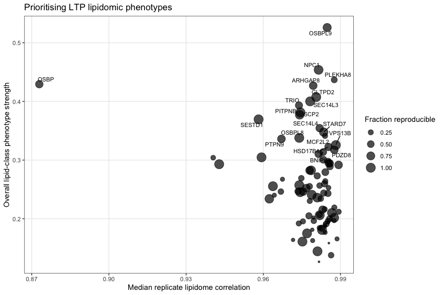<!-- -->

This plot should be particularly informative:

**upper right = strong + reproducible phenotype**.

------------------------------------------------------------------------

# Part XXII — A saturation-specific LTP ranking

``` r
saturation_priority <- fa_metric_gene %>%

  filter(
    Metric %in%
      c(
        "UnsaturationIndex",
        "PUFA_percent",
        "HUFA_percent",
        "SFA_percent",
        "MeanChainLength",
        "VLCFA_percent"
      )
  ) %>%

  group_by(Gene) %>%

  summarise(

    StructuralPhenotypeStrength =
      sqrt(
        mean(
          effect_median^2,
          na.rm = TRUE
        )
      ),

    ReproducibleFraction =
      mean(
        reproducible,
        na.rm = TRUE
      ),

    .groups = "drop"
  ) %>%

  left_join(
    gene_replicate_score,
    by = "Gene"
  ) %>%

  arrange(
    desc(
      StructuralPhenotypeStrength
    )
  )


print(
  saturation_priority,
  n = Inf
)
```

    ## # A tibble: 90 × 4
    ##    Gene     StructuralPhenotypeStr…¹ ReproducibleFraction MedianReplicateCorre…²
    ##    <chr>                       <dbl>                <dbl>                  <dbl>
    ##  1 OSBP                        3.71                 0.304                  0.873
    ##  2 PLEKHA8                     3.49                 0.632                  0.988
    ##  3 HSD17B4                     3.18                 0.765                  0.985
    ##  4 TRIO                        3.04                 0.403                  0.974
    ##  5 STARD8                      2.98                 0.382                  0.988
    ##  6 VPS13B                      2.86                 1                      0.988
    ##  7 STARD7                      2.85                 0.721                  0.983
    ##  8 ESYT3                       2.73                 0.471                  0.983
    ##  9 SCP2                        2.72                 1                      0.974
    ## 10 SEC14L4                     2.68                 0.471                  0.982
    ## 11 GRAMD1A                     2.67                 0.382                  0.941
    ## 12 STARD5                      2.65                 0.529                  0.985
    ## 13 PITPNB                      2.64                 0.765                  0.974
    ## 14 GM2A                        2.63                 0.552                  0.985
    ## 15 ATCAY                       2.61                 0.464                  0.974
    ## 16 NPC1                        2.61                 0.896                  0.981
    ## 17 BNIPL                       2.57                 0.382                  0.983
    ## 18 STARD13                     2.53                 0.552                  0.983
    ## 19 ESYT2                       2.50                 0.449                  0.976
    ## 20 ARHGAP8                     2.49                 0.853                  0.979
    ## 21 PITPNM2                     2.49                 0.433                  0.984
    ## 22 PTPN9                       2.48                 0.642                  0.967
    ## 23 LY96                        2.47                 0.597                  0.988
    ## 24 ACOT12                      2.46                 0.448                  0.982
    ## 25 BNIP2                       2.45                 0.406                  0.989
    ## 26 CPTP                        2.45                 0.507                  0.984
    ## 27 GDAP2                       2.43                 1                      0.974
    ## 28 OSBPL9                      2.43                 0.662                  0.985
    ## 29 OSBPL5                      2.43                 0.485                  0.984
    ## 30 TTPAL                       2.40                 0.338                  0.982
    ## 31 CLVS1                       2.37                 0.426                  0.985
    ## 32 GRAMD1B                     2.36                 0.338                  0.967
    ## 33 VPS13A                      2.34                 0.529                  0.967
    ## 34 SEC14L6                     2.32                 0.279                  0.985
    ## 35 PRUNE2                      2.32                 0.463                  0.975
    ## 36 MCF2L2                      2.31                 0.313                  0.984
    ## 37 SEC14L2                     2.29                 1                      0.981
    ## 38 PITPNM3                     2.28                 0.522                  0.975
    ## 39 TTPA                        2.26                 1                      0.983
    ## 40 OSBPL2                      2.25                 0.515                  0.984
    ## 41 KIAA1755                    2.21                 0.324                  0.978
    ## 42 C2CD2L                      2.20                 0.471                  0.984
    ## 43 STARD10                     2.19                 0.582                  0.978
    ## 44 STOML1                      2.18                 0.471                  0.981
    ## 45 ACOT11                      2.15                 0.448                  0.982
    ## 46 GLTPD2                      2.11                 1                      0.981
    ## 47 MCF2                        2.09                 0.406                  0.979
    ## 48 MOSPD2                      2.06                 0.676                  0.962
    ## 49 MCF2L                       2.06                 0.397                  0.984
    ## 50 PITPNC1                     2.05                 1                      0.981
    ## 51 PDZD8                       2.04                 0.522                  0.988
    ## 52 SCP2D1                      2.03                 0.485                  0.985
    ## 53 OSBPL11                     2.00                 1                      0.974
    ## 54 PITPNA                      1.99                 1                      0.943
    ## 55 OSBP2                       1.97                 0.397                  0.983
    ## 56 OSBPL6                      1.96                 0.433                  0.989
    ## 57 COL4A3BP                    1.95                 1                      0.979
    ## 58 NPC2                        1.95                 1                      0.959
    ## 59 TEX2                        1.92                 1                      0.964
    ## 60 C2CD2                       1.91                 0.358                  0.964
    ## 61 CLVS2                       1.88                 0.324                  0.985
    ## 62 SEC14L3                     1.87                 1                      0.978
    ## 63 VPS13D                      1.87                 1                      0.977
    ## 64 OSBPL1A                     1.87                 0.471                  0.983
    ## 65 ESYT1                       1.86                 0.426                  0.979
    ## 66 SEC14L5                     1.85                 0.324                  0.978
    ## 67 NF1                         1.84                 0.456                  0.986
    ## 68 OSBPL7                      1.83                 0.382                  0.984
    ## 69 SESTD1                      1.80                 1                      0.958
    ## 70 DLC1                        1.80                 0.382                  0.978
    ## 71 NPC1L1                      1.80                 0.456                  0.980
    ## 72 RLBP1                       1.77                 0.353                  0.972
    ## 73 OSBPL8                      1.76                 1                      0.974
    ## 74 SEC14L1                     1.76                 0.735                  0.974
    ## 75 HSDL2                       1.75                 0.324                  0.985
    ## 76 GLTP                        1.73                 1                      0.979
    ## 77 STARD3                      1.70                 0.647                  0.982
    ## 78 KALRN                       1.70                 0.279                  0.977
    ## 79 LY86                        1.67                 0.507                  0.979
    ## 80 OSBPL3                      1.66                 0.368                  0.982
    ## 81 PITPNM1                     1.65                 0.5                    0.989
    ## 82 STARD6                      1.64                 1                      0.982
    ## 83 OSBPL10                     1.58                 0.435                  0.982
    ## 84 ARHGAP1                     1.58                 0.441                  0.984
    ## 85 STARD9                      1.55                 1                      0.988
    ## 86 GRAMD1C                     1.43                 0.791                  0.987
    ## 87 VPS13C                      1.35                 0.388                  0.986
    ## 88 STARD4                      1.29                 1                      0.975
    ## 89 STAR                        1.20                 0.319                  0.986
    ## 90 PCTP                        0.846                0.418                  0.986
    ## # ℹ abbreviated names: ¹​StructuralPhenotypeStrength,
    ## #   ²​MedianReplicateCorrelation

------------------------------------------------------------------------

# Part XXIII — Save the useful tables

``` r
write_csv(
  class_gene,
  file.path(
    OUTDIR,
    "class_effects.csv"
  )
)


write_csv(
  species_gene,
  file.path(
    OUTDIR,
    "lipid_species_effects.csv"
  )
)


write_csv(
  fa_amount_class,
  file.path(
    OUTDIR,
    "fatty_acyl_amounts_and_percentages.csv"
  )
)


write_csv(
  fa_metric_gene,
  file.path(
    OUTDIR,
    "fatty_acyl_summary_metrics.csv"
  )
)


write_csv(
  fa_specific_gene,
  file.path(
    OUTDIR,
    "fatty_acyl_specific_log2FC.csv"
  )
)


write_csv(
  fa_percentage_gene,
  file.path(
    OUTDIR,
    "fatty_acyl_specific_percentage_changes.csv"
  )
)


write_csv(
  annotation_coverage,
  file.path(
    OUTDIR,
    "annotation_coverage.csv"
  )
)


saveRDS(
  list(
    clean_data =
      acyls_clean,

    qc =
      qc_table,

    class_effect =
      class_effect,

    class_gene =
      class_gene,

    species_effect =
      species_effect,

    species_gene =
      species_gene,

    fatty_acyl_long =
      fa_long,

    fatty_acyl_amounts =
      fa_amount_class,

    fatty_acyl_metrics =
      fa_metric_gene,

    fatty_acyl_specific =
      fa_specific_gene
  ),

  file.path(
    OUTDIR,
    "acyls1_analysis_objects.rds"
  )
)
```

And at the very end of the Markdown:

``` r
sessionInfo()
```

    ## R version 4.4.0 (2024-04-24)
    ## Platform: aarch64-apple-darwin20
    ## Running under: macOS Sonoma 14.8.3
    ## 
    ## Matrix products: default
    ## BLAS:   /Library/Frameworks/R.framework/Versions/4.4-arm64/Resources/lib/libRblas.0.dylib 
    ## LAPACK: /Library/Frameworks/R.framework/Versions/4.4-arm64/Resources/lib/libRlapack.dylib;  LAPACK version 3.12.0
    ## 
    ## locale:
    ## [1] en_US.UTF-8/en_US.UTF-8/en_US.UTF-8/C/en_US.UTF-8/en_US.UTF-8
    ## 
    ## time zone: Europe/Amsterdam
    ## tzcode source: internal
    ## 
    ## attached base packages:
    ## [1] stats     graphics  grDevices utils     datasets  methods   base     
    ## 
    ## other attached packages:
    ##  [1] ggrepel_0.9.5   lubridate_1.9.4 forcats_1.0.0   stringr_1.5.1  
    ##  [5] dplyr_1.1.4     purrr_1.0.4     readr_2.2.0     tidyr_1.3.1    
    ##  [9] tibble_3.2.1    ggplot2_4.0.2   tidyverse_2.0.0
    ## 
    ## loaded via a namespace (and not attached):
    ##  [1] bit_4.0.5          gtable_0.3.6       crayon_1.5.2       compiler_4.4.0    
    ##  [5] Rcpp_1.0.12        tidyselect_1.2.1   parallel_4.4.0     scales_1.4.0      
    ##  [9] yaml_2.3.8         fastmap_1.2.0      R6_2.5.1           labeling_0.4.3    
    ## [13] generics_0.1.3     knitr_1.49         pillar_1.9.0       RColorBrewer_1.1-3
    ## [17] tzdb_0.4.0         rlang_1.1.4        utf8_1.2.4         stringi_1.8.4     
    ## [21] xfun_0.51          S7_0.2.1           bit64_4.0.5        timechange_0.3.0  
    ## [25] cli_3.6.2          withr_3.0.0        magrittr_2.0.3     digest_0.6.35     
    ## [29] grid_4.4.0         vroom_1.7.0        rstudioapi_0.18.0  hms_1.1.3         
    ## [33] lifecycle_1.0.4    vctrs_0.6.5        evaluate_0.24.0    glue_1.7.0        
    ## [37] farver_2.1.2       fansi_1.0.6        rmarkdown_2.27     tools_4.4.0       
    ## [41] pkgconfig_2.0.3    htmltools_0.5.8.1

## The outputs I would pay most attention to

For your LTP screen, I think the most informative combination will be
**five separate phenotypes**, rather than trying to reduce saturation
into one number:

- `UnsaturationIndex` — mean double bonds per resolved fatty-acyl chain.
- `PUFA_percent` — fraction of resolved fatty-acyl moles with ≥2 double
  bonds.
- `HUFA_percent` — fraction with ≥4 double bonds, which should make
  20:4/20:5/22:6-type effects more visible.
- `MeanChainLength` and `VLCFA_percent` — likely particularly
  informative for membrane trafficking phenotypes.
- Individual FA changes such as **16:0, 18:1, 18:2, 20:4, 22:6, 24:0 and
  24:1**.

The other part I would retain is the distinction between **absolute
fatty-acyl amount** and **fatty-acyl percentage**. If 20:4-PC goes up
because total PC doubles, that is a different phenotype from PC
remaining constant but being remodelled from 18:1 toward 20:4.

And for your unreliable replicates, I would use the QC workflow exactly
as above: **flag → inspect raw replicate points → manually exclude by
`SampleKey` or by gene/sample/class**. I would not use an automated
outlier-removal algorithm with only ~3 biological replicates, because it
is too easy to delete a genuine strong biological phenotype.
