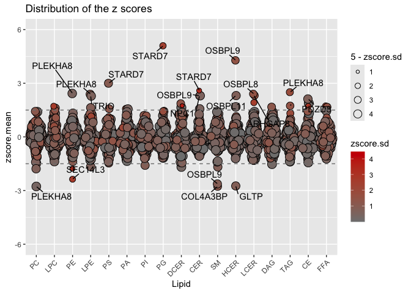
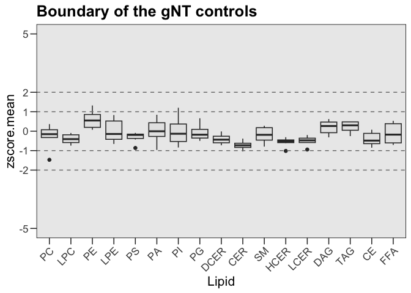
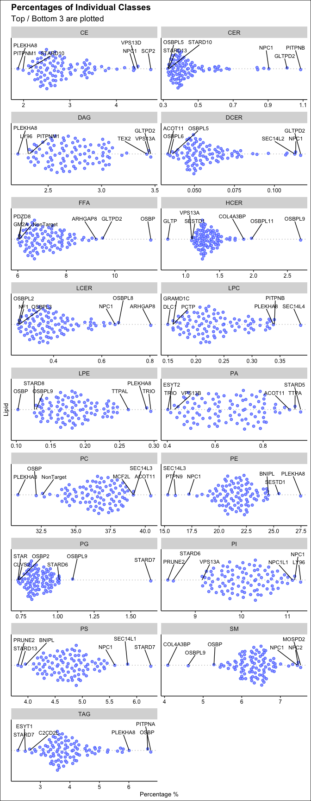
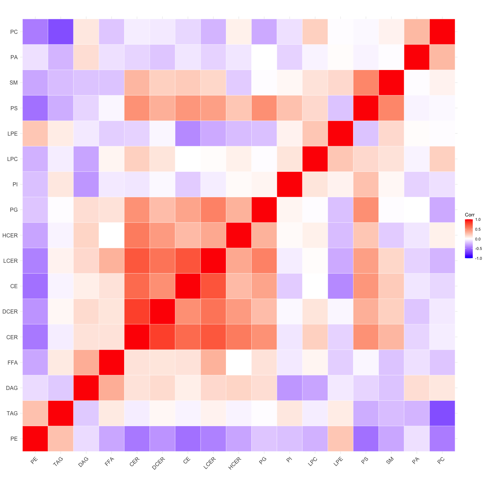
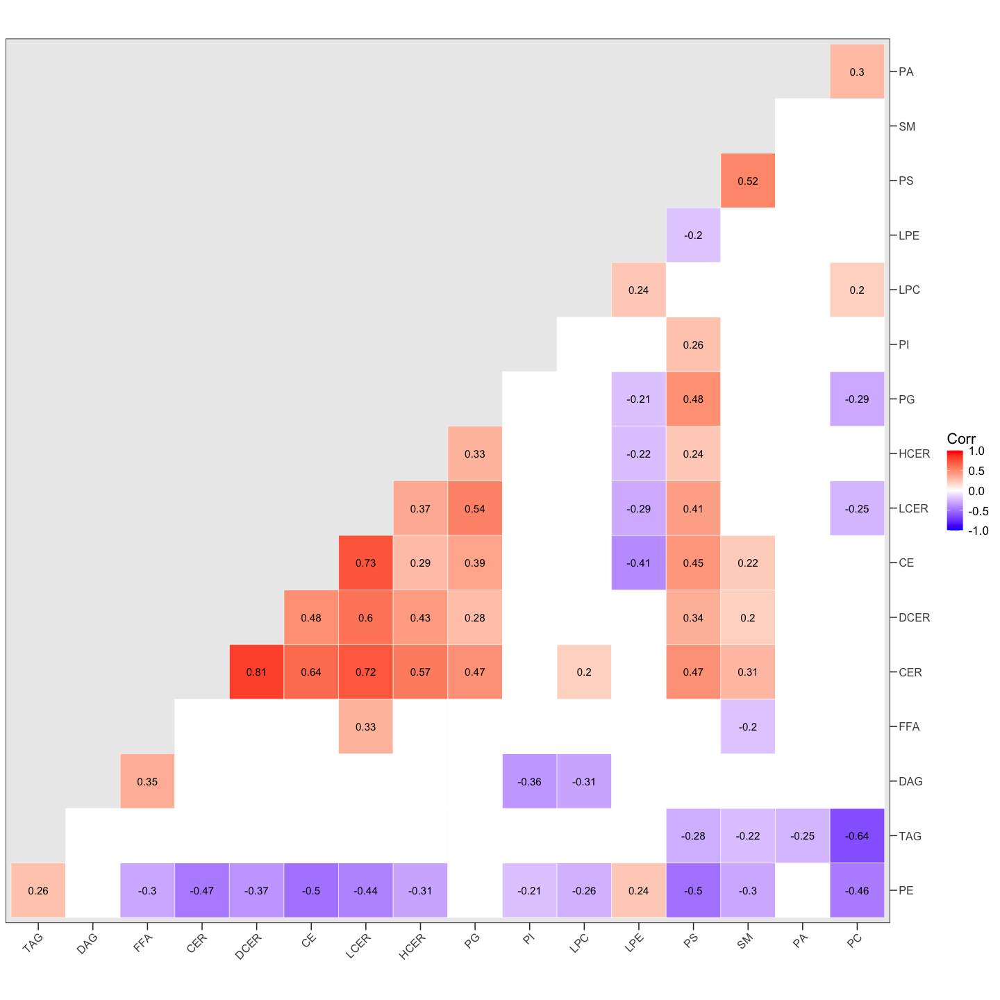
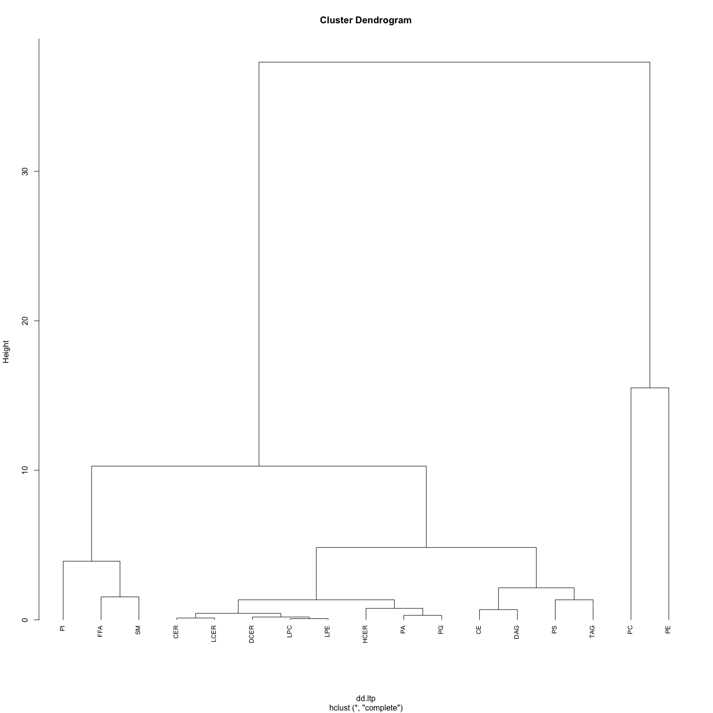
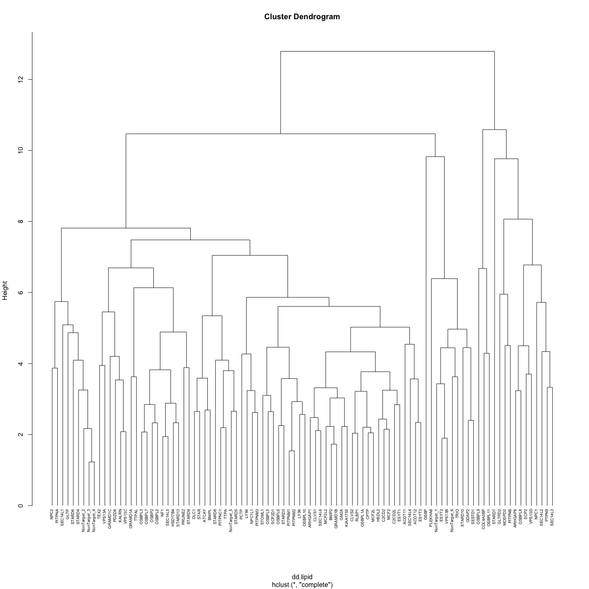

global_analysis
================
Birol Cabukusta
2026-07-27

## GLOBAL ANALYSIS OF LTP KNOCKOUT LIBRARY IN MELJUSO CELLS

Total cell lipidomics

    ## 
    ## Attaching package: 'dplyr'

    ## The following objects are masked from 'package:stats':
    ## 
    ##     filter, lag

    ## The following objects are masked from 'package:base':
    ## 
    ##     intersect, setdiff, setequal, union

    ## 
    ## Attaching package: 'tidyr'

    ## The following object is masked from 'package:reshape2':
    ## 
    ##     smiths

## Load data

## Define variables

``` r
seleLipids <- c('PC','LPC','PE','LPE','PS','PA','PI','PG',
                'DCER','CER','SM','HCER','LCER',
                'DAG','TAG','CE','FFA')
```

## Z-scores

``` r
ggplot(data2, aes(Lipid, zscore.mean,

                            label = Target.Gene.Symbol))+
  #theme_base() +
  theme(axis.text.x=element_text(angle =45, hjust = 1)) +
  #scale_fill_gradient(high = 'grey50', low  = '#CC0000') +
  scale_fill_gradient(high = '#CC0000', low  = 'grey50') +
  geom_quasirandom(color = 'black', shape = 21, aes(size = 5- zscore.sd,
                                                    fill = zscore.sd )) +
  scale_size(range = c(0, 5)) +
  scale_x_discrete(limits = seleLipids) +
  ylim(-6,6) +
  geom_text_repel(data = subset(data2, abs(zscore.mean) > 2),
                   min.segment.length = 0, seed = 42, box.padding = 0.5,
                  max.overlaps = Inf,
                  max.time = 10, max.iter = 1e5) +
  geom_hline(yintercept = 1.5, color = 'grey50', linetype = 2) +
  geom_hline(yintercept = -1.5, color = 'grey50', linetype = 2) +
  ggtitle("Distribution of the z scores")
```

    ## Warning: Removed 13 rows containing missing values or values outside the scale range
    ## (`geom_point()`).

<!-- -->

``` r
# LOOK AT THE CONTROLS
ggplot(data = data2 %>% subset(sampleRoster  %in% 91:96),
       aes(Lipid, zscore.mean)) +
  theme_base() +
  theme(axis.text.x=element_text(angle =45, hjust = 1)) +
  geom_boxplot(fill = 'grey90', outlier.alpha = 1) +
  scale_x_discrete(limits = seleLipids) +
  geom_hline(yintercept = c(-2, -1, 1,2), color = 'grey50', linetype = 2) +
  scale_y_continuous(limits = c(-5,5), breaks = c(-5,-2,-1,0,1,2,5)) +
  ggtitle('Boundary of the gNT controls')
```

<!-- -->

## Percentages of individual classes

``` r
labels <- data2 %>%
  group_by(Lipid) %>%
   group_modify(~ bind_rows(
          slice_max(.x, order_by = percentage.mean, n = 3, with_ties = FALSE),
    slice_min(.x, order_by = percentage.mean, n = 3, with_ties = FALSE)
   )) %>%
  ungroup() %>%
  distinct()


ggplot(data2,
         aes(percentage.mean, Lipid)) +
    #geom_boxplot() +
    geom_quasirandom(shape = 21, color = '#4175FF', fill = '#A5A5FF') +
    theme_clean(base_size = 12, base_family = 'Arial') +
    facet_wrap(Lipid~.,  scales='free', ncol = 2) +
   geom_text_repel(data = labels, aes(label = Target.Gene.2) , max.overlaps = Inf, nudge_y = 0.4, size = 3) +
    #facet_grid(Lipid~., scales='free')+
    theme(axis.text.y = element_blank(),
          axis.ticks.y = element_blank()) +
   xlab("Percentage %") +
    ggtitle("Percentages of Individual Classes","Top / Bottom 3 are plotted") 
```

    ## Warning: The `size` argument of `element_line()` is deprecated as of ggplot2 3.4.0.
    ## ℹ Please use the `linewidth` argument instead.
    ## ℹ The deprecated feature was likely used in the ggthemes package.
    ##   Please report the issue at <https://github.com/jrnold/ggthemes/issues>.
    ## This warning is displayed once every 8 hours.
    ## Call `lifecycle::last_lifecycle_warnings()` to see where this warning was
    ## generated.

    ## Orientation inferred to be along y-axis; override with
    ## `position_quasirandom(orientation = 'x')`

<!-- -->

## CORRELATION ANALYSIS

``` r
library(ggcorrplot)
library(tibble)
library(GGally)
```

    ## Registered S3 method overwritten by 'GGally':
    ##   method from   
    ##   +.gg   ggplot2

``` r
## CORRELATION BASED ON AVERAGE PERCENTAGES ##

matrix.percentages <- data2 %>% 
   dcast(Target.Gene.Symbol~Lipid, value.var = 'percentage.mean') %>%
   column_to_rownames(var = 'Target.Gene.Symbol')

correlation.percentages <- cor(matrix.percentages)
p.values.matrix.percentages <- cor_pmat(matrix.percentages) #p-values matrix

#this is slowing it down
#ggpairs(matrix.percentages[-1]) 

#
ggcorrplot(correlation.percentages, hc.order = TRUE, outline.col = "white")
```

    ## Warning: `aes_string()` was deprecated in ggplot2 3.0.0.
    ## ℹ Please use tidy evaluation idioms with `aes()`.
    ## ℹ See also `vignette("ggplot2-in-packages")` for more information.
    ## ℹ The deprecated feature was likely used in the ggcorrplot package.
    ##   Please report the issue at <https://github.com/kassambara/ggcorrplot/issues>.
    ## This warning is displayed once every 8 hours.
    ## Call `lifecycle::last_lifecycle_warnings()` to see where this warning was
    ## generated.

<!-- -->

``` r
ggcorrplot(correlation.percentages, hc.order = TRUE, outline.col = "white", 
           type = "lower",
           lab=T,
           insig = 'blank', 
           ggtheme = theme_base, 
           colors = c("blue", "white", "red"),
           p.mat = p.values.matrix.percentages,
           sig.level = 0.051#calculate p-values using the original matrix!
) +
   scale_y_discrete(position = 'right')
```

<!-- -->

``` r
#Dendograms
dd.ltp <- dist(scale(matrix.percentages %>% t), method = "euclidean")
hc.ltp <- hclust(dd.ltp, method = 'complete')
plot(hc.ltp, hang = -1, cex = 0.8)
```

<!-- -->

``` r
dd.lipid <- dist(scale(matrix.percentages), method = "euclidean")
hc.lipid <- hclust(dd.lipid, method = 'complete')
plot(hc.lipid, hang = -1, cex = 0.6)
```

<!-- -->

## ACYL CHAINS

``` r
acyls1 = read.csv('data/LTP_acyl_concentrations_raw1.csv')
acyls1 %>% colnames
```

    ##  [1] "X"                  "LBP_Family"         "Target.Gene.Symbol"
    ##  [4] "Roster"             "SampleID"           "Extraction"        
    ##  [7] "Type2"              "Class"              "Tails"             
    ## [10] "nmolg"              "Tail_1"             "Tail_1_length"     
    ## [13] "Tail_1_bend"        "Tail_2"             "Tail_2_length"     
    ## [16] "Tail_2_bend"        "Total_tail_length"  "Total_tail_bend"

``` r
#### START SIMPLE ####
#PUFA index within the same class
PufaIndex1 = merge(
  acyls1 %>% 
    group_by(Target.Gene.Symbol, SampleID, Class) %>%
    filter(Total_tail_bend>3) %>% 
    summarise(Class_pufas=sum(nmolg, na.rm = T)) %>% 
    ungroup() , 
  acyls1 %>% 
    group_by(Target.Gene.Symbol, SampleID, Class) %>%
    summarise(Class_total=sum(nmolg, na.rm = T)) %>% 
    ungroup(),
  by=c(1:3) 
) %>% 
  mutate(PufaRatio = Class_pufas/Class_total) 
```

    ## `summarise()` has grouped output by 'Target.Gene.Symbol', 'SampleID'. You can
    ## override using the `.groups` argument.
    ## `summarise()` has grouped output by 'Target.Gene.Symbol', 'SampleID'. You can
    ## override using the `.groups` argument.

``` r
PufaIndex2 = PufaIndex1 %>% 
  group_by(Target.Gene.Symbol, Class) %>% #take the mean and sd of each percentage
  summarize(PufaRatio.Mean = mean(PufaRatio, na.rm = T),
            PufaRatio.Sd = sd(PufaRatio, na.rm = T))
```

    ## `summarise()` has grouped output by 'Target.Gene.Symbol'. You can override
    ## using the `.groups` argument.

``` r
PufaIndex2.labels <- PufaIndex2 %>%
  group_by(Class) %>%
   group_modify(~ bind_rows(
          slice_max(.x, order_by = PufaRatio.Mean, n = 3, with_ties = FALSE),
    slice_min(.x, order_by = PufaRatio.Mean, n = 3, with_ties = FALSE)
   )) %>%
  ungroup() %>%
  distinct()


PufaIndex2%>% 
  ggplot(aes(Class, PufaRatio.Mean)) +
  geom_quasirandom(shape = 21, color = '#4175FF', fill = '#A5A5FF') +
  theme_clean(base_size = 12, base_family = 'Arial') +
  geom_text_repel(data = PufaIndex2.labels,aes(label = Target.Gene.Symbol), max.overlaps = Inf,  size = 3) 
```

<!-- -->

``` r
PufaIndex1%>% 
  filter(Target.Gene.Symbol %in%  c("PTPN9",'LY86','STOML1','ACOT11','CLVS1','SEC14L1','SEC14L3','STARD7')) %>% 
  #filter(Class %in% c('PE','PEO','PEP') ) %>% 
  ggplot(aes(Class, PufaRatio, color = Target.Gene.Symbol)) +
  # geom_boxplot(data = PufaIndex1%>% 
  #               filter(Target.Gene.Symbol %in% paste0('NonTarget_',1:6))) +
  facet_grid(Target.Gene.Symbol~.) +
  geom_boxplot() +
  geom_quasirandom() +
  theme_base(base_size = 12, base_family = 'Arial') 
```

<!-- -->

``` r
### take it to next level

UnsaturationLevels = 
  acyls1 %>%  
  group_by(Target.Gene.Symbol, SampleID, Class) %>%
  mutate(abundance= nmolg/sum(nmolg, na.rm = T)) %>% 
  reframe(UnsatLevel = sum(abundance*Total_tail_bend, na.rm = T)) 

UnsaturationLevels %>% 
  ggplot(aes(Class, UnsatLevel)) +
  geom_quasirandom()
```

    ## Warning: <ggplot> %+% x was deprecated in ggplot2 4.0.0.
    ## ℹ Please use <ggplot> + x instead.
    ## This warning is displayed once every 8 hours.
    ## Call `lifecycle::last_lifecycle_warnings()` to see where this warning was
    ## generated.

<!-- -->

``` r
UnsaturationLevel.labels <- UnsaturationLevels %>%
  group_by(Class) %>%
   group_modify(~ bind_rows(
          slice_max(.x, order_by = UnsatLevel, n = 3, with_ties = FALSE),
    slice_min(.x, order_by = UnsatLevel, n = 3, with_ties = FALSE)
   )) %>%
  ungroup() %>%
  distinct()

UnsaturationLevels %>% 
  ggplot(aes(Class, UnsatLevel)) +
  geom_quasirandom(shape = 21, color = '#4175FF', fill = '#A5A5FF') +
  theme_clean(base_size = 12, base_family = 'Arial') +
  geom_text_repel(data = UnsaturationLevel.labels ,aes(label = Target.Gene.Symbol), max.overlaps = Inf,  size = 3) 
```

<!-- -->

``` r
# END #### Yore hia


# Acyls1 %>% 
#   group_by(Target.Gene.Symbol, SampleID, Tail) %>%
#   summarise(sumTails=sum(nmolg, na.rm = T)) %>% # sum all FA within each sample
#   ungroup() %>% 
#   group_by(SampleID) %>% 
#   mutate(percTail = sumTails / sum(sumTails, na.rm = T)) %>% # take the percentages within each group
#   ungroup() %>%
#   group_by(Target.Gene.Symbol, Tail) %>% #take the mean and sd of each percentage
#   summarize(tail.mean = mean(percTail, na.rm = T),
#             tail.sd = sd(percTail, na.rm = T))%>% 
#   ggplot(aes (tail.mean, Tail, label = Target.Gene.Symbol)) +
#   theme_clean(base_size = 12, base_family = 'Arial') +
#   #facet_wrap(Tail~.,  scales='free', ncol = 1) +
#   geom_quasirandom() 

# Acyls1 %>% 
#     group_by(Target.Gene.Symbol, SampleID, Class2) %>%
#     summarise(ClassTotal=sum(nmolg, na.rm = T)) 


# labels <- data2 %>%
#   group_by(Lipid) %>%
#    group_modify(~ bind_rows(
#           slice_max(.x, order_by = percentage.mean, n = 3, with_ties = FALSE),
#     slice_min(.x, order_by = percentage.mean, n = 3, with_ties = FALSE)
#    )) %>%
#   ungroup() %>%
#   distinct()


# ggplot(data2,
#          aes(percentage.mean, Lipid)) +
#     #geom_boxplot() +
#     geom_quasirandom(shape = 21, color = '#4175FF', fill = '#A5A5FF', dodge = 1) +
#     theme_clean(base_size = 12, base_family = 'Arial') +
#    geom_text_repel(data = labels,aes(label = Target.Gene.2), max.overlaps = Inf, nudge_y = 0.4, size = 3) +
#     facet_wrap(Lipid~.,  scales='free', ncol = 2) +
#     #facet_grid(Lipid~., scales='free')+
#     theme(axis.text.y = element_blank(),
#           axis.ticks.y = element_blank()) +
#    xlab("Percentage %") +
#     ggtitle("Percentages of Individual Classes","Top / Bottom 3 are plotted") 
#     
#########

# quad5 = quad3%>% 
#   mutate(tail.length = substr(Tails2 ,1, str_locate(Tails2,':')-1),
#          tail.bend = substr(Tails2, str_locate(Tails2,':')+1, nchar(Tails2))) 
# 
# 
# quad5.tail = quad5%>% 
#   group_by(Target.Gene.Symbol, SampleID, tail.length) %>%
#   summarize(tail.length.sum = sum(nmolg, na.rm = T)) %>% 
#   ungroup %>% 
#   group_by(SampleID) %>% 
#   mutate(ratioTails = tail.length.sum / sum(tail.length.sum, na.rm = T)) %>% # take the percentages within each group
#   ungroup() %>%
#   group_by(Target.Gene.Symbol, tail.length) %>% 
#   summarize(length.mean = mean(ratioTails, na.rm=T),
#             length.sd = sd(ratioTails, na.rm=T))
# 
# 
# ggplot(quad5.tail, aes(tail.length, length.mean, fill = length.sd, label = Target.Gene.Symbol)) +
#   geom_quasirandom(shape = 21, size = 2)+
#   facet_grid(.~tail.length, scales = 'free') 
# 
# 
# 
# quad5.bond = quad5%>% 
#   group_by(Target.Gene.Symbol, SampleID, tail.bend) %>%
#   summarize(tail.bend.sum = sum(nmolg, na.rm = T)) %>% 
#   ungroup %>% 
#   group_by(SampleID) %>% 
#   mutate(ratioTails = tail.bend.sum / sum(tail.bend.sum, na.rm = T)) %>% # take the percentages within each group
#   ungroup() %>%
#   group_by(Target.Gene.Symbol, tail.bend) %>% 
#   summarize(bend.mean = mean(ratioTails, na.rm=T),
#             bend.sd = sd(ratioTails, na.rm=T))
# 
# ggplot(quad5.bond, aes(tail.bend, bend.mean, fill = bend.sd, label = Target.Gene.Symbol)) +
#   geom_quasirandom(shape = 21, size = 2) 
# 
# 
# 
# #
# 
# 
# quad6 = quad4%>% 
#   mutate(tail.length = substr(Tails2 ,1, str_locate(Tails2,':')-1),
#          tail.bend = substr(Tails2, str_locate(Tails2,':')+1, nchar(Tails2)))
# 
# 
# 
# quad6 %>%
#   ggplot(aes(Target.Gene.Symbol, tail.mean, fill = tail.length)) +
#   geom_col() +
#   theme_base() +
#   theme(axis.text.x = element_text(angle = 45, hjust = 1))
# 
# quad6 %>% 
#   ggplot(aes(tail.mean, Target.Gene.Symbol, fill = tail.bend)) +
#   geom_col() +
#   theme_base() +
#   theme(axis.text.x = element_text(angle = 45, hjust = 1))
# 
# 
# quad5.bond %>%
#   mutate(Target.Gene.Symbol = factor(Target.Gene.Symbol,levels = quad5.bond %>%
#                                        filter(tail.bend == 0) %>%
#                                        arrange(bend.mean) %>%
#                                        pull(Target.Gene.Symbol)
#   )
#   ) %>% 
#   ggplot(aes(bend.mean, Target.Gene.Symbol)) +
#   geom_col(aes(fill = tail.bend))


# normalize data ####
## normalize to popc & separate Class/Tail
# popc.identifier <-  quad2 %>%
#   group_by(SampleID) %>%
#   filter(Type2 == 'PC160181') %>%
#   summarise(total.popc = sum(nmolg, na.rm = T))
# 
# quad2 <- quad2 %>%
#   merge(popc.identifier, by='SampleID',all.x = T) %>%
#   group_by(SampleID) %>%
#   mutate(norm.popc = nmolg / total.popc) 
# 
# #normalize to average of (91:96)
# sample.normed <-  quad2 %>%
#   group_by(Type2) %>%
#   filter(Roster %in% c(91:96)) %>%
#   summarise(norm.popc.control.mean = mean(norm.popc, na.rm = T)) 
# 
# quad7 <- quad2 %>%
#   merge(sample.normed, by=c('Type2'),all.x = T) %>%
#   mutate(
#     double_normed_popc = norm.popc / norm.popc.control.mean,
#     GeneID2 = str_replace(Target.Gene.Symbol, 'NonTarget..', 'NT')) 
# 
# head(quad7)


#commit by "git commit -m "Update files"
```

git config http.postBuffer 524288000 git pull & git push git commit -m
“Update files” git pull & git push
